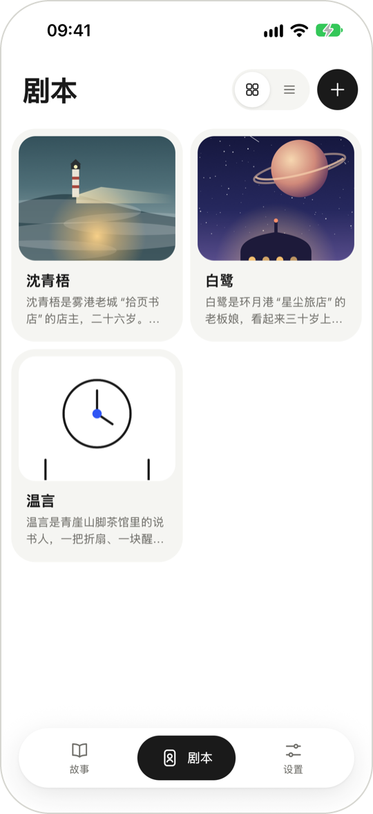
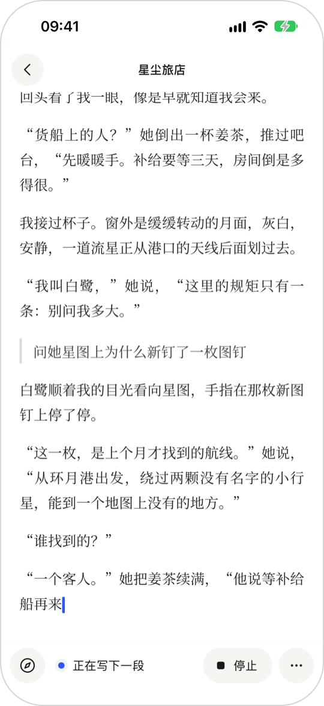
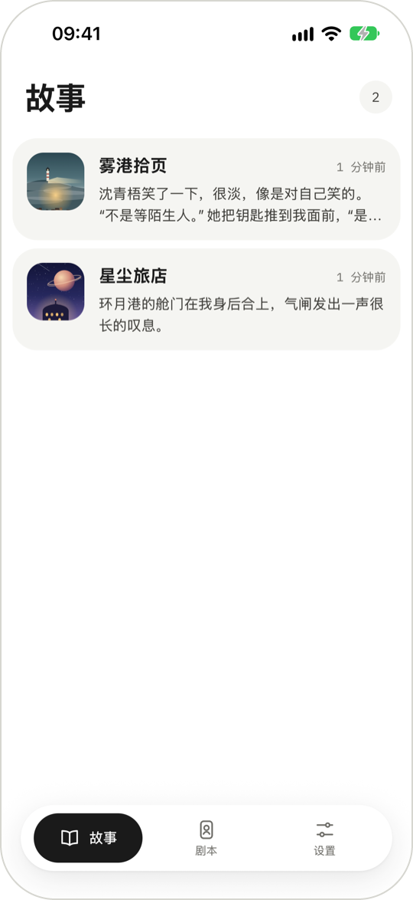
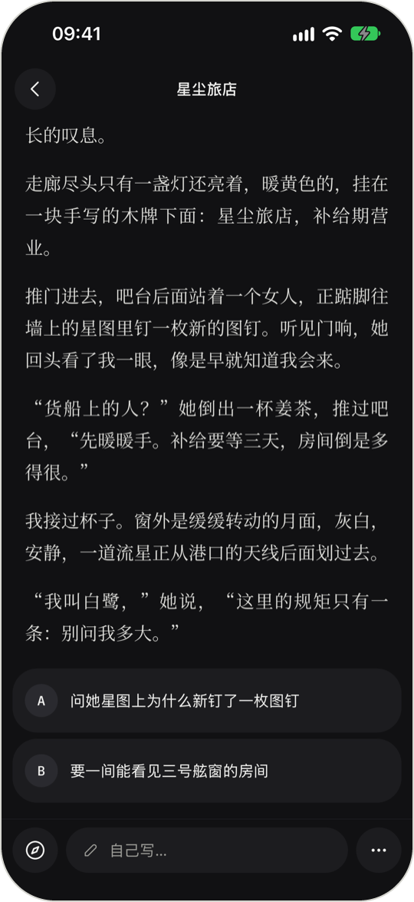
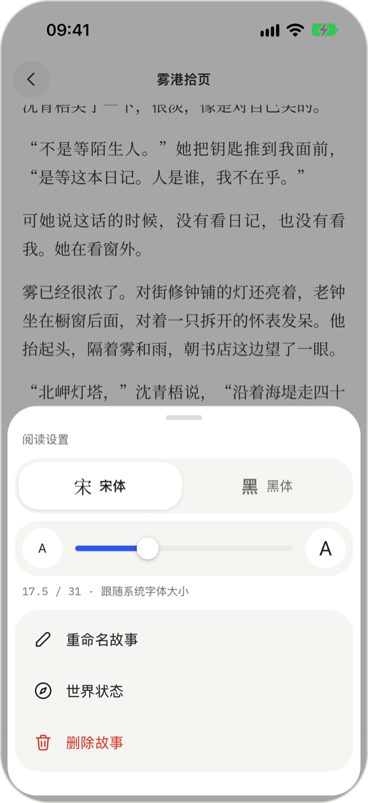
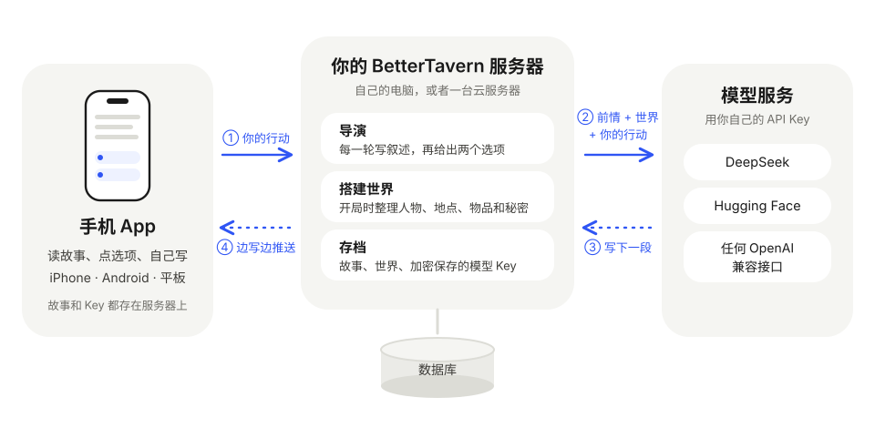

  <picture>
    <source media="(prefers-color-scheme: dark)" srcset="docs/design/logo/svg/logo-dark.svg">
    
  </picture>

<h1 align="center">BetterTavern</h1>

只写给你一个人的互动小说：你是故事里的“我”，AI 每一轮为你续写，再给你两个选择。

  
  &nbsp;
  
  &nbsp;
  

> **还在开发中。** 第一版的主要功能已经能用，但还没有上架应用商店，需要自己运行服务器，见下面的[怎么开始](#怎么开始)。
> 截图里的角色和故事都是为演示写的原创内容。

## 这是什么

BetterTavern 是一个手机上的互动小说 App。挑一张角色卡，给主角起个名字，故事就开始了：

- AI 用第一人称写下一段故事，结尾给你两个选项，点一下就继续；
- 想做选项之外的事，点“自己写”，用一句话告诉它你要做什么；
- 想结束故事时，在“更多”里点“写结局”，可以说说想要怎样的结局，AI 会写一大段收尾；
- 开局时，AI 会先读角色卡，整理出这个世界里的人物、地点、物品和秘密，之后照着写，不容易前后矛盾。

用的是你自己的 AI 模型：DeepSeek、OpenAI、Grok、Hugging Face，或者任何兼容 OpenAI 接口的服务，包括在自己电脑上跑的模型。

## 一轮故事

<table align="center">
  <tr>
    <td align="center" width="50%"> 每一轮：一段叙述，两个选项</td>
    <td align="center" width="50%"> 文字边写边出现，随时可以停下</td>
  </tr>
</table>

- 叙述一个字一个字地出来，不用干等；写到一半想换个方向，点“停止”。
- 网络断了，或者 App 切到后台，回来以后会从断的地方接着写，不重复也不缺字。
- 生成失败时会告诉你原因，点“重试”再来一次。

## 从一张角色卡开始

<table align="center">
  <tr>
    <td align="center" width="33%"> 导入的角色卡都在剧本库里</td>
    <td align="center" width="33%"> 给主角起名字，开始故事</td>
    <td align="center" width="33%"> 每个故事都从上次停下的地方接着读</td>
  </tr>
</table>

- 支持 SillyTavern 的角色卡：PNG 图片或 JSON 文件，V1、V2、V3 都可以。卡里的图片会成为故事的封面，没有图片的卡会配一张简洁的线条封面。
- 开局前给主角起名字；想多交代几句也可以：选一个身份（过路的旅人、旧相识……）、每段写多长、想要什么文风。
- 同一张卡可以开好几个故事，每个故事各走各的。

## 世界会记住

<table align="center">
  <tr>
    <td align="center" width="33%"> 人物、地点、物品、组织</td>
    <td align="center" width="33%"> 谁在哪里、谁拿着什么</td>
    <td align="center" width="33%"> 秘密先藏着，想看再揭开</td>
  </tr>
</table>

- 阅读时点左下角的指南针，打开世界面板：故事里的人物、地点、物品，它们之间的关系，还有已经知道的事实。
- 主角还不知道的秘密默认藏着，要你确认才会揭开，不会被剧透。

## 舒服地读

<table align="center">
  <tr>
    <td align="center" width="50%"> 夜间模式</td>
    <td align="center" width="50%"> 宋体或黑体，字号可调</td>
  </tr>
</table>

- 外观可以跟随系统，也可以固定成浅色或夜间。
- 在平板上，正文居中排版，世界面板可以停靠在旁边。

## 用你自己的模型

  

- 在“设置 → 模型”里添加：选服务商，贴上 API Key，模型列表会自动出来，选一个就好。
- 可以添加好几个模型，在列表里点一下就能换一个来写故事。
- 你只为自己用掉的模型额度付费，BetterTavern 不经手。

## 你的故事在哪里

- 故事、世界设定、模型 Key 都保存在你自己运行的服务器上。Key 加密保存，App 里只显示后四位。
- 只有在写故事的时候，服务器才把需要的前情发给你选的模型服务。
- 服务器的运行日志不记录故事内容，也不记录 Key。

## 它是怎么工作的

  

1. 你点一个选项，或者写下自己的行动，App 把它发给服务器。
2. 服务器把这个故事的前情、世界设定和你的行动整理好，发给你选的模型。
3. 模型写下一段叙述和两个新选项。
4. 服务器一边收一边推给手机，你看到文字一个字一个字地出来；写完以后存档。

为什么要有一台服务器：故事存在服务器上，换手机也不会丢；Key 不放在手机里；写故事的活在服务器上做，手机只负责显示。

给好奇的人：服务器用 Python（FastAPI）和 PostgreSQL，App 用 React Native（Expo），iPhone 和 Android 用同一套代码。

## 现在到哪一步了

**已经能用**：注册登录、导入角色卡、开局搭建世界、一轮一轮地玩、自己写、停止和重试、断线续传、世界面板、阅读设置、夜间模式、平板排版，以及电脑浏览器里的网页版（侧栏、键盘快捷键、拖文件导入）。

**接下来**：世界跟着剧情自动更新（现在世界在开局时搭好，之后还不会变）、回退和重新生成、长篇故事自动整理前情摘要、更多模型服务商、英文界面。

## 怎么开始

现在需要自己运行服务器：

1. 准备一台电脑运行服务器，按[开发者指南](docs/development.md)装好并启动。
2. 手机上装 [Expo Go](https://expo.dev/go)，扫电脑上显示的二维码打开 App。手机和电脑要在同一个网络里，或者用 Tailscale 这类组网工具连起来。
3. 在 App 里注册，添加一个模型，导入一张角色卡，开始你的第一个故事。

想在电脑上玩：在仓库根目录 `make web` 启动网页版，浏览器打开 http://localhost:5173 ，账号和手机上的通用。

正式版计划上架应用商店，服务器也会提供更省事的部署方式。

## 更多

- [开发者指南](docs/development.md)：本地开发、测试、目录结构
- [技术方案](docs/README.md)：后端、客户端、测试的完整设计
- [界面设计](docs/design/ui/README.md) 和 [标志](docs/design/logo/README.md)

## 许可证

待定（MIT 或 Apache-2.0），发布前确定。
