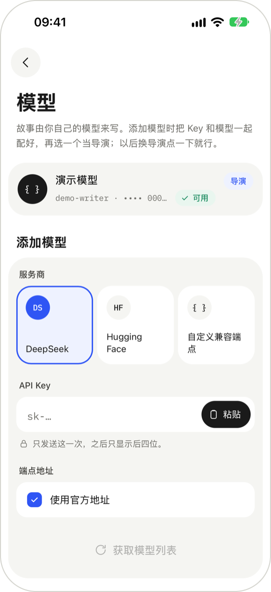
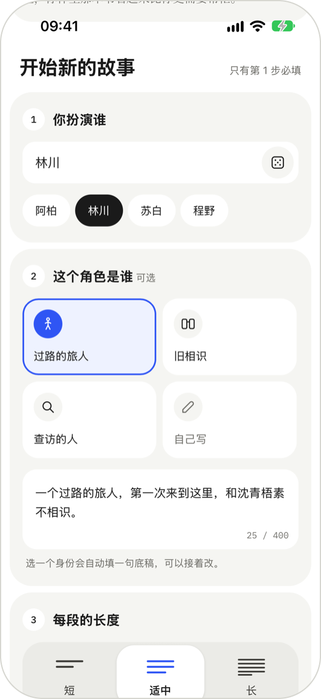
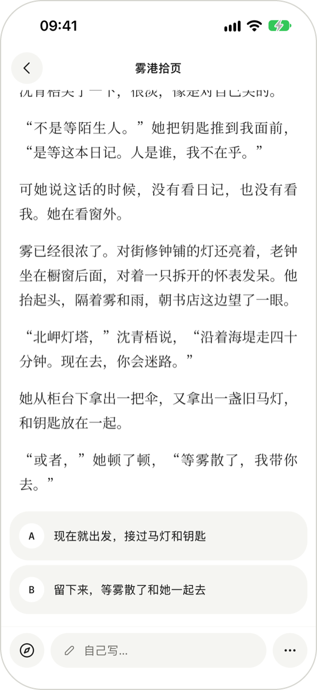
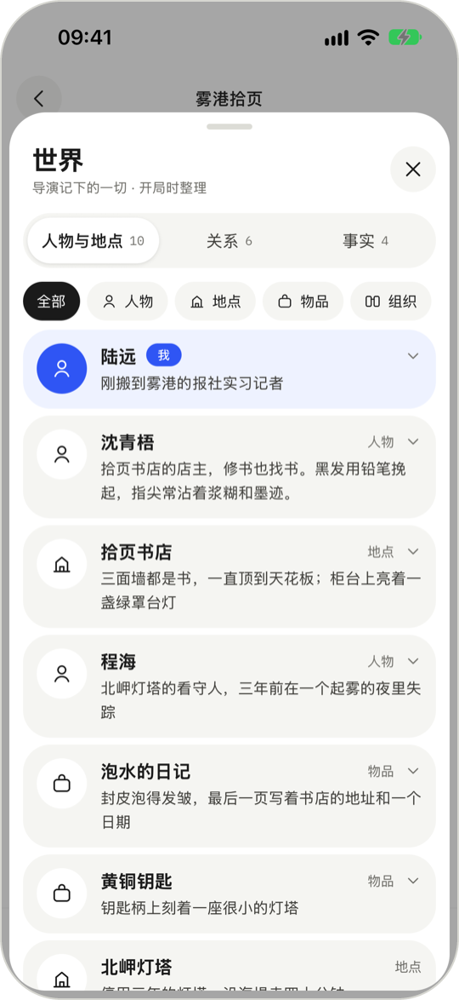
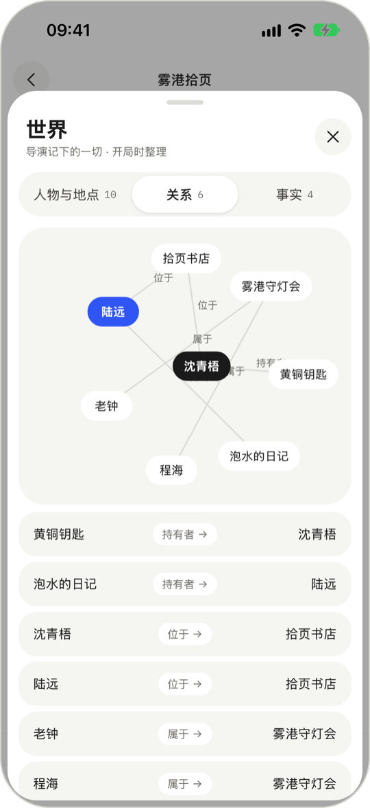
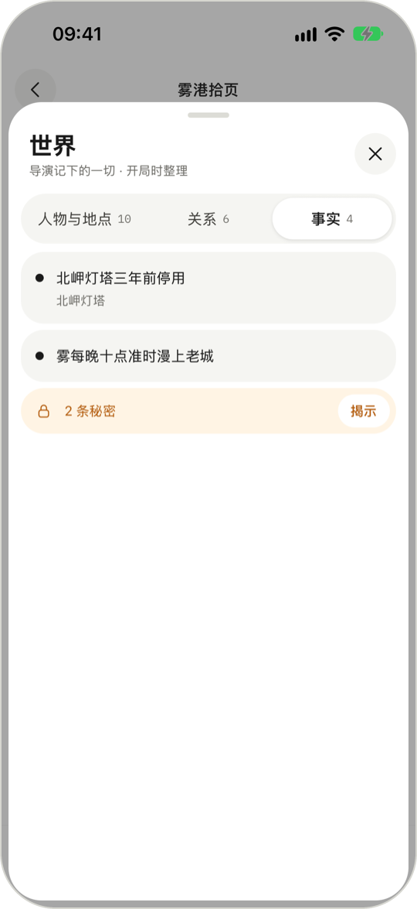

<p align="center">
  <picture>
    <source media="(prefers-color-scheme: dark)" srcset="docs/design/logo/svg/logo-dark.svg">
    
  </picture>
</p>

# BetterTavern 使用说明

BetterTavern 是一个第一人称的互动小说应用。导入一张 SillyTavern 角色卡（或者在工作台里让 agent 帮你写一张），给主角起名字，AI 以“我”的视角写出一段故事，结尾给出两个选项；你点一个选项，或者自己写一句要做的事，它接着往下写。

它由三部分组成：服务器、手机 App 或网页（任选其一，账号通用），以及写故事的 AI 模型。

最简单的用法是打开官方服务 [bettertavern.com](https://bettertavern.com) 注册：不用配置，直接用官方模型写，新用户送 1500 点体验额度，用完可以换成自己的 API Key。
也可以自己运行服务器、用自己的模型服务，下面的安装步骤就是写给这种情况的。

> **开发中。**还没有上架应用商店。Android 可以在[项目主页](https://devyangcooking.cn/)下载安装包（默认连官方服务），iPhone 先用 Safari 打开网页版。
> 本页的截图里，角色和故事都是为演示写的原创内容。

**目录**：[1 组成](#1-组成) · [2 安装与运行](#2-安装与运行) · [3 使用](#3-使用) · [4 长篇故事是怎么保持连贯的](#4-长篇故事是怎么保持连贯的) · [5 数据与隐私](#5-数据与隐私) · [6 服务器设置](#6-服务器设置) · [7 常见问题](#7-常见问题) · [8 已知限制](#8-已知限制) · [9 更多文档](#9-更多文档)

## 1 组成

<p align="center">
  
</p>

图的源文件是 `docs/images/readme/overview.mmd`，样式和怎么重新生成见[架构图解](docs/agent-runtime-architecture.md)第 15 节。

| 部分 | 做什么 | 技术 |
| --- | --- | --- |
| 服务器（`apps/server`） | 保存账户、剧本、故事和世界设定；调用模型写故事，并在后台整理世界状态和长期记忆 | Python 3.12、FastAPI、PostgreSQL 16。分两个进程：`api` 处理请求、写故事，`worker` 做后台整理 |
| 手机 App（`apps/mobile`） | 在 iPhone、Android、iPad 上阅读和游玩 | React Native（Expo）；Android 有安装包，iPhone 用 Expo Go 打开 |
| 网页（`apps/web`） | 在电脑浏览器里游玩，有侧栏和键盘快捷键，角色卡可以直接拖进窗口导入 | React + Vite |
| 模型服务 | 实际写故事的 AI | DeepSeek、OpenAI、Grok（xAI）、Gemini、Hugging Face，或任何兼容 OpenAI 接口的服务（包括本机运行的模型） |

## 2 安装与运行

### 需要准备

- 运行服务器的机器：Docker（推荐），或者 Python 3.12+、[uv](https://docs.astral.sh/uv/) 和 PostgreSQL 16；
- 运行客户端：Node 22.18 或更新版本；
- 一个模型服务的 API Key。

### 用 Docker 部署服务器

```bash
git clone https://github.com/Hexthebaldy/BetterTavern.git
cd BetterTavern
docker compose -f deploy/docker-compose.yml run --rm --no-deps migrate bettertavern keygen >> deploy/.env
docker compose -f deploy/docker-compose.yml up -d
```

第一条生成两个密钥（`MASTER_KEYS`、`AUTH_SECRET`）写进 `deploy/.env`，第二条构建并启动。起来以后浏览器打开 http://localhost:8080 就能注册、使用。

- 会起 `postgres`、`api`、`worker`、`web` 四个常驻容器，`migrate` 建完表就退出。`web` 发网页，并把接口请求转给 `api`。
- 默认只有这台电脑自己能打开。要让手机和别的电脑连，在 `deploy/.env` 里加一行 `WEB_BIND=0.0.0.0`，再执行一次 `up -d`；
  它们用 `http://<这台电脑的局域网 IP>:8080` 访问，手机 App 的服务器地址也填这个。这是不加密的 http，只在家里或信得过的局域网这样做。端口用 `WEB_PORT` 改。
- 要从外网访问：在前面放一层带 TLS 的反向代理，转到 `8080`，并在 `deploy/.env` 里加 `AUTH_COOKIE_SECURE=true`（网页登录的 Cookie 只走 https）。
- 已经在用 bettertavern.com 的网页时，登录页底部的“服务器 › 更改”可以直接跳到自己服务器的网页。账户和数据不会带过去，要在自己的服务器上重新注册。
- **备份 `MASTER_KEYS`**：已保存的模型 Key 是用它加密的，丢了就解不开，只能重新填写。

### 从源码运行（开发用）

```bash
cp apps/server/.env.example apps/server/.env
make db-up                  # 用 Docker 起 PostgreSQL；用本机的 PostgreSQL 就跳过，改 .env 里的 DATABASE_URL
make install && make migrate
make dev                    # api，接口文档在 http://localhost:8000/docs
make worker                 # 另开一个终端：后台整理
```

开发环境不用配置密钥，第一次启动时会自动生成。详细说明见[开发者指南](docs/development.md)。

### 打开客户端

**网页**：

```bash
make js-install
make web
```

浏览器打开 http://localhost:5173 。正式部署时用 `make web-build` 生成 `apps/web/dist`，由反向代理和接口放在同一个域名下。

**手机**：Android 直接装[项目主页](https://devyangcooking.cn/)上的安装包（点“下载 Android 版”），打开后在登录页底部填上服务器地址（用 Docker 部署的是 `http://192.168.1.10:8080` 这样，从源码运行的是 `:8000`）。
安装时手机会提示允许浏览器或文件管理器安装应用。iPhone 还没有安装包，按下面的步骤用 Expo Go 打开（Android 也可以这样用）：

```bash
cp apps/mobile/.env.example apps/mobile/.env     # 把里面的地址改成电脑的局域网 IP
make mobile-install
cd apps/mobile && npm start
```

手机上装 [Expo Go](https://expo.dev/go)，扫终端里的二维码。手机和电脑要在同一个网络里，或者用 Tailscale 这类组网工具连起来；用蜂窝网络访问需要一个 https 地址。连不上时的排查见 [apps/mobile/README.md](apps/mobile/README.md)。

## 3 使用

### 3.1 注册，添加模型

<p align="center"></p>

1. 打开 App 或网页，注册账号（邮箱加密码）。在官方服务上，验证邮箱以后就有官方模型当导演，可以直接跳到 3.2；想用自己的模型再往下看。
2. **设置 → 模型 → 添加模型**：选服务商，粘贴 API Key，模型列表会自动出来，选一个。
3. 保存时勾选“设为导演”。导演就是写故事的那个模型，一次只有一个，在模型列表里点一下就能换。
4. （可选）在模型详情里打开 **“用于后台整理”**：后台每回合整理人物、物品、地点和事实，建议用便宜、快的模型；不设时用导演的模型。后台模型必须能调用工具，不确定时在模型详情里点“测试这个模型”。
5. （可选）在模型详情里打开 **“用于工作台”**：工作台里帮你写角色卡的 agent 用它，要能调用工具；不设时用导演的模型。
6. （可选）**设置 → 外部服务**：配网页搜索（Tavily、Brave、SearXNG、博查）和生成封面（OpenAI Images、对话接口出图、Gemini）。agent 写作品里的角色时会先查资料；读网页默认由服务器自己读，不用配。

### 3.2 做角色卡（工作台）

- **让 agent 写**：在工作台的输入框里说一句想要什么样的角色。agent 先问几个问题（每题都有推荐，也可以“都交给你”），再给出方案（名字、设定、世界书条目、开场、封面），你确认以后一项项写出来，右边的卡片预览实时出字。作品里的角色它会先联网查资料，记下每条资料用在哪里。
- **导入**：点“导入角色卡”或把文件拖进网页窗口，一次一张。支持 SillyTavern 的 PNG（卡面图片里带数据）和 JSON，V1、V2、V3 都可以，最大 16 MB。导入后进手动表单。
- **手动写**：空白表单，每次修改自动保存。页头的“Agent / 手动”随时可以切，改的是同一份草稿。
- 写好以前都是草稿，点“保存到角色卡仓库”才进库；之后接着改，agent 会先给出改动的对比，采用了才写进去。仓库里的卡可以在“剧本 → 角色卡”里打开、看版本历史、恢复旧版。
- 封面可以上传，也可以用配好的文生图生成；没有封面的卡配一张线条封面。

#### 剧本

- 剧本用角色卡仓库里的卡新建（“剧本”页右上角的加号，或者工作台里“保存并开始新故事”）。可以选几张卡做群像剧本，第一张是主角色。
- 剧本里存着默认主角、偏好和用哪条开场白：选了卡里的某条开场白，故事就从这一段开始，导演不重写；也可以让导演根据设定写。
- 剧本实时用角色卡最新保存的内容；已经开始的故事不受影响。

### 3.3 开始一个故事

<p align="center"></p>

1. 在剧本详情里点“开始新的故事”。
2. 给主角起名字。也可以交代几句：主角是谁（过路的旅人、旧相识……）、每段写多长、想要什么文风、不想看到什么内容。
3. 开局时 AI 先读角色卡，整理出这个世界的人物、地点、物品和秘密，然后写开场。这一步通常要十几秒到几十秒。

同一张卡可以开好几个故事，各走各的。**故事用什么语言写，由开局时的界面语言决定**，之后不变。

### 3.4 每一段

<p align="center"></p>

- 叙述一边写一边出现；结尾给出两个选项，点一个就继续。
- 想做选项之外的事，点 **“自己写…”**，用一句话写要做什么。
- 写的过程中可以点 **“停止”**。生成失败时会说明原因，点 **“重试”** 再来一次。
- 网络断了，或者 App 切到后台，回来后会从断的地方接着写，不重复也不缺字。
- 故事长了以后，AI 有时会先翻一翻前面的内容再写，这时底部显示“正在回想前情…”，多等一两秒。
- 网页上有键盘快捷键（选选项、自己写、打开世界状态等），按 `?` 查看完整的表。

### 3.5 世界状态

<p align="center">
  
  &nbsp;
  
  &nbsp;
  
</p>

点阅读页左下角的指南针（网页上可以停靠在右侧）打开世界状态面板：人物、地点、物品、组织，它们之间的关系，以及已经知道的事实。

- 世界状态随剧情更新：每写完一段，服务器在后台把这一段里的变化记下来（谁到了哪里、谁拿走了什么、谁死了、发现了什么）。
- 后台整理比写故事慢一点，面板标题下写着“截至第几回合”。整理失败或者跳过某一回合时，面板里有一条提示。
- 主角还不知道的秘密默认藏着，确认后才会揭开。

### 3.6 回到更早的一段

- 手机：**更多 → 回到更早的一段**，选一段并确认。
- 网页：鼠标移到更早的某一段上，点 **“回到这里”**。

之后的段落会被撤销，世界状态和整理出来的记忆也退回到那时的样子。正在生成时不能回退。每个存档能回退的次数有上限（默认 1 次，由服务器的 `ROLLBACK_LIMIT` 设置），用完后按钮上会写明。

### 3.7 写结局

**更多 → 写结局**，可以写下希望的结局方向（也可以不填）。AI 会写一大段收尾，之后这个故事显示“已完结”，不能再继续；如果还有回退次数，回到结局之前的某一段可以接着玩。

### 3.8 阅读设置和界面

- **更多 → 阅读设置**：正文字体（宋体或黑体）、字号。
- **设置 → 外观**：跟随系统、浅色、夜间。
- **设置 → 语言**：跟随系统、中文、English、日本語，选了立刻生效。
- 在平板上正文居中排版，世界状态面板可以停靠在旁边。

## 4 长篇故事是怎么保持连贯的

模型一次能读的内容有限，故事长了以后不能把全部前文都发给它。BetterTavern 把“记住故事”拆给几个后台步骤，写故事时只发最需要的部分：

- **世界状态**：每写完一段，后台把变化记成结构化的数据（人物在哪、谁拿着什么、谁知道什么秘密），写下一段时把和此刻相关的部分交给 AI。改动会先按规则检查，比如同一个人不能同时在两个地方。
- **章节摘要**：一章写完（原文积累到一定长度、并且场景告一段落），后台写一段这一章的摘要；更早的章节合并成全书梗概。AI 看到的是梗概、最近几章的摘要，加上当前这一章的原文。
- **玩家画像**：每章结束时，后台总结一次你喜欢什么、常怎么选，帮 AI 把握方向。
- **大纲**：后台为故事拟一个大致的走向，只给 AI 参考。你的行动永远优先；你走向别处，大纲跟着改。大纲不会显示给你。
- **查前文**：更早的细节不在 AI 眼前时，它可以按人名或关键词翻找以前的段落。

这些整理都在后台进行，不会让你多等。回退时它们一起退回。设计细节见 [agent runtime 架构图解](docs/agent-runtime-architecture.md)。

## 5 数据与隐私

- 账户、剧本、故事、世界状态都保存在你自己运行的服务器上（PostgreSQL）。
- 模型的 API Key 在服务器上加密保存，App 和网页里只显示后四位，手机上不保存 Key。
- 写故事和后台整理时，服务器把需要的故事内容发给你选的模型服务；不会发给别的地方。
- 服务器的运行日志不记录故事内容，也不记录 Key。
- **设置 → 账户 → 删除账户** 会删掉这个账户的所有故事、剧本和模型，不能恢复。

## 6 服务器设置

服务器从环境变量读取设置。开发时写在 `apps/server/.env`（每一项的说明见 `apps/server/.env.example`），Docker 部署时写在 `deploy/.env`。常用的几项：

| 设置 | 默认 | 说明 |
| --- | --- | --- |
| `MASTER_KEYS`、`AUTH_SECRET` | 开发环境自动生成 | 加密模型 Key 的主密钥、签发登录令牌的密钥。生产环境必须配置，用 `bettertavern keygen` 生成 |
| `DATABASE_URL` |  | PostgreSQL 的地址 |
| `ALLOW_PRIVATE_ENDPOINTS` | `false` | 是否允许模型地址指向内网（例如本机的 Ollama）。多人共用的服务器不要打开 |
| `OUTBOUND_PROXY` |  | 访问模型服务时走的代理 |
| `ROLLBACK_LIMIT` | `1` | 每个存档能回退几次 |
| `CHAPTER_SOFT_TOKENS`、`CHAPTER_HARD_TOKENS` | `8000`、`16000` | 一章多长时整理一次章节摘要 |
| `DIRECTOR_TIMEOUT_S` | `600` | 写一段的总时长上限（秒） |
| `WORKER_CONCURRENCY` | `4` | worker 同时处理几个后台任务 |
| `ENABLE_PROBE_ENDPOINTS` | 开发环境打开，生产环境关闭 | “设置 → 连接测试”用的接口 |
| `PLATFORM_API_KEY` |  | 官方模型：用运营方自己的 Key 给用户直接用、按用量扣点数。不配就没有，用户只用自己的 Key（见 [docs/ops.md](docs/ops.md) 第 9 节） |
| `CONTENT_POLICY` | `open` | `sfw` 时写故事、写卡的提示词里加内容边界（官方服务用）；用户存的角色卡不审核 |

## 7 常见问题

**手机连不上服务器。**先在手机浏览器里打开 `http://<电脑的局域网 IP>:8000/health`（用 Docker 部署的是 `:8080`），打不开说明网络不通（不在同一个网络、防火墙、IP 变了）。排查步骤见 [apps/mobile/README.md](apps/mobile/README.md)。

**添加模型时提示地址“解析到内网或保留地址”。**本机开着 Clash 等代理的 fake-ip 模式时，所有域名都会解析到保留地址。把模型服务的域名加进代理的 fake-ip-filter，或者在自己用的服务器上设 `ALLOW_PRIVATE_ENDPOINTS=true`。

**世界状态一直停在开局。**检查 worker 有没有在运行（`make worker`，或 Docker 的 `worker` 容器）；再看世界状态面板里的提示。如果说后台模型不能调用工具，在设置里换一个后台模型，或者点“测试这个模型”重新确认。

**文字不是一段段出来，而是最后一下子全出现。**中间的反向代理或隧道在缓冲 SSE。在 **设置 → 连接测试** 里测一下，结果是“轮询降级”就说明有一跳在缓冲；按 `deploy/nginx.example.conf` 关掉缓冲。

**“回到这里”点不了。**正在生成时不能回退；这个存档的回退次数用完了也不行（按钮上会写明）。

**换了主密钥以后模型都用不了。**旧的 Key 是用旧主密钥加密的。把旧主密钥保留在 `MASTER_KEYS` 的后面（逗号隔开，第一个用于加密，其余只用于解密），或者重新填写各个模型的 Key。

## 8 已知限制

- 没有上架应用商店，没有公共服务器，也没有一键部署的托管版本。
- 不能重新生成某一段：生成失败时可以重试；对写出来的内容不满意，可以回到上一段换一个行动（受回退次数限制）。
- 世界状态由后台整理，通常落后不到一回合，后台慢时会落后几回合。
- 后台整理每回合都要调用模型，花费比只写故事多。用 deepseek-flash 时，一局 300 回合（导演和后台合计）大约 8 元。
- 世界状态面板只能看，不能手动修改。
- 许可证待定（MIT 或 Apache-2.0），发布前确定。

还没解决的技术问题列在[待优化清单](docs/backlog.md)。

## 9 更多文档

- [开发者指南](docs/development.md)：本地开发、测试、评测、目录结构
- [技术方案总览](docs/README.md)：后端、客户端、测试的设计，数据模型和接口的参考文档
- [agent runtime 架构图解](docs/agent-runtime-architecture.md)：用图讲后台的几个 agent、上下文怎么拼、回退
- [界面设计](docs/design/ui/README.md)、[标志](docs/design/logo/README.md)
