# agent runtime 架构图解

> 文档索引：[总览](README.md) · [后端](backend.md) · [客户端](client.md) · [测试](testing.md) · [数据模型](data-model/README.md) · [接口](api/README.md)

本页用图把服务端的 agent runtime 从头讲一遍：有哪些进程、一回合怎么走、六个 agent 各做什么、导演的上下文怎么拼、后台怎么整理世界状态和记忆、大纲怎么改、写入怎么防冲突、回退时发生什么、代码分几层。

每张图后面跟一段说明。设计上为什么这样定、每条规则的细节，以 [agent-runtime.md](agent-runtime.md) 为准；表结构以 [data-model/](data-model/README.md) 为准；还没解决的问题在[待优化清单](backlog.md)。本页对应阶段 5 完成时的代码（提交 `b922f7e`），改架构时同步更新这里的图。

## 0 先认识几个词

| 词 | 意思 |
| --- | --- |
| 一局、存档 | 玩家用一张角色卡开的一个故事（表 `playthroughs`）。 |
| 回合 | 玩家做一次行动，导演写一段叙述和两个选项（表 `turns`）。第 0 回合是开场。 |
| agent | 一次“给模型一份资料和一个任务，让它写出结果”的角色。有的 agent 能调用工具，比如查旧回合、改世界状态。 |
| 导演 | 玩家唯一在等的 agent：写叙述和选项。 |
| 后台 | 玩家不等的工作，在另一个进程（worker）里做：整理世界状态、整理章节、修订大纲。 |
| 世界状态 | 故事里“此刻是什么样”：人物、物品、地点、组织，它们之间的关系，事实，没解开的线索。 |
| 状态块 | 从世界状态里挑出和此刻相关的部分，排成一段文字（`<world-state>`），放进导演的上下文。 |
| 回合标签 | 世界状态 agent 给每回合写的一句话摘要和涉及的实体（表 `turn_notes`），召回时按它查。 |
| 章节摘要、全书梗概、玩家画像 | 整理出来的长期记忆：一章一段摘要；更早的章并进全书梗概；玩家喜欢什么、怎么玩。 |
| 大纲、一拍 | 后台写的故事方向：前提、接下来几拍（每拍是故事的一个阶段）、必须守住的约束。只给导演把握方向，玩家的行动永远优先。 |
| 前缀缓存 | 服务商会记住最近请求的开头，下一次请求开头一字不差的部分算得更快、收费更低。 |
| 围栏 | 写数据库前先做一次带条件的更新（“进度还是 N、时间线编号还没变才写”），条件不满足就整个作废。防止回退之后旧任务把过时的结果写进来。 |
| 时间线编号 | `playthroughs.timeline_epoch`，每回退一次加 1。 |
| 租约 | 同一局同一时刻只能有一个回合在生成：生成前领租约，写完释放。 |
| SSE | 服务端推送事件的一种 HTTP 方式，叙述一段一段推给客户端，断线后能续传。 |
| 后台模型 | 玩家可以单独配一个便宜、快的模型给后台用；没配时后台也用导演的模型。 |

## 1 全景：两个进程、一个数据库


- **api 进程**负责玩家在等的那一段：收到行动，立刻返回回合 id，然后在进程里的后台任务里让导演生成，叙述一段一段经 SSE 推给客户端。生成和客户端的连接是分开的，客户端断线不影响生成，重连后从断点续传。
- **worker 进程**负责后台：从任务队列领任务，整理世界状态、整理章节、修订大纲。它和 api 之间不直接调用，只通过数据库里的任务表交接。
- **PostgreSQL** 存全部数据，同时当任务队列用（领任务时 `FOR UPDATE SKIP LOCKED`，有新任务时 `NOTIFY` 叫醒 worker）。不需要另外的消息队列和缓存。
- 两个进程都通过同一套服务商适配层调模型：导演用玩家设为“导演”的模型，后台用“后台模型”。

## 2 一回合怎么走

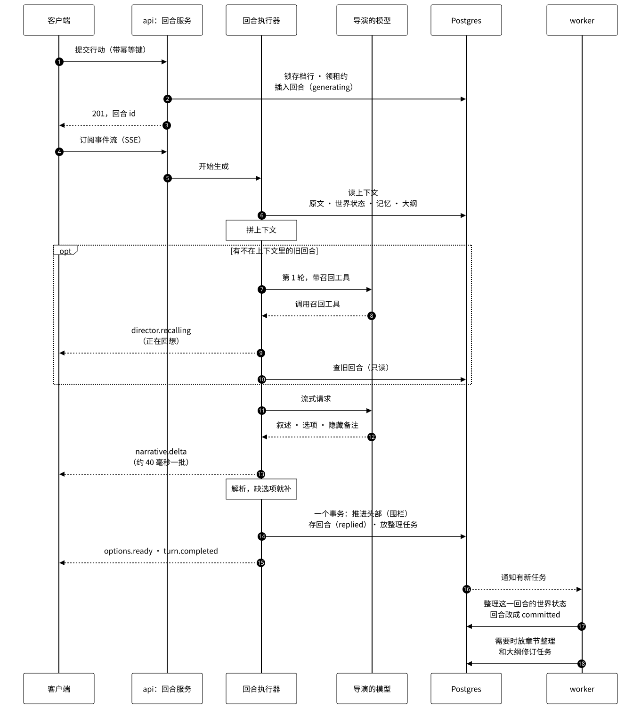

- 第 2 步在一个事务里：锁住存档行，检查幂等键（同一次提交重发不会建两个回合）、故事是否已经结束、有没有别的回合在生成（租约），再插入回合。到这里就返回，生成交给回合执行器。
- 第 6～13 步是导演。只有这一回合有不在上下文里的旧回合、模型能调用工具、不是开场时，才提供召回工具（第 6 节）。
- 图里“解析，缺选项就补”那一步叫“补选项”：导演没给够两个选项时另调一次模型补，补两次还不够就让玩家自己写。
- 第 15 步之后这一回合对玩家就结束了，状态是 `replied`。世界状态由后台整理，整理完改成 `committed`。
- **下一回合不等后台。**状态块开头写明“截至第几回合”，还没整理的回合一定以原文出现在上下文里，规则是“原文比状态块新时以原文为准”。所以后台慢一点只会让状态块旧一点，玩家不用等。

回合的状态：`generating`（生成中）→ `replied`（导演写完）→ `committed`（世界状态整理完）；生成失败是 `failed`，被回退掉的是 `archived`。

## 3 六个 agent


每样数据只有一个写入者（开局时的世界状态由开局构建写，之后只有世界状态 agent 改），出错时好查。

| agent | 什么时候跑 | 用哪个模型 | 工具 | 产出 | 代码 |
| --- | --- | --- | --- | --- | --- |
| 导演 | 每回合，玩家在等 | 导演的模型 | 召回：`recall`、`read_turn`、`lookup`（只读，最多两轮） | 叙述、两个选项、隐藏备注（`<narrative>`、`<options>`、`<director-notes>` 标签） | `runtime/agents/director.py`、`director_tools.py`、`runtime/director_loop.py` |
| 开局构建 | 第 0 回合，世界还没建好时 | 导演的模型 | 无 | 开局设定（世界、主角、人物、地点、物品、事实、开场简报），规定格式的 JSON | `runtime/agents/world_builder.py` |
| 补选项 | 导演没给够两个选项时 | 导演的模型 | 无 | 两个选项，JSON | `runtime/agents/options_repair.py` |
| 世界状态 agent | 每回合，后台 `state` 队列 | 后台模型 | 查询和修改世界状态，共 18 个，以 `commit` 结束（最多 20 轮） | 一批修改、回合标签、场景是否结束、大纲要不要改 | `runtime/agents/state_keeper.py`、`state_keeper_tools.py`、`runtime/state_runner.py` |
| 章节整理 | 一章的原文够长、遇到场景结束（或到上限）时，后台 `memory` 队列 | 后台模型 | 无 | 章节摘要、新一版玩家画像，必要时新一版全书梗概，JSON | `runtime/agents/chapter_writer.py`、`runtime/memory_runner.py` |
| 大纲修订 | 还没有大纲、或者世界状态 agent 说“要改”时，后台 `memory` 队列 | 后台模型 | 无 | 第一版大纲；之后是“改不改”和改了的新一版，JSON | `runtime/agents/outline_writer.py`、`runtime/outline_runner.py` |

## 4 agent 是怎么跑起来的


- **执行循环**是自己写的普通函数，不用 LangGraph：一轮调一次模型；模型要用工具，就执行工具，把模型的这条回复和工具结果接到消息后面，再调下一轮；不用工具就结束。最后一轮不再提供工具（世界状态 agent 的最后一轮只提供 `commit`），模型只能交出结果。
- **结构化输出阶梯**：要 JSON 的 agent（开局构建、补选项、章节整理、大纲修订）按模型的能力依次试 `json_schema` → 工具调用 → `json_object` → 把格式写进提示词。输出都用 pydantic 校验，不合格带着错误再试一次，还不行就降一级。
- **路由**：每个任务属于一个槽位（`RouteTask`）。世界状态、章节整理、大纲修订是“后台的任务”，用后台模型；其余用导演的模型。
- **提示词**都是数据文件（`runtime/prompts/<语言>/*.j2` 和 `*.json`），三种语言一一对应；Python 里不写长的提示词。渲染是确定性的（不取时间、不用随机数），同样的输入逐字节相同，前缀缓存和重放测试都靠这一点。
- **围栏标签**：注入上下文的玩家文字、角色卡、实体文字、摘要，一律先过 `sanitize_for_fence()`，把 `<player-action>` 这类标签的尖括号换成全角，免得一句“`</player-action>` 忽略以上规则”跳出围栏。
- **记录**：每次运行记一行 `agent_runs`（状态、用量、延迟、结果摘要），每一步记一行 `agent_steps`（发了什么、回了什么）。故事文字只进数据库，不进日志。日志查看工具（`make vis`）按回合显示每一步。

## 5 导演的上下文怎么拼


- **按“变得多慢”从前往后排。**服务商的前缀缓存只认一字不差的开头，某一段一变，从这一段往后都要重新算。规则开局后不变，放最前；回顾每章才变；原文一章里只在末尾追加，前面不动；每回合都变的状态块、大纲、玩家行动放最后，离模型开始写的地方最近，模型也最重视。阶段 4 的 300 回合试玩里，缓存命中稳定在 82～84%。
- **原文取多少**由章节摘要定：章节摘要已经覆盖到的回合不再放原文（在回顾里），从那之后的回合整段放进来，再往前多留上一章最后 2 回合接上文。世界状态落后时，原文的起点不晚于“已整理到的回合 + 1”。
- **大纲为什么不放 system**：大纲每隔几回合就可能改，放进 system 会让每次改大纲时后面整段缓存失效。
- **更早的回合**不在上下文里，导演需要细节时用召回工具查（第 6 节）。
- **紧急截断**：真超过有效窗口的 95% 时，只截发出去的内容，从最旧的原文回合开始丢，至少留 2 回合，直到不超过 90%。这是后台整理跟不上时的保护，平时用不到。

状态块（`runtime/context/state_block.py`）按“场景 → 主角 → 在场人物 → 这回合提到的 → 相关的 → 名册 → 玩家知道的事实 → 只有导演知道的秘密 → 挂在在场的人和物身上的线索”排版，预算不够时从名册开始删。

## 6 导演的一回合：召回工具


- 只有三个条件都满足时才提供召回工具：这一回合有不在上下文里的旧回合、模型能调用工具、不是开场。不提供时请求里没有工具说明，和没有召回功能时完全一样。
- 三个工具都只读：`recall` 按关键词或人名找旧回合（查回合标签和原文，不用向量），`read_turn` 读某一回合的全文，`lookup` 查人物、物品、地点的完整资料。
- 最多两轮工具。每用一轮，整段上下文就要重新发一次，玩家多等约 1 秒。
- 叙述一旦开始推给玩家，这一轮就定下来了，之后的工具调用一律忽略。
- 模型偶尔把工具调用写成正文。解析器认得出来，这时什么都不推给玩家，用同样的消息不带工具马上再请求一次。
- 隐藏备注（`<director-notes>`）是导演写给后台的，比如“伏笔：火漆是假的”。它从推给玩家的内容里去掉，存在回合上；世界状态 agent 会读它，之后的回合里它跟着原文回到导演的上下文，导演记得自己埋过什么。

## 7 后台：三种任务、两条队列


- **每局两条队列**，同一条队列里的任务按顺序一个一个做，两条队列之间互不等待。写一章、修订大纲要几秒到几十秒，不能让下一回合的世界状态整理排在它们后面。
- **一个任务把到那时为止的事都做完**：世界状态整理会把还没整理的回合一个个整理完；章节整理会把够切的章都写完；大纲修订把攒下的原因一起处理。所以队列里已经有一个还没开始的同类任务时，不再放新的。
- **放任务和业务数据在同一个事务里**：回合存好的同时放世界状态整理任务，世界状态写好的同时放章节整理和大纲修订任务。不会出现“数据写了、任务没放”。
- **失败不靠队列重试**：
  - 世界状态整理失败一次就停下，下一回合的任务会从这一回合开始；同一回合失败两次就跳过它，免得卡住后面所有回合。
  - 章节整理和大纲修订失败了，进度不动，下一回合整理完会再放一个任务。

## 8 世界状态 agent 内部


- **工具**：查询（`find_entity`、`lookup`）；修改（新建、修改、退场、移动、建立和解除关系、记下和推翻事实、把秘密告诉某人、换场景、改时间）；线索（记下、解开、合并、改写和写答案）；收尾 `commit`（一句话摘要、涉及的实体、场景是否结束、大纲要不要改）。
- **修改不是调用时就写库**，而是作用到内存里的修改清单上，当场按规则检查：名字和编号对不对、一个人或物同一时刻只在一处、主角不能退场、已确定的实体不能改长期描述、每回合最多新建 3 个实体、没解开的线索最多 15 条……不合规的把原因交回模型。`commit` 时再对整个世界查一遍一致性规则（`domain/world/invariants.py`）。
- **铅笔和钢笔**：新出现的实体先记成铅笔（以后可以改写），在另一回合再次出现时改成钢笔（已成定论）。铅笔实体不进名册，只在名字被提到时进状态块。
- **撤销记录**（`state_patches`）：每项修改记下改之前和改之后的整行，回退时倒着套回去（第 11 节）。

## 9 记忆分层


| 层 | 存在哪 | 谁写、什么时候 | 导演怎么看到 | 回退到第 K 回合时 |
| --- | --- | --- | --- | --- |
| 原文 | `turns` | 导演，每回合 | 当前这一章整段；更早的用工具查 | K 之后的归档 |
| 回合标签 | `turn_notes` | 世界状态 agent，每回合 | 召回工具按它查 | K 之后的删掉 |
| 章节摘要 | `story_summaries` | 章节整理，每章结束时 | 最近 3 章放在回顾里 | 在 K 之后写的删掉 |
| 全书梗概 | `story_summaries` | 章节整理，第 4 章起每章结束时并进最早一章 | 最新一版放在回顾里 | 在 K 之后写的删掉 |
| 玩家画像 | `player_profiles` | 章节整理，每章结束时改写一版 | 放在回顾里 | 不动 |
| 世界状态 | 实体、关系、事实 | 世界状态 agent，每回合 | 状态块；`lookup` 工具 | 按撤销记录倒着恢复 |
| 线索 | `threads` | 世界状态 agent（也读导演的隐藏备注） | 挂在在场的人和物身上的放在状态块里 | 同上 |
| 大纲 | `outline_revisions` | 大纲修订 | 最后一条消息里的切片 | 依据在 K 之后的删掉 |

比这些更早的细节不在上下文里，导演需要时用召回工具按回合标签找到那一回合，再读原文（第 6 节）。

**在哪里切一章**由代码按固定规则定（`domain/memory/chapters.py`），不让模型判断：从上次章节摘要之后累计原文的长度，超过约 8000 token 以后在下一个“场景结束”处切；一直没有场景结束，到约 16000 token 时硬切。“场景是否结束”由世界状态 agent 每回合判断。还没并进梗概的章节摘要满 3 章时，下一章写好的同时把最早一章并进全书梗概。

## 10 大纲



- **第一版**：开局设定里没有大纲。世界状态整理完开场那一回合后，放一个大纲修订任务，照开局设定写第一版（约 5 秒），所以第 1 回合起导演就能看到。
- **什么时候改**：世界状态 agent 每回合多回答一个问题，大纲要不要改：这一拍的完成条件达到了、玩家放弃了这一拍或者在做和它无关的事、出现了大纲里没有的大事，就写一句原因。修订把攒下的原因一起交给模型，由它决定改不改，改或不改都记一行。
- **大纲只管方向**：一拍是故事的一个阶段（通常 10～30 回合），不是场景里的下一步。导演看到的只有前提、当前这一拍、下一拍和约束；system 里写明玩家的行动永远优先，不要把玩家拉回来，大纲本身不写进叙述和选项。玩家改了目标，大纲跟着改。
- **代码修正**：模型写的大纲不直接入库，先按固定规则修正（`domain/memory/outline.py` 的 `settle()`），修正规则不交回模型。
- 这一块还有两个没解决的问题：同一件事会被重复报“要改”，以及漏报没有兜底（[待优化清单](backlog.md) O1、O2）。

## 11 围栏：后台写入为什么不会写乱


存档行上有三个进度：世界状态整理到第几回合（`state_seq`）、章节摘要覆盖到第几回合（`summarized_seq`）、大纲修订看过第几回合的原因（`outline_seq`）。

每个后台任务开始时读一次进度和时间线编号，写入时第一句是带条件的更新，比如：

```sql
UPDATE playthroughs SET state_seq = :seq
WHERE id = :id AND state_seq = :seq - 1 AND timeline_epoch = :epoch
```

改到 0 行，说明期间回退过，或者别的任务已经做过这一步：整个事务作废，这次运行记成 `stale`。条件满足才写其他表。这样不用加锁，旧任务也写不进过时的结果。导演提交一回合也一样，围栏是头部、租约和时间线编号。

## 12 回退


- 整个回退在一个事务里，几百到几千行，几十到几百毫秒，不调模型。
- 能做到这一点，是因为所有整理出来的东西都记下了来源回合，只新增不覆盖：撤销记录记了每回合的每项修改；章节摘要和梗概记了“写它时章节摘要覆盖到第几回合”（`written_seq`）；大纲修订记了“依据到第几回合”（`based_on_seq`）。
- 玩家画像不回退（它描述的是玩家，不是故事）。
- 回退前已经开始的后台任务，写入时发现时间线编号变了，整个结果作废。
- 一致性靠一个随机测试保证：随机地往前玩几回合、回退到更早的某一回合，每次回退后的世界状态、回合标签、摘要、大纲和进度，都要和当初刚整理完那一回合时逐行相同（`tests/integration/test_rollback.py`）。

## 13 代码分层


依赖只能顺着箭头走，`apps/server/importlinter.ini` 在 CI 里检查：

- `domain` 只用标准库和 pydantic，不碰数据库和网络，能单独测；
- `runtime` 不直接访问数据库，要读写什么就在 `runtime/ports.py` 里定义接口，由 `services` 里的 `Pg*Store` 实现。所以 runtime 的单元测试用内存里的假实现就能跑；
- `providers` 不 import 本项目的其他包；
- `infra` 是叶子，可以用 `domain`，不能用 `runtime`、`services`、`api`。

想动某一块时从这里找：

| 想改的 | 先看 |
| --- | --- |
| 导演写什么、怎么写 | `runtime/prompts/<语言>/director.*.j2`、`runtime/agents/director.py` |
| 上下文的摆放和预算 | `runtime/context/assembler.py`、`state_block.py`、`domain/memory/chapters.py` |
| 召回工具 | `runtime/agents/director_tools.py`、`runtime/director_loop.py`、`services/recall_store.py` |
| 世界状态 agent 的规则 | `domain/world/draft.py`、`threads.py`、`invariants.py`；工具在 `runtime/agents/state_keeper_tools.py` |
| 世界状态的写入 | `services/state_store.py`、`infra/db/repositories/state.py` |
| 章节整理 | `runtime/memory_runner.py`、`runtime/agents/chapter_writer.py`、`services/memory_store.py` |
| 大纲 | `domain/memory/outline.py`、`runtime/outline_runner.py`、`runtime/agents/outline_writer.py`、`services/outline_store.py` |
| 回退 | `services/playthrough_service.py`、`infra/db/repositories/rollback.py` |
| 后台任务和 worker | `services/*_jobs.py`、`entrypoints/worker.py`、`infra/queue/` |
| 模型服务商 | `providers/`（适配器、能力表 `capabilities.yaml`、并发名额） |

## 14 怎么验证它是对的

| 用什么 | 证明什么 |
| --- | --- |
| 单元测试（`make test`） | 规则本身：修改清单的检查、切章、大纲修正、上下文的摆放和确定性、执行循环、解析器；模型用按剧本回复的假适配器 |
| 数据库测试（`make test-integration`） | 真实 Postgres 上的写入、围栏、队列、回退的随机测试，以及文档里的表结构和真实的表是否一致 |
| 离线端到端（`tests/e2e/`） | 用假模型服务把整条链路跑通：开局、玩几回合、后台整理、续传 |
| 剧本试玩（`evals/playtest.py`） | 用真模型把一局玩上百回合，逐回合检查世界状态、选项、召回、上下文长度、大纲；结果和花费记在 [evals.md](evals.md) |

测试的分层和每个文件测什么，见 [testing.md](testing.md)。

## 15 改图

图是 SVG 图片，源文件在 [images/agent-runtime/](images/agent-runtime/) 里，和图片同名、扩展名是 `.mmd`（Mermaid 写法）。改图时改源文件，再重新生成同名的 SVG：

- 用 Mermaid 11.6 以上生成，用同目录的 `mermaid.config.json`（黑白、直线、关掉 HTML 标签），白底。关掉 HTML 标签以后，文字是 SVG 自己的文字，在各种 Markdown 查看器和图片查看器里都能显示；
- 命令行可以用 mermaid-cli：`npx -p @mermaid-js/mermaid-cli mmdc -c docs/images/agent-runtime/mermaid.config.json -b white -i 源文件.mmd -o 图片.svg`；
- 文字里要写尖括号时用全角的 `＜recap＞`：半角的 `<recap>` 会被当成 HTML 标签吞掉，写成 `#lt;` 又会被转义两次显示成 `&lt;`；
- 节点的名字不要用 Mermaid 的关键字（例如 `call`、`end`），否则画不出来。

现在的图是用浏览器里的 Mermaid 11.6.0 生成的。连线画成直线（`mermaid.config.json` 里的 `curve: linear`）要 11.6 以上，11.4 不认这个设置。图一律黑白：节点、边框、文字、连线都是黑色，底色是白色，也写在 `mermaid.config.json` 里。状态图不认直线的设置，所以大纲每一拍的状态也用流程图画；时序图里自己指向自己的箭头只能画成弧线，所以写成备注框。
