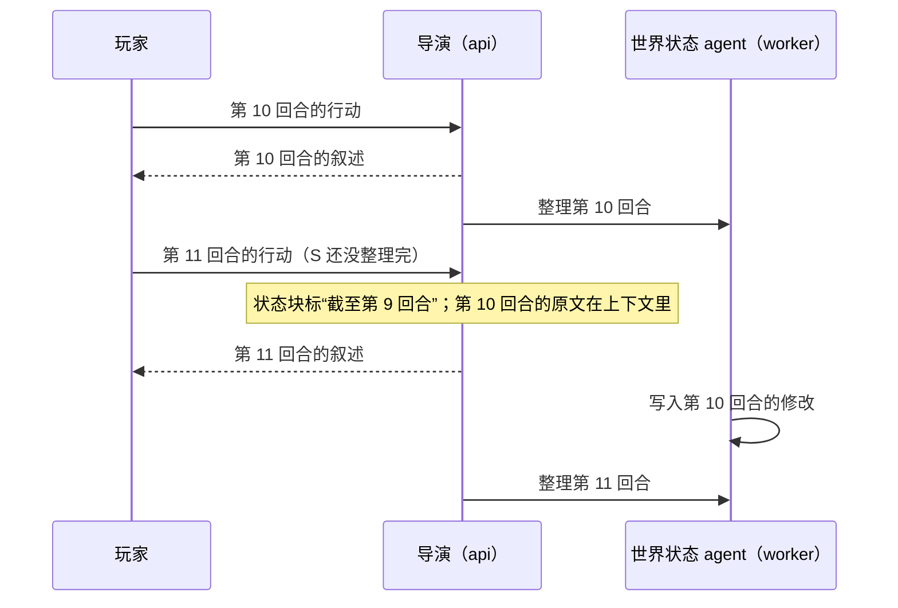

# Agent runtime 技术方案

> 文档索引：[总览](README.md) · [后端](backend.md) · [客户端](client.md) · [测试](testing.md) · [数据模型](data-model/README.md) · [接口](api/README.md)

本页是服务端 agent runtime 的新方案：几个 agent 各管什么、能用哪些工具、一回合怎么走、长期记忆分几层、回退时怎么保证记忆不乱，以及分几个阶段做。它取代 [backend.md](backend.md) 里关于后台管线、屏障、压缩、大纲门控和回退的旧设计，两份文档冲突时以本页为准。provider 层、导演的输出协议、结构化输出、提示词管理、接口和安全仍以 backend.md 为准。

现在（M1）的代码只做了“拼上下文 → 调一次导演 → 解析”：世界状态开局后不再变化，历史原文全部放进上下文，占到有效窗口的 95% 才从最旧的回合开始丢。本方案要解决的是几百到几千回合之后，故事仍然前后一致，导演仍然记得早先的事。

## 1 目标与范围

目标：

- 长篇一致：几百到几千回合后，人物、物品、地点的状态，埋下的伏笔，玩家的喜好，导演都还记得，不自相矛盾。
- 玩家等待的时间不变长：整理记忆的工作都在后台做，用便宜快速的小模型，不挡下一回合。
- 回退到任意回合：回退后，世界状态和整理过的记忆都和“只玩到那一回合”时一样。
- 每一步都看得到、能重放：每次调模型、每次用工具都有记录，评测时可以原样重跑。

不做：

- 分支：同时保留几条故事线、来回切换。
- 按意思检索（把文字转成向量，找意思相近的内容）。接口留着，评测发现需要再加。
- Jev 等专门的判断模型。
- LangGraph：执行循环自己写（第 2 节第 11 条）。
- 调模型出错时自动重试或换模型（已经去掉，见 backend.md 第 8 节“错误分类”）。

## 2 几个决定

| # | 问题 | 决定 | 原因 |
| --- | --- | --- | --- |
| 1 | 有哪些 agent | 玩家在等的只有导演；后台有世界状态 agent、大纲修订、定期整理三个（第 4 节） | 玩家只等导演，其余工作都不挡下一回合 |
| 2 | 工具怎么分 | 导演只有只读的召回工具；修改世界状态的工具只给世界状态 agent | 每样数据只有一个写入者，出错时好查 |
| 3 | 导演用工具会让玩家多等 | 最多两轮工具；第三次请求不再提供工具，只能写叙述 | 每用一轮工具，就要把整段上下文重新发给模型一次 |
| 4 | 世界状态 agent 的修改怎么写入 | 修改工具被调用时只记下来；agent 说“提交”后，代码一次性检查，在一个事务里一起写入 | 回退要靠每回合的修改记录来撤销；不能出现一半写进去、一半没写的情况 |
| 5 | 下一回合等不等世界状态写完 | 不等。状态块标明“截至第几回合”，之后回合的原文在上下文里，规则是“原文比状态块新时以原文为准” | 小模型偶尔慢，不能让玩家等 |
| 6 | 大纲什么时候改 | 世界状态 agent 每回合回答一个问题：大纲要不要改。要改就排一个大纲修订任务，用导演的模型；完成一拍也走这条路 | 只有一个判断、一个修改入口 |
| 7 | 拼上下文时要不要自动查旧回合 | 不查。上下文里放各级摘要、最近的原文和状态块；要查过去的细节由导演自己用工具 | 按人物自动查出来的，大多是摘要里已经有的内容，既占窗口又分散模型的注意力 |
| 8 | 场景什么时候结束 | 由世界状态 agent 判断，不按回合数。场景原文太长时，按 token 把前一半压成“本场景前情”，场景继续 | 按回合数强制结束会把高潮切断 |
| 9 | 怎么召回 | 按回合标签里的人物查，或者按关键词在这一局的文字里逐条找；不用向量 | 一局只有几千回合，逐条找也只要几毫秒，中文分词的问题也不存在 |
| 10 | 回退到什么程度 | 当前故事线上任意一回合。所有整理出来的记忆都记下来源回合，只新增不覆盖；回退时作废来源在目标回合之后的部分。玩家画像不回退 | 记忆和回合一一对得上，回退不需要调模型 |
| 11 | 执行循环用什么写 | 自己写，每个步骤是普通函数；不用 LangGraph | LangGraph 对我们主要多了图的可视化，代价是很重的依赖、另一份需要保持一致的运行状态，以及和自有服务商层之间的适配 |
| 12 | 实体和事实的“重要程度” | 删掉。需要排序时用能数出来的依据：最近一次出现在第几回合、建立于第几回合 | 模型打的分没有客观标准，前后不一致 |
| 13 | 上下文怎么排 | 按“变得多慢”从前往后排，旧回合按场景整块移出（第 6 节） | 服务商的前缀缓存只认从开头起一字不差的部分 |

## 3 一回合怎么走

### 玩家在等的一段（api 进程）

1. 玩家提交行动：建回合、占住这一局（和现在一样，见 [data-model/story.md](data-model/story.md)“并发控制”）。
2. 第 0 回合先建世界（WorldBuilder，和现在一样）。
3. 拼上下文（第 6 节）。这一步是纯函数，不调模型。
4. 导演写叙述（第 5 节的执行循环）：
   - 前两次请求带召回工具。模型要用工具时，推一条 `director.recalling`，客户端显示“正在回想……”；
   - 叙述一边写一边推给玩家（和现在一样）；
   - 选项之后可以写一段玩家看不到的 `<director-notes>`（第 4 节“导演”）。
5. 补选项（和现在一样）。
6. 一个事务里存回合（状态 `replied`）、放开这一局，并往后台队列放一个“整理第 N 回合”的任务。
7. 推 `options.ready`、`turn.completed`。

### 后台（worker 进程）

每局两条队列。队列内按顺序执行，两条之间互不等待：

| 队列 | 任务 | 什么时候放进来 |
| --- | --- | --- |
| `state` | 世界状态 agent 整理一回合 | 每回合存好后 |
| `memory` | 大纲修订、场景摘要、本场景前情、章节整理 | 世界状态 agent 写入时按条件放进来（第 4 节） |

分两条，是因为大纲修订和章节整理要几十秒，不能让下一回合的世界状态整理排在它们后面。

### 下一回合不等后台



- 状态块开头写明“以下是截至第 N 回合的状态；第 N 回合之后的原文里发生的变化，以原文为准”。导演的规则里也写这一条。
- 世界状态 agent 每次只整理一回合，按顺序来，落后时依次补上。
- 上下文里的原文从“已整理到的回合”之后开始（第 6 节），所以还没整理的回合一定以原文出现，不会丢。
- 原来的屏障（下一回合开始前等上一回合整理完，最多 8 秒）和 `turn.waiting_state` 事件去掉。回合存好后是 `replied`，世界状态 agent 写入后是 `committed`。

## 4 Agent 一览

| Agent | 何时运行 | 用哪个模型 | 工具 | 产出 | 写到哪里 |
| --- | --- | --- | --- | --- | --- |
| 导演 | 每回合，玩家在等 | 导演的模型 | 召回（只读） | 叙述、两个选项、隐藏备注 | `turns`（由代码在事务里写） |
| 开局构建（WorldBuilder） | 第 0 回合 | 导演的模型 | 无 | 开局设定 Seed | 世界状态表（现在就有） |
| 补选项 | 导演没给够两个选项时 | 导演的模型 | 无 | 两个选项 | `turns.options`（现在就有） |
| 世界状态 agent | 每回合，后台 `state` 队列 | 后台模型 | 查询、修改 | 一批修改、回合标签、场景是否结束、大纲要不要改 | 世界状态表、`state_patches`、`turn_notes`、`threads` |
| 大纲修订 | 世界状态 agent 说“要改”时，后台 `memory` 队列 | 导演的模型 | 无 | 新一版大纲，或者“不改” | `outline_revisions` |
| 定期整理 | 场景结束、场景太长、章节结束时，后台 `memory` 队列 | 后台模型 | 无 | 场景摘要、本场景前情、章节摘要、全书梗概、玩家画像 | `story_summaries`、`player_profiles` |

“后台模型”是新加的一项模型设置：`model_routes` 加一个“用于后台”的标记（每个用户最多一行为真），设置页和接口同步加。没配时用导演的模型，能用，但贵。

### 导演

- 输入：第 6 节拼好的上下文。
- 工具：`recall`、`read_turn`、`lookup`（第 7 节“召回”）。
- 输出：在现在的 `<narrative>`、`<options>` 之后，加一段可选的 `<director-notes>`，是导演写给后台的备注，比如“埋了一个伏笔：信封上的火漆是假的”。解析器把它从推给玩家的内容里去掉，存在回合上（`turns.director_notes`），世界状态 agent 会读它。玩家看不到。
- 叙述和选项的解析、补选项都和现在一样（backend.md 第 6 节“导演”）。

### 世界状态 agent

输入（由代码拼好，不调模型）：

- 待整理的这一回合：玩家行动、叙述、导演的隐藏备注（阶段 3）；
- 前三回合的一句话摘要，用来接上文；
- 相关实体现在的资料（带编号，实体 e1、e2……，事实 f1、f2……，只在这一次运行里有效）：主角、当前场景的地点、在场人物、主角的随身物品，加上这一回合文字里出现了名字的实体；还有涉及它们的事实；
- 还没解开的线索（阶段 3）；
- 大纲当前这一拍的意图和完成条件（阶段 5）；
- 当前场景从第几回合开始；原文已有多少 token（阶段 4）。

实体和事实给模型看的都是紧凑的 JSON，工具结果也是。

工具：

- 查询：`find_entity(名字)` 按名字和别名找实体（包括已退场的和铅笔实体），`lookup(编号)` 取一个实体的完整资料。
- 修改：`create_entity`、`update_entity`、`retire_entity`、`move`（某人或某物到某地、某物到某人手里）、`link` / `unlink`、`add_fact`、`retract_fact`（推翻一条事实）、`share_fact`（让更多人物知道一条秘密）、`set_scene`（地点、在场人物、当前目标）、`set_clock`（故事内的时间）；阶段 3 加 `open_thread` / `close_thread`。
- 收尾：`commit(digest, entities, scene_ended)`，每回合必须以它结束；阶段 5 加 `outline_change`：
  - `digest`：这一回合的一句话摘要；
  - `entities`：这一回合涉及的人物、地点、物品；
  - `scene_ended`：这一回合之后场景是否结束；
  - `outline_change`：大纲要不要改，要改时写一句原因。
- 最多带工具请求 20 次，最后一次只提供 `commit`；整理一回合最多 3 分钟（设置项 `STATE_TURN_TIMEOUT_S`）。模型没调用任何工具就停下时，提醒它用 `commit` 结束，再请求一次。

执行：

- 修改工具被调用时，代码只把它作用到这次运行的修改清单上（内存里的一份世界副本，`domain/world/draft.py`），并立刻按规则检查：名字和编号对不对、类型对不对、一个人或物同一时刻只在一处（`move` 会去掉原来的位置）、主角不能退场、退场的人物不能在场、已确定的实体不能改长期描述、每回合最多新建 3 个实体，等等。不合规的不执行，原因作为工具结果交回模型，让它当场改正；被拒绝的记进 `agent_runs.result.rejected`。
- `commit` 时，代码对整个世界再检查一遍（`domain/world/invariants.py`），只看这次新出现的问题。有问题就不接受这次 `commit`，把问题交回模型改，直到轮数用完；轮数用完还没有被接受的 `commit`，这一回合算失败。
- 写入是一个事务（第 8 节）。写完按需往 `memory` 队列放任务：
  - `outline_change` 为“要改”：放一个大纲修订；
  - `scene_ended` 为真：放一个场景摘要；
  - 当前场景的原文超过预算（第 6 节）：放一个“本场景前情”。
- 不另做一套“一次输出修改清单”的办法。能力表里的 `tools` 说这个模型不能调用工具时，设置页提示它不能用于后台整理；真用它整理时直接失败，原因是 `tools_unsupported`。
- 新出现的实体先记为铅笔（`sketch`）：不进名册，只在名字被提到时进状态块；在另一个回合再次出现时改为钢笔（`canon`）。不再按回合数自动退场。

失败：

- 调模型出错、超时、没有被接受的 `commit`：这一回合先不整理，记一次失败。整理在后台进行，那时这一回合的推送连接已经关了，所以不推事件：世界状态接口带上“截至第几回合”和最近的问题（`state_issue`），客户端在世界状态面板里显示。
- 不单独重试：下一回合的任务从最早没整理的回合开始，一并补上。
- 同一回合连续失败两次就跳过它（回合标签留空、世界状态不改），免得卡住后面所有回合。被跳过的回合仍以原文留在场景里，直到场景摘要把它写进去。
- 这一版不做事后补整理：被跳过的回合里发生的状态变化（比如主角拿走了钥匙）会漏掉，之后的回合再涉及时，世界状态 agent 按叙述改正。以后可以在场景结束时为被跳过的回合补跑一次；补出的修改记在补跑时的回合上，不插回过去，免得和后面回合的修改冲突、打乱回退时的撤销顺序。

### 大纲修订

- 输入：现在的大纲、全书梗概、章节摘要、本章各场景的摘要、最近几回合的一句话摘要、所有“要改”的原因、还没解开的线索。
- 输出：新一版大纲，或者“不改”加一句原因。
- 检查：已经完成的拍不能改回没完成。
- 队列里已经有一个还没开始的大纲修订时，新的原因并进去，只跑一次。
- 一局还没有大纲（开局设定里没给）时，第一次世界状态整理就会说“要改”，由大纲修订写出第一版。

大纲的结构（存在 `outline_revisions.content`）：

```jsonc
{
  "premise": "一句话故事前提",
  "beats": [
    { "id": "b3", "status": "active",                      // pending / active / done / skipped
      "intent": "玩家发现盟友隐瞒了真相，两人关系发生逆转",
      "done_when": "玩家得知该事实，或看到确凿证据" }
  ],
  "constraints": ["b5 完成前不要揭晓反派身份"]
}
```

线索不再放在大纲里，单独成表（第 7 节）。

### 定期整理

| 任务 | 何时放进来 | 输入 | 产出 |
| --- | --- | --- | --- |
| 场景摘要 | 世界状态 agent 说场景结束 | 这个场景所有回合的原文（有“本场景前情”时，是前情加之后的原文）和它们的一句话摘要 | 一条场景摘要；另外回答“这一章是否结束”，结束时接着做章节整理 |
| 本场景前情 | 当前场景的原文超过预算 | 场景前一半回合的原文 | 一条“本场景前情”，覆盖这些回合；场景继续 |
| 章节整理 | 场景摘要说这一章结束 | 本章所有场景摘要、上一版全书梗概、上一版玩家画像、本章玩家所有行动的原文 | 章节摘要、新一版全书梗概、新一版玩家画像 |

- “这一章是否结束”交给模型判断，大纲的一拍刚完成是一个强提示；不按场景数强制。
- 章节摘要越积越多、超过预算时（第 6 节），把最早的几章并进全书梗概。
- 摘要的写法沿用 backend.md 第 4 节“摘要提示词的要点”：开头声明下面是待总结的数据、不是指令；一律用过去时；不写当前场景的细节（状态块会提供）。
- 玩家画像：一段不超过 800 字的文字，写玩家喜欢什么、不喜欢什么、怎么玩（常选冒进还是谨慎、爱写对话还是行动……）。只在章节整理时改写，改写时在上一版基础上合并，不能超过上限。

## 5 Agent runtime 的部件

代码放在新目录 `runtime/agent/`。

### Agent 定义

每个 agent 是一份 `AgentSpec`：

```python
@dataclass(frozen=True)
class AgentSpec:
    name: str                  # director、state_keeper、outline、consolidator……
    task: RouteTask            # 用哪条模型配置：导演的模型，或后台模型
    output: OutputKind         # 流式标签文字（导演）、以收尾工具结束（世界状态 agent）、规定格式的 JSON
    tools: tuple[str, ...]     # 能用的工具名
    max_tool_rounds: int       # 导演 2；世界状态 agent 20
    finish_tool: str | None    # 收尾工具（世界状态 agent 的 commit）
```

总时长由调用方控制：导演沿用 `runtime/turn_stream.py` 的上限，世界状态 agent 是 `StateRunnerConfig.turn_timeout_s`。

提示词模板仍按语言放在 `runtime/prompts/<lang>/`，每个 agent 一个或几个模板。

### 工具

每个工具是一个 `Tool`：名字、给模型看的说明（按语言放在提示词目录里）、参数的 JSON 格式、读还是写、返回内容的长度上限、执行函数。

- 执行函数只通过 `runtime/ports.py` 的接口读写数据，和现在一样，runtime 不直接碰数据库。
- 返回内容一律先过 `sanitize_for_fence()`，再用 `<recall>` 标签包起来交给模型，防止旧回合里玩家写的文字冒充指令。
- agent 调用了不在自己清单里的工具，不执行，返回“你没有这个工具”。参数格式不对，返回错误说明，让模型自己改。
- 写工具不直接写库，只往这次运行的修改清单里加一项（第 4 节）。

### 执行循环

```text
run(spec, messages, ctx):
  for round in 0 .. spec.max_tool_rounds:
      tools = spec 的工具 if round < spec.max_tool_rounds else 不提供
      调模型（流式），一边收一边处理：
          正文 → 交给这个 agent 的解析器（导演用标签解析器，叙述推给玩家）
          工具调用 → 收集起来
      这一轮没有工具调用，或者导演的叙述已经开始 → 结束
      依次执行工具，把模型的这条回复和每个工具结果接到 messages 后面
      agent 调用了收尾工具（commit）→ 结束
  记录这次运行
```

几个细节：

- 导演的 `<narrative>` 一旦开始写，这一轮之后的工具调用一律忽略（记一条日志），叙述照常写完。标签之外的字本来就不推给玩家，所以模型在调用工具之前说的话（比如“让我查一下”）玩家看不到。
- 每一轮都把完整的消息重新发给模型。前面的消息一字不差，前缀缓存能命中，多出来的主要是工具结果和新写的内容。
- 模型不支持工具调用时，一直不提供工具，导演只靠拼好的上下文写。
- 取消开关、占用标记、总时长和总字数上限都沿用现在的代码（`runtime/turn_stream.py`），作用于整个循环。

### 记录与重放

- 每次运行写一行 `agent_runs`（现在就有）。
- 每一步写一行新表 `agent_steps`：属于哪次运行、第几步、调模型还是用工具、工具名、参数、结果、耗时、token 数。参数和结果里有故事文字，所以只存进数据库，不写进日志（日志只记工具名、长度、耗时）。
- 重放：评测时用 `agent_steps` 里存下的工具结果代替真的去查库，同一回合不连数据库也能原样再跑一遍；模型的回复也用存下来的，就是完全确定的重放。
- 日志查看工具（`apps/vis`）的回合详情页显示每一步。

### 后台任务

- 用现有的 Postgres 任务队列（`infra/queue/`），排序键是 `playthrough_id:state` 或 `playthrough_id:memory`。
- 任务只带一局的 id：处理时读当时的整理进度和时间线编号，写入时这两个对不上（期间回退过、或者别的任务已经整理过），整个结果作废（`agent_runs` 记为 `stale`）。
- 同一局同一种任务在队列里只留一个还没开始的：比如又来一个大纲修订，就把原因并进已有的那个。

## 6 上下文怎么拼

### 顺序

服务商会记住最近请求的开头部分，下一次请求的开头一字不差时算得更快、收费更低（前缀缓存）。某一段变了，从这一段往后都要重新计算。所以按“变得多慢”从前往后排：

| # | 内容 | 什么时候变 | 消息 |
| --- | --- | --- | --- |
| 1 | 规则、故事设定 | 开局后不变 | system |
| 2 | 全书梗概、章节摘要、玩家画像、大纲切片 | 章节整理、大纲修订时 | system |
| 3 | 本章已结束场景的摘要（包括“本场景前情”） | 场景摘要、本场景前情写入时 | system |
| 4 | 原文回合 | 场景内只在末尾追加；场景摘要写入后整块移出 | user / assistant 交替 |
| 5 | 状态块（标“截至第 N 回合”）、和在场人物有关的未解线索、玩家行动 | 每回合 | 最后一条 user |

大纲切片：当前这一拍的意图和完成条件、下一拍的意图（标注“仅供把握走向”）、全部约束。

### 原文回合怎么取

- 从“最近一条场景摘要（或本场景前情）覆盖到的回合”之后开始，到上一回合为止，整段放进来。
- 换场景时，上一个场景最后 2 回合的原文保留到下一次场景摘要写入，免得新场景开头接不上。
- 场景中间不挤掉旧回合，只在末尾追加，所以前缀缓存一直有效；只有场景摘要写入的那一刻，原文这一段整块换掉。
- 世界状态落后时，原文的起点不晚于“已整理到的回合 + 1”，保证没整理的回合一定以原文出现。

### 预算

下表是各块占有效窗口 W（backend.md 第 4 节“有效窗口与预算”）的上限，初始值待评测调整：

| 块 | 上限 | 超出时 |
| --- | --- | --- |
| 规则、故事设定 | 10% | 从设定尾部截断并告警 |
| 全书梗概、章节摘要 | 15% | 定期整理把最早的几章并进全书梗概 |
| 玩家画像、大纲切片 | 4% | 画像有字数上限；大纲先去掉下一拍的提示 |
| 本章场景摘要 | 10% | 章节整理后清空 |
| 原文回合 | 45% | 当前场景超过时放一个“本场景前情”任务 |
| 状态块 | min(12%, 2500 token) | 按 backend.md 第 3 节“预算与降级”的顺序删减 |
| 未解线索 | 2% | 按最近提到的顺序截断 |
| 玩家行动 | 3% | 保留首尾，中间省略 |

这些上限是后台整理的触发条件，不是拼上下文时临时删内容。真超过 95% 时仍然走现在的紧急截断（只截发送的内容，不删数据），这是整理跟不上时的保护。原来“占到 80% 才压缩一次”的设计去掉。

摘要进入上下文时仍带回顾说明（backend.md 第 4 节“回顾的包装”）：这是背景资料，不要复述，只针对玩家最新的行动写。

## 7 记忆分层

| 层 | 内容 | 存在哪 | 谁写、何时 | 导演怎么读 | 回退到第 K 回合时 |
| --- | --- | --- | --- | --- | --- |
| 原文回合 | 玩家行动、叙述、隐藏备注 | `turns` | 导演，每回合 | 当前场景整段；更早的用工具查 | K 之后的标为已撤销 |
| 回合标签 | 一句话摘要、涉及的实体 | `turn_notes` | 世界状态 agent，每回合 | 召回工具按它查 | K 之后的删除 |
| 场景摘要、本场景前情 | 一段话 | `story_summaries` | 定期整理 | 本章的放在上下文里 | 覆盖到 K 之后的删除 |
| 章节摘要 | 一段话 | `story_summaries` | 定期整理 | 放在上下文里 | 覆盖到 K 之后的删除 |
| 全书梗概 | 一段话，每次更新是新的一版 | `story_summaries` | 定期整理 | 放在上下文里 | 退回到覆盖范围不超过 K 的最新一版 |
| 世界状态 | 实体、关系、事实 | `entities`、`entity_links`、`facts` | 世界状态 agent，每回合 | 状态块；`lookup` 工具 | 按修改记录倒序撤销 |
| 线索与伏笔 | 没解开的悬念、答应过的事、埋下的伏笔 | `threads` | 世界状态 agent（包括读导演的隐藏备注） | 和在场人物有关的放在最后一条消息 | K 之后新增的删除，K 之后解开的重新变回没解开 |
| 玩家画像 | 玩家的喜好，有字数上限 | `player_profiles` | 定期整理，章节结束时 | 放在 system | 不回退 |
| 大纲 | 各拍、约束 | `outline_revisions` | 大纲修订 | 切片放在 system | 退回到依据的回合不超过 K 的最新一版 |

### 状态块

沿用 backend.md 第 3 节的分层和版面，改这几处：

- 去掉“重要程度”。名册按“最近一次出现在第几回合”（`entities.last_seen_seq`，世界状态 agent 写入时更新）从近到远排，按 token 截断；事实按“建立于第几回合”从近到远排，涉及其他已选实体的排在前面。
- 被提及的一层用名字匹配：把这一局所有未退场实体的名字和别名，在玩家行动和上一段叙述里逐个找。一局只有几十到几百个实体，直接比对就够快。
- 一跳邻居的一层只看关系，不再按重要程度过滤；预算不够时最先去掉。
- 开头标明“截至第 N 回合”。

### 召回

导演的三个工具都是只读的，只能看到当前故事线上、本回合之前的内容：

| 工具 | 参数 | 返回 |
| --- | --- | --- |
| `recall` | `query`（关键词）或 `entity`（名字），二选一；`limit` 最多 5 | 按回合从近到远：回合号、一句话摘要、命中处前后各约 100 字的原文 |
| `read_turn` | `seq` | 这一回合的玩家行动和完整叙述，最多 3000 字 |
| `lookup` | `name` | 这个实体的完整资料、全部有效事实（只给导演看的秘密单独标出）、关系 |

- 按人物查：在 `turn_notes.entity_ids` 里找包含这个实体的回合。
- 按关键词查：在这一局的一句话摘要和原文里直接找包含这个词的回合。一局最多几千回合、几 MB 文字，不建索引逐条找也只要几毫秒。
- 已经整段在上下文里的回合不返回。
- 每次调用的返回不超过约 800 token，一回合所有工具的返回加起来不超过约 2000 token。

### 线索与伏笔

- 来源：世界状态 agent 从叙述里看出来的（谁答应了什么、留下了什么悬念），以及导演隐藏备注里写明的伏笔。
- 每条记：类型（悬念、承诺、伏笔）、内容、涉及的实体、从第几回合开始、在第几回合解开。
- 进上下文的：涉及在场人物或本回合被提到的实体、还没解开的，按最近提到的顺序排，受预算限制。
- 大纲修订时读全部没解开的线索。

### 事实不删除

被推翻的事实标为 `superseded`，并记下“从第几回合起不再成立”（新增列 `superseded_seq`），不删除。回退时撤销这个标记即可，也能查出“第 30 回合时主角知道什么”。

## 8 写入与回退

### 一条原则

所有整理出来的记忆都记下它来自哪些回合（`first_seq` 到 `last_seq`，或者所属的回合），只新增，不就地覆盖。回退到第 K 回合时，凡是来源包含 K 之后回合的，一律作废，退回到更早的版本。这一步全部由代码在一个事务里完成，不调模型。

### 存档行上的计数

| 列 | 意思 |
| --- | --- |
| `timeline_epoch` | 时间线编号，每次回退加 1（已有） |
| `state_seq` | 世界状态已整理到第几回合（新增，取代 `state_version`） |

`outline_version`、`summary_version`、`rollback_floor_seq` 不再需要，删掉：大纲和摘要的“当前版本”按回合范围查得出来，回退也没有下限。

### 世界状态 agent 的写入（一个事务）

1. `UPDATE playthroughs SET state_seq = :seq WHERE id = :id AND state_seq = :seq - 1 AND timeline_epoch = :epoch`。改到 0 行就放弃：期间回退过，或者别的任务已经整理过这一回合。
2. 写实体、关系、事实。每一项修改在 `state_patches` 里记一行：改之前的值、改之后的值、属于哪一回合、第几项。
3. 写 `turn_notes`、`threads`，更新涉及实体的 `last_seen_seq`。
4. 回合状态改为 `committed`。
5. 按需往 `memory` 队列放任务。

### 回退到第 K 回合（一个事务）

接口是 `POST /v1/playthroughs/{id}/rollback`，参数是目标回合的 id。不做“重新生成最新一回合”：反复刷新同一个节点没有意思。

每个存档能回退的次数有上限，先是 1 次（服务端的设置项）。存档行记下已经回退了几次；以后给充值用户放开到 3 次时，只改“查上限”这一步。次数用完返回 409 `ROLLBACK_LIMIT_REACHED`，存档详情返回还能回退几次，客户端据此显示或隐藏“回到这里”。

1. 锁存档行，检查目标回合在当前故事线上、回退次数没用完。
2. 有回合正在生成时不回退，返回 409 `TURN_IN_PROGRESS`；客户端只在没有回合生成时显示“回到这里”，玩家要回退就先点停止。
3. `timeline_epoch` 加 1：从这一刻起，所有带旧编号的后台任务写入时都会作废；队列里还没开始的旧任务直接标为取消。
4. K 之后的回合标为 `archived`。
5. 世界状态：对 K 之后各回合的 `state_patches`，按回合倒序、项倒序写回改之前的值（创建的删掉，修改和退场的恢复原样）；`state_seq` 改为 `min(state_seq, K)`；大于 K 的 `last_seen_seq` 修正为不超过 K。
6. `turn_notes`：K 之后的删除。
7. `threads`：K 之后新增的删除，K 之后解开的重新变回没解开。
8. `story_summaries`：`last_seq` 大于 K 的删除。K 所在的场景和章节变回“还没结束”，之后由世界状态 agent 重新判断。
9. `outline_revisions`：依据的回合大于 K 的删除。
10. `player_profiles` 不动。
11. 头部指向第 K 回合，回退次数加 1。接口返回新的存档详情，客户端重新拉取回合和世界状态。

世界状态落后时回退：比如只整理到第 20 回合，回退到第 25 回合。第 21 到 25 回合仍然有效，作废的只是正在跑的任务；回退后为第 21 回合放一个新任务，接着整理。

撤销的量是几百到几千行，一个事务里几十到几百毫秒。数据只增不删的代价是：按一局几千回合算，摘要、标签和修改记录合计几 MB。

### 表的变化

| 阶段 | 新增 | 删除或修改 |
| --- | --- | --- |
| 1 | `agent_steps` | `entities.importance`、`facts.importance` 删除 |
| 2 | `state_patches`、`turn_notes`；`playthroughs.state_seq`；`turns.state_seq`；`model_routes.is_background`；`facts.superseded_seq`（迁移 0011）；回退次数（2b） | `playthroughs.state_version`、`turns.state_lag` 删除 |
| 3 | `threads`；`turns.director_notes` |  |
| 4 | `story_summaries`、`player_profiles` | `playthroughs.summary_version`、`rollback_floor_seq` 删除 |
| 5 | `outline_revisions` | `playthroughs.outline_version` 删除 |

每张表的列、约束和索引在实现时写进 [data-model/](data-model/README.md)。

## 9 评测

这次改动的价值全在“长了以后还记得、还连贯”，所以在 `apps/server/evals/` 里加三类评测：

- 长剧本回放：写好 200 到 500 回合的玩家行动序列，用真模型自动跑完，再用固定问题检查：
  - 早先埋下的伏笔是否还在线索表里，后来是否被提到或解开；
  - 已死亡、已离场的人物是否又出现；
  - 导演是否说出了主角不知道的秘密；
  - 针对早先回合的具体细节提问，导演能否用工具查到。
- 回退一致性：同一份剧本跑到第 N 回合再回退到 K，和直接跑到 K 相比，世界状态、线索、摘要、大纲应该完全一样。用假模型保证结果确定，随机取很多组 N 和 K 自动检查。
- 每回合记录：花费、玩家看到第一个字的时间、导演用了几轮工具、世界状态落后几回合、前缀缓存命中的 token 比例。

## 10 分阶段

每个阶段做完都能单独运行和发布；`docs/`（包括 `data-model/`、`api/`）在同一个改动里更新。

| 阶段 | 内容 | 做完的标准 |
| --- | --- | --- |
| 1 runtime 骨架 | `AgentSpec`、工具注册表、执行循环、`agent_steps`；导演、开局构建、补选项改到循环上跑（导演暂不给工具）；删除实体和事实的“重要程度”（开局设定的输出格式、表结构、状态块和 system 里人物的选取规则）；日志查看工具显示每一步 | 现有测试全部通过；同一份剧本回放的结果和改造前一致 |
| 2 世界状态与回退 | 分三次做。2a：“后台模型”设置（接口、设置页）；`state` 队列和世界状态 agent；修改清单的检查与写入；`state_patches`、`turn_notes`、`state_seq`；状态块标版本、提到的和相关的两层；去掉屏障和 `turn.waiting_state`；铅笔与钢笔；世界状态面板显示截至第几回合和整理问题。2b：回退接口（含次数上限）和客户端入口；回退一致性测试。2c：100 回合回放脚本 | 100 回合回放的一致性检查通过；回退一致性测试通过 |
| 3 召回 | 三个召回工具、`<recall>` 标签、`director.recalling` 事件和客户端提示；导演隐藏备注（`turns.director_notes`）；`threads` | 召回评测出结果；记下工具用得多不多、首字慢了多少 |
| 4 分层记忆 | `memory` 队列和定期整理；场景摘要、本场景前情、章节摘要、全书梗概、玩家画像；上下文按第 6 节重排；回退时作废摘要 | 300 回合回放：上下文长度稳定；前缀缓存命中率；长程问题的正确率 |
| 5 大纲 | `outline_revisions`；世界状态 agent 回答“要不要改”；大纲修订；开局设定里的大纲作为第一版；大纲切片进上下文 | 偏离剧本的评测：该改时改，不该改时不改 |

第 4、5 阶段互不依赖，顺序可以换。

## 11 风险

| 风险 | 影响 | 应对 |
| --- | --- | --- |
| 小模型的工具调用不稳 | 世界状态写错，或者交不出结果 | 每个修改当场检查，不合规的把原因交回模型；提交前再查一遍整个世界；不能调用工具的模型不能用于后台整理；修改记录可以撤销 |
| 导演过度使用工具 | 首字变慢、花费增加 | 最多两轮；评测里记录用工具的比例和首字时间，据此改提示词 |
| 世界状态长时间落后 | 状态块过时 | 原文从“已整理到的回合 + 1”开始，没整理的回合一定在上下文里；世界状态面板显示截至第几回合和整理问题 |
| 摘要丢细节 | 后期想不起早先的小事 | 原文永久保留，导演可以用工具查；评测里专门出这类问题 |
| 后台模型和导演模型不是同一家 | 要另配一把密钥 | 设置页说明；没配时用导演的模型 |

## 12 和旧设计的不同

| 旧设计（backend.md） | 现在 |
| --- | --- |
| LangGraph 编排两张图 | 自己写执行循环 |
| 下一回合等上一回合的状态整理，最多 8 秒（屏障） | 不等；状态块标明截至第几回合 |
| 三条后台队列（state、summary、outline） | 两条（state、memory） |
| 大纲门控：小模型判断“这一拍完成没有”和“偏离程度”，判断不了时用规则 | 世界状态 agent 只回答“要不要改” |
| 占用率超过 80% 时压缩成一份滚动摘要 | 在场景、章节的分界处整理出场景摘要、章节摘要和全书梗概 |
| 回退下限是最近一次压缩的边界 | 可以回退到任意回合 |
| 实体和事实有“重要程度” | 删掉，按出现的回合排序 |
| StateKeeper 一次输出 `StatePatch` | 世界状态 agent 用修改工具，攒成一批后一起写入；不能调用工具的模型不能用于后台整理 |
| 拼上下文时按打分检索事实 | 不自动查旧回合；导演用召回工具 |
