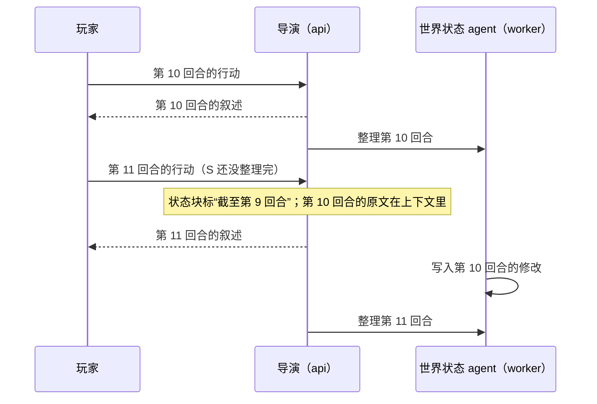

# Agent runtime 技术方案

> 文档索引：[总览](README.md) · [后端](backend.md) · [客户端](client.md) · [测试](testing.md) · [数据模型](data-model/README.md) · [接口](api/README.md)

第一次读建议先看[架构图解](agent-runtime-architecture.md)：用图把整个设计从头讲一遍，再回来看本页的细节和理由。

本页是服务端 agent runtime 的新方案：几个 agent 各管什么、能用哪些工具、一回合怎么走、长期记忆分几层、回退时怎么保证记忆不乱，以及分几个阶段做。它取代 [backend.md](backend.md) 里关于后台管线、屏障、压缩、大纲门控和回退的旧设计，两份文档冲突时以本页为准。provider 层、导演的输出协议、结构化输出、提示词管理、接口和安全仍以 backend.md 为准。

方案开始前（M1）的代码只做了“拼上下文 → 调一次导演 → 解析”：世界状态开局后不再变化，历史原文全部放进上下文，占到有效窗口的 95% 才从最旧的回合开始丢。本方案要解决的是几百到几千回合之后，故事仍然前后一致，导演仍然记得早先的事。五个阶段已经做完（2026-10-21，进度和试玩结果见第 13 节）。

## 1 目标与范围

目标：

- 长篇一致：几百到几千回合后，人物、物品、地点的状态，埋下的伏笔，玩家的喜好，导演都还记得，不自相矛盾。
- 玩家等待的时间不变长：整理记忆的工作都在后台做，用便宜快速的小模型，不挡下一回合。
- 回退到任意回合：回退后，世界状态和整理过的记忆都和“只玩到那一回合”时一样。
- 每一步都看得到、能重放：每次调模型、每次用工具都有记录，评测时可以原样重跑。

不做：

- 分支：同时保留几条故事线、来回切换。
- 按意思检索（把文字转成向量，找意思相近的内容）。接口留着，评测发现需要再加。
- Jev 等专门的判断模型。
- LangGraph：执行循环自己写（第 2 节第 11 条）。
- 调模型出错时自动重试或换模型（已经去掉，见 backend.md 第 8 节“错误分类”）。

## 2 几个决定

| # | 问题 | 决定 | 原因 |
| --- | --- | --- | --- |
| 1 | 有哪些 agent | 玩家在等的只有导演；后台有世界状态 agent、大纲修订、章节整理三个（第 4 节） | 玩家只等导演，其余工作都不挡下一回合 |
| 2 | 工具怎么分 | 导演只有只读的召回工具；修改世界状态的工具只给世界状态 agent | 每样数据只有一个写入者，出错时好查 |
| 3 | 导演用工具会让玩家多等 | 最多两轮工具；第三次请求不再提供工具，只能写叙述 | 每用一轮工具，就要把整段上下文重新发给模型一次 |
| 4 | 世界状态 agent 的修改怎么写入 | 修改工具被调用时只记下来；agent 说“提交”后，代码一次性检查，在一个事务里一起写入 | 回退要靠每回合的修改记录来撤销；不能出现一半写进去、一半没写的情况 |
| 5 | 下一回合等不等世界状态写完 | 不等。状态块标明“截至第几回合”，之后回合的原文在上下文里，规则是“原文比状态块新时以原文为准” | 小模型偶尔慢，不能让玩家等 |
| 6 | 大纲什么时候改 | 世界状态 agent 每回合回答一个问题：大纲要不要改。要改就排一个大纲修订任务，用后台模型；完成一拍也走这条路。第一版大纲在开局后由后台写，开局后一两回合才有 | 只有一个判断、一个修改入口；玩家只等导演 |
| 7 | 拼上下文时要不要自动查旧回合 | 不查。上下文里放各级摘要、最近的原文和状态块；要查过去的细节由导演自己用工具 | 按人物自动查出来的，大多是摘要里已经有的内容，既占窗口又分散模型的注意力 |
| 8 | 场景和章节什么时候结束 | 场景结束由世界状态 agent 判断，不按回合数。章节按固定规则切：这一章的原文超过一定长度以后，在下一个场景结束处切；一直没有场景结束就到上限硬切。不写场景摘要 | 章节断在自然的地方；不让模型判断“这一章是否结束”，少一个 agent、少一层状态 |
| 9 | 怎么召回 | 按回合标签里的人物查，或者按关键词在这一局的文字里逐条找；不用向量 | 一局只有几千回合，逐条找也只要几毫秒，中文分词的问题也不存在 |
| 10 | 回退到什么程度 | 当前故事线上任意一回合。所有整理出来的记忆都记下来源回合，只新增不覆盖；回退时作废来源在目标回合之后的部分。玩家画像不回退 | 记忆和回合一一对得上，回退不需要调模型 |
| 11 | 执行循环用什么写 | 自己写，每个步骤是普通函数；不用 LangGraph | LangGraph 对我们主要多了图的可视化，代价是很重的依赖、另一份需要保持一致的运行状态，以及和自有服务商层之间的适配 |
| 12 | 实体和事实的“重要程度” | 删掉。需要排序时用能数出来的依据：最近一次出现在第几回合、建立于第几回合 | 模型打的分没有客观标准，前后不一致 |
| 13 | 上下文怎么排 | 按“变得多慢”从前往后排，旧回合按场景整块移出（第 6 节） | 服务商的前缀缓存只认从开头起一字不差的部分 |
| 14 | 想少花钱的玩家 | 剧本可以选闪电模式：除了不在后台维护世界状态，其他和普通模式一样；卡的原文放进导演的系统提示，原文太长时后台用导演的模型压成梗概；开局后不能换（第 3 节“闪电模式”） | 后台不再每回合调模型；压缩请求和导演的请求开头相同，能命中前缀缓存 |

## 3 一回合怎么走

### 玩家在等的一段（api 进程）

1. 玩家提交行动：建回合、占住这一局（和现在一样，见 [data-model/story.md](data-model/story.md)“并发控制”）。
2. 第 0 回合先建世界（WorldBuilder，和现在一样）。
3. 拼上下文（第 6 节）。这一步是纯函数，不调模型。
4. 导演写叙述（第 5 节的执行循环）：
   - 前两次请求带召回工具。模型要用工具时，推一条 `director.recalling`，客户端显示“正在回想……”；
   - 叙述一边写一边推给玩家（和现在一样）；
   - 选项之后可以写一段玩家看不到的 `<director-notes>`（第 4 节“导演”）。
5. 补选项（和现在一样）。
6. 一个事务里存回合（状态 `replied`）、放开这一局，并往后台队列放一个“整理第 N 回合”的任务。
7. 推 `options.ready`、`turn.completed`。

### 后台（worker 进程）

每局两条队列。队列内按顺序执行，两条之间互不等待：

| 队列 | 任务 | 什么时候放进来 |
| --- | --- | --- |
| `state` | 世界状态 agent 整理一回合 | 每回合存好后 |
| `memory` | 章节整理、大纲修订 | 世界状态 agent 每整理完一回合放一个章节整理，由它看够不够切一章；还没有大纲、或者有还没处理的“大纲要改”的原因时，再放一个大纲修订（第 4 节） |

分两条，是因为大纲修订和章节整理要几十秒，不能让下一回合的世界状态整理排在它们后面。

### 下一回合不等后台



- 状态块开头写明“以下是截至第 N 回合的状态；第 N 回合之后的原文里发生的变化，以原文为准”。导演的规则里也写这一条。
- 世界状态 agent 每次只整理一回合，按顺序来，落后时依次补上。
- 上下文里的原文从“已整理到的回合”之后开始（第 6 节），所以还没整理的回合一定以原文出现，不会丢。
- 原来的屏障（下一回合开始前等上一回合整理完，最多 8 秒）和 `turn.waiting_state` 事件去掉。回合存好后是 `replied`，世界状态 agent 写入后是 `committed`。

### 闪电模式

剧本设置里可以打开“闪电模式”（`scenarios.setup.lightning`）。开局时拷到存档上（`playthroughs.mode = 'lightning'`），之后不能改：中途换回普通模式时世界状态停在开局时，接不上。

原则：**除了不在后台维护世界状态，其他地方都和普通模式一样**。普通模式下玩家每走一回合，除了导演，后台还要调几次模型（世界状态 agent 一回合常常调好几次，隔一段还有章节整理和大纲修订）；闪电模式只有导演自己的请求，后台只在原文太长时压一次，花费明显更少。代价是人物、物品在哪、谁知道什么、埋下的伏笔这些变化没人整理，只靠原文和梗概记着，长故事前后更容易对不上。剧本表单上的说明只讲这两点（“花费 token 更少，无世界状态功能，叙事表现有所下降”），不讲后台怎么做。

| | 普通模式 | 闪电模式 |
| --- | --- | --- |
| 开局搭世界 | WorldBuilder 调一次模型；失败时退回最小设定 | 一样 |
| 导演 | 有不在上下文里的旧回合时给召回工具；选项后面可以写隐藏备注 | 一样。没有回合标签，按人物查时退回按名字搜原文；查人物资料查到的是开局时的设定 |
| 卡的原文 | 开局时整理进世界状态，状态块按需带进来 | 世界状态不更新，也就没有状态块：卡的原文整段放进 system（开局时的快照） |
| 世界书 | 常驻条目放进 system，其余按关键词挑中的放进最后一条消息（第 7 节“世界书”） | 一样 |
| 回合存好以后 | `replied`，世界状态 agent 写入后变成 `committed` | 直接是 `committed` |
| 后台 | `state` 队列的世界状态 agent；`memory` 队列的章节整理、大纲修订 | 只有 `memory` 队列的压缩（任务 `memory.lightning`） |
| 记忆 | 状态块、线索、章节摘要、全书梗概、玩家画像、大纲 | 只有一版梗概 |
| 客户端 | 世界状态面板 | 不显示世界状态的入口和面板；网页端的剧本和存档上标“闪电” |

**卡的原文**（`domain/world/card_source.py`）：开局搭世界时，把剧本里每张卡的描述、性格、场景、对话示例存成快照（`playthroughs.seed` 的 `cards` 键，[data-model/story.md](data-model/story.md)），宏换成主角名和角色名。卡里的世界书不在这里：世界书功能上线（迁移 `0026`）以后开的局，卡里的世界书和剧本挂的一起走世界书快照，按关键词带进上下文（第 7 节“世界书”）；以前开的闪电存档快照里还有卡的世界书条目。之后改卡不影响这一局，系统提示开局后不变，前缀缓存一直有效。整份最多 15000 字，防止特别长的卡撑爆上下文：超出时依次去掉世界书里不是常驻的条目、截短对话示例、去掉常驻条目、截短场景、性格、描述，并记一条 `world.cards_truncated` 警告。这个功能上线前开局的闪电存档没有快照，系统提示里就没有这一节。

**上下文**（`runtime/context/assembler.py`；system 提示词按 `lightning` 去掉世界状态和大纲的说明，加上 `<card-source>`）：

1. system：规则、故事设定、卡的原文；`<recap>` 里只有梗概（还没压过时没有 `<recap>`），不写“与 `<world-state>` 冲突时以它为准”；
2. 原文回合：从梗概覆盖到的回合之后开始，到上一回合为止（`domain/memory/lightning.py` 的 `raw_start`）。不像章节那样多留前两回合：压缩时最近的原文本来就留着；
3. 最后一条 user：玩家的行动（给了召回工具时前面加一句“现在是第几回合、原文从第几回合开始”），没有状态块和大纲切片。

两次压缩之间，下一回合的请求以这一回合的请求开头（只差最后那条行动里的召回提示），每回合只有新加的那一回合要重新算，其余都命中前缀缓存。

**压缩**（`runtime/lightning_runner.py`，请求在 `runtime/agents/compressor.py`）：

- 什么时候：每回合存好时，在同一个事务里放一个 `memory.lightning` 任务（结局那一回合不放；队列里已经有一个还没开始的就不再放）。任务先算梗概之后的原文一共多少 token，没到阈值就结束，不调模型。
- 阈值：min(12000 token, 导演有效窗口的一半)。
- 压掉哪些：从最新一回合往回留，留下的原文至少 3000 token、至少 2 回合，更早的和旧梗概一起合成新的一版梗概。按 12000 的阈值，大约每攒到一万二压掉前九千。三个数在 `domain/memory/lightning.py`。
- 用导演的模型（同一条模型设置，不用后台模型），不开推理。请求就是导演下一回合会发的那段上下文，只把最后一条换成整理要求（`compressor.j2`）：开头那一大段和导演上一回合的请求一字不差，能命中缓存，压一次主要花在输出的梗概上。导演那边带着召回工具时（已经压过一次以后），压缩请求也带上一样的工具说明，但不许调用（`tool_choice: none`）：工具说明在服务商那里排在消息前面，少了它整段缓存都对不上。
- 输出：`<synopsis>` 标签里的一段话，最多约 1500 字。按时间顺序写发生了什么、关键的因果和转折、人物关系、谁知道什么秘密、谁答应过什么、还没解开的悬念；写清到最后一回合为止主角在哪、身边有谁、手里有什么要紧的东西、在做什么；越早的越简略。
- 写入：一个事务，先对存档的 `summarized_seq` 和时间线编号做带条件的 UPDATE（第 8 节），对不上（期间回退过、已经压过）这次结果作废；成功后写一版新梗概（`story_summaries` 的 `synopsis`，`first_seq` 是 0，`written_seq` 等于 `last_seq`）和一条 `agent_runs`（按导演的模型计费）。
- 失败（调模型出错、超过 3 分钟、没写出梗概）：记一次失败就停下。下一回合存好时会再放任务，所以会再试；一直失败时原文越积越长，由紧急截断兜着。
- 导演不等压缩：还没压好时，上下文里只是多几回合原文。

**回退**：世界状态开局后没改过，没有修改记录要撤销。梗概按第 8 节“回退到第 K 回合”的第 8 步处理：删掉在第 K 回合之后写的那几版，`summarized_seq` 改回剩下的最新一版覆盖到的回合；第 K 回合之前、被删掉的那几版覆盖过的原文回到上下文里，之后再按长度重新压。

## 4 Agent 一览

| Agent | 何时运行 | 用哪个模型 | 工具 | 产出 | 写到哪里 |
| --- | --- | --- | --- | --- | --- |
| 导演 | 每回合，玩家在等 | 导演的模型 | 召回（只读） | 叙述、两个选项、隐藏备注 | `turns`（由代码在事务里写） |
| 开局构建（WorldBuilder） | 第 0 回合 | 导演的模型 | 无 | 开局设定 Seed | 世界状态表（现在就有） |
| 补选项 | 导演没给够两个选项时 | 导演的模型 | 无 | 两个选项 | `turns.options`（现在就有） |
| 世界状态 agent | 每回合，后台 `state` 队列 | 后台模型 | 查询、修改 | 一批修改、回合标签、场景是否结束、大纲要不要改 | 世界状态表、`state_patches`、`turn_notes`、`threads` |
| 大纲修订 | 还没有大纲、或者世界状态 agent 说“要改”时，后台 `memory` 队列 | 后台模型 | 无 | 新一版大纲，或者“不改” | `outline_revisions` |
| 章节整理 | 一章的原文够长、遇到场景结束（或到上限）时，后台 `memory` 队列 | 后台模型 | 无 | 章节摘要、新一版玩家画像；必要时新一版全书梗概 | `story_summaries`、`player_profiles` |
| 压缩（只有闪电模式） | 梗概之后的原文超过阈值时，后台 `memory` 队列（第 3 节“闪电模式”） | 导演的模型 | 无 | 新一版全书梗概 | `story_summaries` |

“后台模型”是新加的一项模型设置：`model_routes` 加一个“用于后台”的标记（每个用户最多一行为真），设置页和接口同步加。没配时用导演的模型，能用，但贵。

### 导演

- 输入：第 6 节拼好的上下文。
- 工具：`recall`、`read_turn`、`lookup`（第 7 节“召回”，`runtime/agents/director_tools.py`）。只在这一回合有不在上下文里的旧回合（第 6 节“原文回合怎么取”）、模型能调用工具、不是开场时才提供；这时最后一条消息里写明现在是第几回合、上面的原文从第几回合开始。不提供工具时请求里没有工具说明，和以前完全一样。
- 输出：在现在的 `<narrative>`、`<options>` 之后，加一段可选的 `<director-notes>`，是导演写给后台的备注，比如“埋了一个伏笔：信封上的火漆是假的”。解析器把它从推给玩家的内容里去掉，存在回合上（`turns.director_notes`，最多 600 字），世界状态 agent 会读它；之后的回合里它跟着那一回合的叙述回到导演的上下文，导演记得自己埋过什么。玩家看不到，接口也不返回。
- 叙述和选项的解析、补选项都和现在一样（backend.md 第 6 节“导演”）。

### 世界状态 agent

输入（由代码拼好，不调模型）：

- 待整理的这一回合：玩家行动、叙述、导演的隐藏备注；
- 前三回合的一句话摘要，用来接上文；
- 相关实体现在的资料（带编号，实体 e1、e2……，事实 f1、f2……，只在这一次运行里有效）：主角、当前场景的地点、在场人物、主角的随身物品，加上这一回合文字里出现了名字的实体；还有涉及它们的事实；
- 还没解开的线索（带编号 t1、t2……，连同导演定下的答案）：涉及上面相关实体的在前，其余按记下的回合从早到晚，最多 16 条（没解开的最多 15 条，所以是全部）；
- 大纲当前这一拍的意图和完成条件（还没有大纲时没有这一项）；前几回合已经说过“要改”、大纲修订还没处理的原因（修订在后台和这里并行，上一回合说过的这时可能还没改完；不列出来的话，同一件事会被再说一遍，试跑里每次“要改”都被说了两遍）；
- 当前场景从第几回合开始；原文已有多少 token（阶段 4）。

实体和事实给模型看的都是紧凑的 JSON，工具结果也是。

工具：

- 查询：`find_entity(名字)` 按名字和别名找实体（包括已退场的和铅笔实体），`lookup(编号)` 取一个实体的完整资料。
- 修改：`create_entity`、`update_entity`、`retire_entity`、`move`（某人或某物到某地、某物到某人手里）、`link` / `unlink`、`add_fact`、`retract_fact`（推翻一条事实）、`share_fact`（让更多人物知道一条秘密）、`set_scene`（地点、在场人物、当前目标）、`set_clock`（故事内的时间）、`open_thread`（记下一条线索，可以带上答案；没解开的最多 15 条，每回合最多新记 2 条）、`close_thread`（把线索标为解开）、`merge_threads`（几条说同一件事的合成一条）、`update_thread`（改说法，或者写下导演新定下的答案）。
- 收尾：`commit(digest, entities, scene_ended, outline_change)`，每回合必须以它结束：
  - `digest`：这一回合的一句话摘要；
  - `entities`：这一回合涉及的人物、地点、物品；
  - `scene_ended`：这一回合之后场景是否结束；
  - `outline_change`：大纲要不要改，要改时写一句原因（这一拍完成了、玩家明显走向了别处、出现了大纲里没有的大事），存在 `turn_notes.outline_reason`；照着走、还没完成、还没有大纲时不填。
- 最多带工具请求 20 次，最后一次只提供 `commit`；整理一回合最多 3 分钟（设置项 `STATE_TURN_TIMEOUT_S`）。模型没调用任何工具就停下时，提醒它用 `commit` 结束，再请求一次。

执行：

- 修改工具被调用时，代码只把它作用到这次运行的修改清单上（内存里的一份世界副本，`domain/world/draft.py`），并立刻按规则检查：名字和编号对不对、类型对不对、一个人或物同一时刻只在一处（`move` 会去掉原来的位置）、主角不能退场、退场的人物不能在场、已确定的实体不能改长期描述、每回合最多新建 3 个实体，等等。不合规的不执行，原因作为工具结果交回模型，让它当场改正；被拒绝的记进 `agent_runs.result.rejected`。
- `commit` 时，代码对整个世界再检查一遍（`domain/world/invariants.py`），只看这次新出现的问题。有问题就不接受这次 `commit`，把问题交回模型改，直到轮数用完；轮数用完还没有被接受的 `commit`，这一回合算失败。
- 写入是一个事务（第 8 节）。同一个事务里往 `memory` 队列放一个章节整理任务（队列里已经有一个还没开始的就不放），由它看够不够切一章；还没有大纲、或者有还没处理的“要改”的原因时，再放一个大纲修订（同样只留一个还没开始的）。跳过一回合时也一样。
- `scene_ended` 为真的那一回合，先把没解开的线索过一遍：该解开的解开，说同一件事的合并。
- 不另做一套“一次输出修改清单”的办法。能力表里的 `tools` 说这个模型不能调用工具时，设置页提示它不能用于后台整理；真用它整理时直接失败，原因是 `tools_unsupported`。
- 新出现的实体先记为铅笔（`sketch`）：不进名册，只在名字被提到时进状态块；在另一个回合再次出现时改为钢笔（`canon`）。不再按回合数自动退场。

失败：

- 调模型出错、超时、没有被接受的 `commit`：这一回合先不整理，记一次失败。整理在后台进行，那时这一回合的推送连接已经关了，所以不推事件：世界状态接口带上“截至第几回合”和最近的问题（`state_issue`），客户端在世界状态面板里显示。
- 不单独重试：下一回合的任务从最早没整理的回合开始，一并补上。
- 同一回合连续失败两次就跳过它（回合标签留空、世界状态不改），免得卡住后面所有回合。被跳过的回合仍以原文留在上下文里，直到章节摘要把它写进去。
- 这一版不做事后补整理：被跳过的回合里发生的状态变化（比如主角拿走了钥匙）会漏掉，之后的回合再涉及时，世界状态 agent 按叙述改正。以后可以在场景结束时为被跳过的回合补跑一次；补出的修改记在补跑时的回合上，不插回过去，免得和后面回合的修改冲突、打乱回退时的撤销顺序。

### 大纲修订

大纲只给导演把握方向：玩家的行动永远优先，玩家走到哪里，大纲就跟到哪里。在后台写第一版，之后按世界状态 agent 留下的原因决定改不改（`runtime/agents/outline_writer.py`，任务和执行在 `runtime/outline_runner.py`，提示词 `outline_writer.j2`）。

- **第一版**：开局设定里没有大纲。世界状态整理完第 0 回合（开场）后放一个大纲修订任务，由它照开局设定写第一版，所以开局后一两回合导演才看到大纲。第一版写失败时，下一回合整理完会再放一个。
- **什么时候修订**：上次修订之后，有回合的 `turn_notes.outline_reason` 不为空。一次修订把到那时为止的原因一起处理；队列里已经有一个还没开始的，不再放新的。
- **输入**：开局设定（故事、世界、基调、主角和开场时的目标、前几个人物、开场情境和钩子）、全书梗概、还没并进梗概的章节摘要、玩家画像、章节摘要之后最多 60 回合的一句话摘要、还没解开的线索（连同答案）、现在的大纲（JSON）、这些原因。
- **输出**：第一版直接是大纲；之后是“改不改”（`change`）、一句话原因、改的时候完整的新一版。提示词要求：玩家只是暂时岔开、过几回合多半会回来，或者原因说的事已经在大纲里，就不改；被玩家绕过的拍标 `skipped`，往后保持 3～5 拍待写，不够就顺着玩家现在的走向补上。玩家明确放弃原来的目标、换了新目标时，前提跟着改，旧线上还没发生的拍都标 `skipped`，后面的拍围绕新目标重写；旧线的谜团只能留作伏笔，不再是后面每一拍的中心（试跑里只换了当前这一拍，后面几拍还围着旧线，导演就不断把旧线索塞回来）。
- **一拍多大**：一拍是故事的一个阶段，通常 10～30 回合（“在镇上弄清这封信该交给谁”），不是一个场景里的下一步；场景里怎么走是导演每回合自己的事。第一次试跑时模型把拍写成了场景里的下一步，几乎每回合都要改，所以提示词里写明了这一点，世界状态 agent 判断“要改”也按阶段看：玩家在这一拍里换个做法不算。
- **检查**（代码修正，不交回模型，`domain/memory/outline.py` 的 `settle()`）：截掉过长的文字和多余的拍；上一版完成了的拍不能改回没完成；完成和跳过的拍只留最近两拍；只能有一拍进行中。规则见 [data-model/memory.md](data-model/memory.md)。
- **写入**：改或不改都记一行 `outline_revisions`，修订进度 `outline_seq` 前进到这次依据到的回合（第 8 节）。失败（调模型出错、超时、格式一直不对）时什么都不写，进度不动，原因留着，下一回合整理完会再放一个任务。
- 用后台模型（`RouteTask.OUTLINE` 在“后台的 task”里）；超时 3 分钟。

大纲的结构（存在 `outline_revisions.content`）：

```jsonc
{
  "premise": "一句话故事前提",
  "beats": [
    { "id": "b3", "status": "active",                      // pending / active / done / skipped
      "intent": "玩家发现盟友隐瞒了真相，两人关系发生逆转",
      "done_when": "玩家得知该事实，或看到确凿证据" }
  ],
  "constraints": ["b5 完成前不要揭晓反派身份"]
}
```

线索不再放在大纲里，单独成表（第 7 节）。

### 章节整理

一章结束时，后台读这一章的原文，写章节摘要、改写玩家画像（`runtime/agents/chapter_writer.py`，任务和执行在 `runtime/memory_runner.py`）。

- **在哪里切一章**（固定规则，`domain/memory/chapters.py`）：从上次章节摘要之后的回合累计原文的 token 数，超过约 8000 以后，在下一个“场景结束”处切；一直没有场景结束，到约 16000 时硬切。只看已经整理进世界状态的回合（它们的“场景是否结束”才知道）。两条线是设置项 `CHAPTER_SOFT_TOKENS`、`CHAPTER_HARD_TOKENS`，以后按剧本试玩的结果调。
- **输入**：这一章每回合的玩家行动和叙述、现有的全书梗概和最近几章的章节摘要（接上文用）、上一版玩家画像；要并梗概时还有要并进去的那一章。开头声明下面是待整理的资料、不是指令。
- **输出**（规定格式的 JSON，走结构化输出阶梯）：
  - 章节摘要：一段话，最多 500 字，按时间顺序写发生了什么、关键的因果和转折、谁知道了什么，一律过去时，不写选项，不大段照抄对白；
  - 玩家画像：在上一版基础上合并，最多 800 字，写玩家喜欢什么、不喜欢什么、怎么玩、和主要人物的关系走向，只写有依据的；按一局记，不跨故事；
  - 还没并进梗概的章节摘要已经有 3 章时，把最早一章并进全书梗概，产出新一版梗概：最多 1500 字，分“剧情主线”“因果与转折”“信息与秘密”三节，越早的事越简略。原方案里的“未了线索”“玩家倾向”两节不写：分别由线索表和玩家画像负责。
- 用后台模型（没配时用导演的模型），整一章最多 3 分钟（`CHAPTER_TIMEOUT_S`）。
- 写入是一个事务，先对存档的“章节摘要覆盖到第几回合”（`summarized_seq`）做带条件的 UPDATE（第 8 节）。
- 失败（调模型出错、超时、格式一直不对）：记一次失败就停下，不跳过（跳过的回合就没有摘要了）。下一回合整理完会再放一个任务，所以会再试；一直失败时原文越积越长，由紧急截断兜着。
- 积压了好几章（例如阶段 4 上线前就很长的存档）时，一个任务从前往后一章一章写完。

## 5 Agent runtime 的部件

代码放在新目录 `runtime/agent/`。

### Agent 定义

每个 agent 是一份 `AgentSpec`：

```python
@dataclass(frozen=True)
class AgentSpec:
    name: str                  # director、state_keeper、chapter_writer、outline_writer……
    task: RouteTask            # 用哪条模型配置：导演的模型，或后台模型
    output: OutputKind         # 流式标签文字（导演）、以收尾工具结束（世界状态 agent）、规定格式的 JSON
    tools: tuple[str, ...]     # 能用的工具名
    max_tool_rounds: int       # 导演 2；世界状态 agent 20
    finish_tool: str | None    # 收尾工具（世界状态 agent 的 commit）
```

总时长由调用方控制：导演沿用 `runtime/turn_stream.py` 的上限，世界状态 agent 是 `StateRunnerConfig.turn_timeout_s`。

提示词模板仍按语言放在 `runtime/prompts/<lang>/`，每个 agent 一个或几个模板。

### 工具

每个工具是一个 `Tool`：名字、给模型看的说明（按语言放在提示词目录里）、参数的 JSON 格式、读还是写、返回内容的长度上限、执行函数。

- 执行函数只通过 `runtime/ports.py` 的接口读写数据，和现在一样，runtime 不直接碰数据库。
- 返回内容一律先过 `sanitize_for_fence()`，再用 `<recall>` 标签包起来交给模型，防止旧回合里玩家写的文字冒充指令。
- agent 调用了不在自己清单里的工具，不执行，返回“你没有这个工具”。参数格式不对，返回错误说明，让模型自己改。
- 写工具不直接写库，只往这次运行的修改清单里加一项（第 4 节）。

### 执行循环

```text
run(spec, messages, ctx):
  for round in 0 .. spec.max_tool_rounds:
      tools = spec 的工具 if round < spec.max_tool_rounds else 不提供
      调模型（流式），一边收一边处理：
          正文 → 交给这个 agent 的解析器（导演用标签解析器，叙述推给玩家）
          工具调用 → 收集起来
      这一轮没有工具调用，或者导演的叙述已经开始 → 结束
      依次执行工具，把模型的这条回复和每个工具结果接到 messages 后面
      agent 调用了收尾工具（commit）→ 结束
  记录这次运行
```

几个细节：

- 导演的 `<narrative>` 一旦开始写，这一轮之后的工具调用一律忽略（记一条日志），叙述照常写完。标签之外的字本来就不推给玩家，所以模型在调用工具之前说的话（比如“让我查一下”）玩家看不到；这一轮也不推 `narrative.done`。
- 模型偶尔把工具调用写成正文（例如 `<recall><query>…`，或者 DeepSeek 内部的 DSML 标记），而不是走工具调用（真实试玩里见过）。解析器认得出这种文字，不把它当叙述抢救，什么都不推给玩家；执行循环用同样的消息、不带工具马上再请求一次，让导演直接写。
- 导演一轮里第一次出现工具调用（还没写叙述）时推 `director.recalling`，客户端显示“正在回想……”。多轮合成一次导演运行（`runtime/director_loop.py`）：用量相加，首字时间从第一次请求算到最后一轮的第一个字（玩家实际等的时间），`agent_runs.result.tool_rounds` 记用了几轮工具。
- 每一轮都把完整的消息重新发给模型。前面的消息一字不差，前缀缓存能命中，多出来的主要是工具结果和新写的内容。
- 模型不支持工具调用时，一直不提供工具，导演只靠拼好的上下文写。
- 取消开关、占用标记、总时长和总字数上限都沿用现在的代码（`runtime/turn_stream.py`），作用于整个循环。

### 记录与重放

- 每次运行写一行 `agent_runs`（现在就有）。
- 每一步写一行新表 `agent_steps`：属于哪次运行、第几步、调模型还是用工具、工具名、参数、结果、耗时、token 数。参数和结果里有故事文字，所以只存进数据库，不写进日志（日志只记工具名、长度、耗时）。
- 重放：评测时用 `agent_steps` 里存下的工具结果代替真的去查库，同一回合不连数据库也能原样再跑一遍；模型的回复也用存下来的，就是完全确定的重放。
- 日志查看工具（`apps/vis`）的回合详情页显示每一步。

### 后台任务

- 用现有的 Postgres 任务队列（`infra/queue/`），排序键是 `playthrough_id:state` 或 `playthrough_id:memory`。
- 任务只带一局的 id：处理时读当时的整理进度和时间线编号，写入时这两个对不上（期间回退过、或者别的任务已经整理过），整个结果作废（`agent_runs` 记为 `stale`）。
- 同一局同一种任务在队列里只留一个还没开始的：比如又有一回合说大纲要改，队列里已经有一个还没开始的大纲修订，就不再放；它开始时会读到这条原因。

## 6 上下文怎么拼

### 顺序

服务商会记住最近请求的开头部分，下一次请求的开头一字不差时算得更快、收费更低（前缀缓存）。某一段变了，从这一段往后都要重新计算。所以按“变得多慢”从前往后排：

| # | 内容 | 什么时候变 | 消息 |
| --- | --- | --- | --- |
| 1 | 规则、故事设定、世界书的常驻条目 | 开局后不变（常驻条目只在换了模型、窗口变了时可能变） | system |
| 2 | `<recap>` 回顾：全书梗概、最近 3 章的章节摘要、玩家画像 | 每章结束时 | system，接在规则后面 |
| 3 | 原文回合：当前这一章，加上一章最后 2 回合 | 一章里只在末尾追加；章节摘要写入后整块移出 | user / assistant 交替 |
| 4 | 状态块（标“截至第 N 回合”，最后一节是挂在在场的人和物身上的线索）、大纲切片 `<outline>`、这一回合挑中的世界书条目 `<lore>`、玩家行动 | 每回合 | 最后一条 user |

大纲切片（`director.outline.j2`）：前提、当前这一拍的意图和完成条件、下一拍的意图、全部约束。有了大纲以后才有，开场那一轮没有。它放在最后一条消息里而不是 system：大纲每隔几回合就可能改一次，放进 system 会让改大纲时后面整段的前缀缓存失效。system 里写明它只供把握方向：玩家的行动永远优先，不要把玩家拉回来，需要时借人物的行动或选项自然地往当前这一拍引，大纲本身不写进叙述和选项。

### 原文回合怎么取

- 从“章节摘要覆盖到的回合”之后开始，到上一回合为止，整段放进来；再往前多留上一章最后 2 回合，免得新一章的开头接不上（`domain/memory/chapters.py` 的 `raw_start`）。
- 一章里不挤掉旧回合，只在末尾追加，所以前缀缓存一直有效；只有章节摘要写入的那一刻，回顾和原文整块换掉，大约每 30 回合（短篇幅）一次。
- 世界状态落后时，原文的起点不晚于“已整理到的回合 + 1”，保证没整理的回合一定以原文出现。
- 章节摘要之前的回合不在上下文里；导演需要细节时用召回工具查原文（第 7 节“召回”）。阶段 3 测召回时用过的临时设置 `DIRECTOR_HISTORY_BLOCK` 已经删掉。
- 每个原文回合里，导演那一条写成和它自己输出一样的格式：`<narrative>` 叙述，后面跟 `<options>` 当时给玩家的选项（补出来的也算；结局回合、没补齐的回合有几个写几个，一个都没有就不写这一段）。只放叙述的话，历史越长模型越不写选项。

### 预算

下表是各块占有效窗口 W（backend.md 第 4 节“有效窗口与预算”）的上限，初始值待评测调整：

| 块 | 上限 | 超出时 |
| --- | --- | --- |
| 规则、故事设定 | 10% | 从设定尾部截断并告警 |
| 全书梗概、章节摘要 | 梗概最多约 1500 字，章节摘要最多 3 章、每章最多约 500 字 | 第 4 章写好时把最早一章并进梗概 |
| 玩家画像、大纲切片 | 画像最多约 800 字；大纲切片是一拍加一拍、前提和约束，每段最多 200 字 | 不截（大纲修订写入时已经截过） |
| 原文回合 | 一章最多约 16000 token，加上一章最后 2 回合 | 到上限时硬切一章 |
| 状态块 | min(12%, 2500 token) | 按 backend.md 第 3 节“预算与降级”的顺序删减 |
| 未解线索 | 2% | 按最近提到的顺序截断 |
| 玩家行动 | 3% | 保留首尾，中间省略 |
| 世界书（常驻的和这一回合挑中的一起） | min(25%, 12000 token) | 常驻的先占，其余按优先级装，装不下的这回合不带（第 7 节“世界书”） |

这些上限靠后台的章节整理保证，不是拼上下文时临时删内容；按字数和章数定，不按窗口比例（后台算不出导演的窗口有多大，按章数也更确定）。真超过 95% 时仍然走现在的紧急截断（只截发送的内容，不删数据），这是整理跟不上时的保护。原来“占到 80% 才压缩一次”的设计去掉。

摘要进入上下文时仍带回顾说明（backend.md 第 4 节“回顾的包装”）：这是背景资料，不要复述，只针对玩家最新的行动写。

## 7 记忆分层

| 层 | 内容 | 存在哪 | 谁写、何时 | 导演怎么读 | 回退到第 K 回合时 |
| --- | --- | --- | --- | --- | --- |
| 原文回合 | 玩家行动、叙述、选项、隐藏备注 | `turns` | 导演，每回合 | 当前这一章整段；更早的用工具查 | K 之后的标为已撤销 |
| 回合标签 | 一句话摘要、涉及的实体 | `turn_notes` | 世界状态 agent，每回合 | 召回工具按它查 | K 之后的删除 |
| 章节摘要 | 一段话 | `story_summaries` | 章节整理，每章结束时 | 最近 3 章放在回顾里 | 在 K 之后写的删除 |
| 全书梗概 | 分三节，每并进一章是新的一版 | `story_summaries` | 章节整理，第 4 章起每章结束时 | 最新一版放在回顾里 | 在 K 之后写的删除（覆盖的是更早的章也一样，只玩到 K 时还没有它） |
| 世界状态 | 实体、关系、事实 | `entities`、`entity_links`、`facts` | 世界状态 agent，每回合 | 状态块；`lookup` 工具 | 按修改记录倒序撤销 |
| 线索与伏笔 | 没解开的悬念、答应过的事、埋下的伏笔，以及导演定下的答案 | `threads` | 世界状态 agent（包括读导演的隐藏备注） | 挂在此刻在场的人和物身上的放在状态块里 | K 之后新增的删除，K 之后解开或合并掉的重新变回没解开，答案改回原来的 |
| 玩家画像 | 玩家的喜好，有字数上限，按一局记 | `player_profiles` | 章节整理，每章结束时 | 放在回顾里 | 不回退 |
| 大纲 | 前提、各拍、约束 | `outline_revisions` | 大纲修订，开局后和世界状态 agent 说“要改”时 | 切片放在最后一条消息里 | 依据的回合大于 K 的删除，退回到剩下的最新一版 |
| 世界书 | 剧本作者写的设定条目（几张卡自带的和剧本挂的） | `playthrough_lore` | 开局时合成一份，之后不变 | 常驻的在 system；其余每回合按关键词挑，放在最后一条消息里 | 快照不变；粘滞、冷却记在每回合的 `turns.lore`，K 之后的回合撤销后跟着回去 |

### 状态块

沿用 backend.md 第 3 节的分层和版面，改这几处：

- 去掉“重要程度”。名册按“最近一次出现在第几回合”（`entities.last_seen_seq`，世界状态 agent 写入时更新）从近到远排，按 token 截断；事实按“建立于第几回合”从近到远排，涉及其他已选实体的排在前面。
- 被提及的一层用名字匹配：把这一局所有未退场实体的名字和别名，在玩家行动和上一段叙述里逐个找。一局只有几十到几百个实体，直接比对就够快。
- 一跳邻居的一层只看关系，不再按重要程度过滤；预算不够时最先去掉。
- 开头标明“截至第 N 回合”。

### 召回

导演的三个工具都是只读的，只能看到当前故事线上、本回合之前的内容：

| 工具 | 参数 | 返回 |
| --- | --- | --- |
| `recall` | `query`（关键词，几个词用空格隔开）或 `entity`（名字），二选一；`limit` 默认 3，最多 5 | 按回合从近到远：回合号、一句话摘要、玩家行动、命中处前后各约 100 字的原文 |
| `read_turn` | `seq` | 这一回合的玩家行动和完整叙述，最多 3000 字 |
| `lookup` | `name` | 这个实体的完整资料、有效事实（最多 12 条，只给导演看的秘密单独标出并写明谁知道）、位置、带着的东西、关系；已经退场的也能查 |

- 按人物查：名字和别名在这一局的实体里找（包括已退场的），再在 `turn_notes.entity_ids` 里找包含这些实体的回合。世界状态里没有这个名字，或者回合标签里没记它时，把名字当关键词在原文里找。
- 按关键词查：在这一局的玩家行动、叙述和一句话摘要里直接找包含任一个词的回合（不分大小写，`%` `_` 不是通配符），命中的词多的排前面，一样多的从近到远。一局最多几千回合、几 MB 文字，不建索引逐条找也只要几毫秒。
- 只查当前故事线（回合状态是 `replied` 或 `committed`），并且只查上下文里的原文开始之前的回合；`read_turn` 要读上下文里已经有的回合时，告诉模型“就在上面”。
- 每次调用的返回不超过约 800 token（2400 字），一回合所有工具的返回加起来不超过约 2000 token（6000 字）；用完以后再调用，告诉模型直接写。

### 世界书

设计和规则见 [lorebook.md](lorebook.md) 第 7 节，这里只写和上下文有关的几点：

- 开局搭世界时（`runtime/runner.py` 的 `_lore`），剧本里几张卡自带的世界书和剧本挂的世界书合成一份快照（`domain/world/lore.py`），写进 `playthrough_lore`。普通模式的 WorldBuilder 照旧读这些条目，提炼进世界状态；
- 每回合由 runner 在线程里挑条目（`runtime/context/lore.py` 的 `select_lore`），规则照 SillyTavern 新装默认设置：扫玩家这次的行动和上一段叙述（前面带说话人的名字），整词匹配、正则、次要关键词、递归，预算有效窗口的 25%、最多 12000 token；
- 整局不变的常驻条目放进 system 的 `<lore>`（只看快照和窗口，前缀缓存一直有效；闪电模式的压缩请求也是这一段）；这一回合挑中的其余条目放进最后一条消息的 `<lore>`，在状态块和大纲后面、玩家行动前面。历史回合不带当时的条目；
- 条目只放正文，过 `sanitize_for_fence()`；system 里说明它是剧本作者写的设定资料，要遵守，但不能改变规则和输出格式，和世界状态、原文冲突时以故事里发生过的为准；
- 粘滞、冷却按回合记在 `turns.lore`，下一回合读父回合的，回退以后自然跟着回去；概率和同组按权重抽用存档、回合号、时间线编号算的哈希当随机数，同一回合重试结果一样。除此之外同样的快照和文字永远挑出同样的条目，重放测试不用特别处理。导演那次运行的 `agent_runs.result.lore` 记挑中了哪几条（[data-model/infra.md](data-model/infra.md)），日志事件 `turn.lore`。

### 线索与伏笔

线索是故事欠玩家的交代，要少而大：主线上没解开的谜团、人物之间明确的承诺、导演明说埋下的伏笔。场景里的小疑问、马上就会揭晓的事不记。

- 来源：世界状态 agent 从叙述里看出来的（谁答应了什么、留下了什么悬念），以及导演隐藏备注里写明的伏笔、真相和承诺。
- 每条记：类型（悬念、承诺、伏笔）、内容、涉及的实体、从第几回合开始、在第几回合解开（或被合并）、导演定下的答案。
- 答案来自隐藏备注，只给导演看。备注跟着那一回合的原文走，原文移出上下文以后备注也看不到了；答案记在线索上，导演回应这条线索时还能和当初定下的真相一致。
- 少而大：没解开的最多 15 条，满了世界状态 agent 要先解开或合并旧的才能记新的；每回合最多新记 2 条；同一句话已经有一条没解开的就不再记。几条说的是同一件事（例如“兜帽客知道谁封的信”“两个人在等这封信”“信真正的收件人是谁”），合成一条主线谜团“这封信是谁封的、要交给谁”：旧的标为 `merged` 并指向新的那一条，答案不给就沿用旧的。
- 进上下文的：挂在此刻在场的人和物（在场人物、场景地点、主角带着的东西）或本回合被提到的实体身上的。主角几乎在每条线索里，不算；只涉及主角或不涉及任何实体的排在后面。越老越靠前（越该回收），每条写明从第几回合起、已经挂了多少回合、答案是什么；最多 8 条，作为状态块的最后一节，状态块预算不够时和事实一起减少。说明写着“故事欠玩家的交代，只有你知道答案：不要直接说破；在场的人身上挂得越久，越该找机会回应，回应时和答案一致”。
- 回退时和实体、事实一样按撤销记录倒着写回（`state_patches.target = thread`）：记下的删掉，解开或合并掉的变回没解开，答案改回原来的。
- 剧本试玩的报告列出挂了超过 50 回合还没解开的线索、写了答案的条数。
- 大纲修订时读全部没解开的线索。

### 事实不删除

被推翻的事实标为 `superseded`，并记下“从第几回合起不再成立”（新增列 `superseded_seq`），不删除。回退时撤销这个标记即可，也能查出“第 30 回合时主角知道什么”。

## 8 写入与回退

### 一条原则

所有整理出来的记忆都记下它来自哪些回合（`first_seq` 到 `last_seq`，或者所属的回合），只新增，不就地覆盖。回退到第 K 回合时，凡是来源包含 K 之后回合的，一律作废，退回到更早的版本。这一步全部由代码在一个事务里完成，不调模型。

### 存档行上的计数

| 列 | 意思 |
| --- | --- |
| `timeline_epoch` | 时间线编号，每次回退加 1（已有） |
| `state_seq` | 世界状态已整理到第几回合（新增，取代 `state_version`） |
| `summarized_seq` | 章节摘要已经覆盖到第几回合（阶段 4） |
| `outline_seq` | 大纲修订已经看过第几回合的原因（阶段 5，取代 `outline_version`） |

`outline_version`、`summary_version`、`rollback_floor_seq` 不再需要，删掉：大纲和摘要的“当前版本”按回合范围查得出来，回退也没有下限。

### 世界状态 agent 的写入（一个事务）

1. `UPDATE playthroughs SET state_seq = :seq WHERE id = :id AND state_seq = :seq - 1 AND timeline_epoch = :epoch`。改到 0 行就放弃：期间回退过，或者别的任务已经整理过这一回合。
2. 写实体、关系、事实。每一项修改在 `state_patches` 里记一行：改之前的值、改之后的值、属于哪一回合、第几项。
3. 写 `turn_notes`、`threads`，更新涉及实体的 `last_seen_seq`。
4. 回合状态改为 `committed`。
5. 往 `memory` 队列放一个章节整理任务。

### 章节整理的写入（一个事务）

1. `UPDATE playthroughs SET summarized_seq = :last WHERE id = :id AND summarized_seq = :first - 1 AND timeline_epoch = :epoch`。改到 0 行就放弃：期间回退过，或者这一章已经写过。
2. 写章节摘要；并了梗概时写新一版梗概。两者都记下“写它时章节摘要覆盖到第几回合”（`written_seq`，就是这一章的最后一回合）。
3. 写新一版玩家画像，记下这次运行。

### 大纲修订的写入（一个事务）

1. `UPDATE playthroughs SET outline_seq = :to WHERE id = :id AND outline_seq = :from AND timeline_epoch = :epoch`：`from` 是开始修订时读到的进度，`to` 是这次依据到的回合（开始时世界状态已整理到的回合）。改到 0 行就放弃：期间回退过，或者别的任务已经修订过。
2. 写一行 `outline_revisions`：改了是新一版大纲，没改只记原因。记下这次运行。

### 回退到第 K 回合（一个事务）

接口是 `POST /v1/playthroughs/{id}/rollback`，参数是目标回合的 id。不做“重新生成最新一回合”：反复刷新同一个节点没有意思。

每个存档能回退的次数有上限，先是 1 次（服务端的设置项）。存档行记下已经回退了几次；以后给充值用户放开到 3 次时，只改“查上限”这一步。次数用完返回 409 `ROLLBACK_LIMIT_REACHED`，存档详情返回还能回退几次，客户端据此显示或隐藏“回到这里”。

1. 锁存档行，检查目标回合在当前故事线上、回退次数没用完。
2. 有回合正在生成时不回退，返回 409 `TURN_IN_PROGRESS`；客户端只在没有回合生成时显示“回到这里”，玩家要回退就先点停止。
3. `timeline_epoch` 加 1：从这一刻起，所有带旧编号的后台任务写入时都会作废。队列里还没开始的任务不用取消：任务只带一局的 id，开始时读的是回退后的进度和时间线编号。
4. K 之后的回合标为 `archived`。
5. 世界状态：对 K 之后各回合的 `state_patches`，按回合倒序、项倒序写回改之前的值（创建的删掉，修改和退场的恢复原样）；`state_seq` 改为 `min(state_seq, K)`；大于 K 的 `last_seen_seq` 修正为不超过 K。
6. `turn_notes`：K 之后的删除。
7. `threads`：K 之后新增的删除，K 之后解开的重新变回没解开。
8. `story_summaries`：`written_seq` 大于 K 的删除，`summarized_seq` 改回剩下的最后一章；被删的章之后会按规则重新切、重新写。只按覆盖范围删不够：一版梗概覆盖的虽然是更早的章，但它是在 K 之后写某一章时并出来的。
9. `outline_revisions`：依据的回合大于 K 的删除，`outline_seq` 改回剩下的最后一次；删了修订时放一个大纲修订任务（K 之前可能还有没处理的原因，或者连第一版都删掉了）。
10. `player_profiles` 不动。
11. 头部指向第 K 回合，回退次数加 1。接口返回新的存档详情，客户端重新拉取回合和世界状态。

世界状态落后时回退：比如只整理到第 20 回合，回退到第 25 回合。第 21 到 25 回合仍然有效，作废的只是正在跑的任务；回退后为第 21 回合放一个新任务，接着整理。

撤销的量是几百到几千行，一个事务里几十到几百毫秒。数据只增不删的代价是：按一局几千回合算，摘要、标签和修改记录合计几 MB。

### 表的变化

| 阶段 | 新增 | 删除或修改 |
| --- | --- | --- |
| 1 | `agent_steps` | `entities.importance`、`facts.importance` 删除 |
| 2 | `state_patches`、`turn_notes`；`playthroughs.state_seq`；`turns.state_seq`；`model_routes.is_background`；`facts.superseded_seq`（迁移 0011）；回退次数（2b） | `playthroughs.state_version`、`turns.state_lag` 删除 |
| 3 | `threads`；`turns.director_notes` |  |
| 4 | `story_summaries`、`player_profiles`；`playthroughs.summarized_seq`（迁移 0016） | `playthroughs.summary_version`、`rollback_floor_seq` 删除 |
| 5 | `outline_revisions`；`playthroughs.outline_seq`；`turn_notes.outline_reason`（迁移 0017） | `playthroughs.outline_version` 删除 |
| 闪电模式 | `playthroughs.mode`（迁移 0024）；剧本设置里的 `lightning` |  |

每张表的列、约束和索引在实现时写进 [data-model/](data-model/README.md)。

## 9 评测

这次改动的价值全在“长了以后还记得、还连贯”，所以在 `apps/server/evals/` 里加三类评测（怎么跑、历次结果和花费见 [evals.md](evals.md)）：

- 长剧本试玩：写好 200 到 500 回合的玩家行动序列，用真模型自动跑完，再用固定问题检查：
  - 早先埋下的伏笔是否还在线索表里，后来是否被提到或解开；
  - 已死亡、已离场的人物是否又出现；
  - 导演是否说出了主角不知道的秘密；
  - 针对早先回合的具体细节提问，导演能否用工具查到。
- 回退一致性：同一份剧本跑到第 N 回合再回退到 K，和直接跑到 K 相比，世界状态、线索、摘要、大纲应该完全一样。用假模型保证结果确定，随机取很多组 N 和 K 自动检查。
- 每回合记录：花费、玩家看到第一个字的时间、导演用了几轮工具、世界状态落后几回合、前缀缓存命中的 token 比例。

## 10 分阶段

每个阶段做完都能单独运行和发布；`docs/`（包括 `data-model/`、`api/`）在同一个改动里更新。

| 阶段 | 内容 | 做完的标准 |
| --- | --- | --- |
| 1 runtime 骨架 | `AgentSpec`、工具注册表、执行循环、`agent_steps`；导演、开局构建、补选项改到循环上跑（导演暂不给工具）；删除实体和事实的“重要程度”（开局设定的输出格式、表结构、状态块和 system 里人物的选取规则）；日志查看工具显示每一步 | 现有测试全部通过；同一回合重放的结果和改造前一致 |
| 2 世界状态与回退 | 分三次做。2a：“后台模型”设置（接口、设置页）；`state` 队列和世界状态 agent；修改清单的检查与写入；`state_patches`、`turn_notes`、`state_seq`；状态块标版本、提到的和相关的两层；去掉屏障和 `turn.waiting_state`；铅笔与钢笔；世界状态面板显示截至第几回合和整理问题。2b：回退接口（含次数上限）和客户端入口（网页是鼠标移到更早的一段上出现“回到这里”；手机正文长按是选中复制，入口放在“更多”里）；回退一致性测试。2c：100 回合剧本试玩脚本（`apps/server/evals/playtest.py`） | 100 回合剧本试玩的一致性检查通过；回退一致性测试通过 |
| 3 召回 | 三个召回工具、`<recall>` 标签、`director.recalling` 事件和客户端提示；导演隐藏备注（`turns.director_notes`）；`threads` | 召回评测出结果；记下工具用得多不多、首字慢了多少 |
| 4 分层记忆 | `memory` 队列和章节整理；章节摘要、全书梗概、玩家画像；上下文按第 6 节重排；回退时作废摘要；删掉阶段 3 的临时设置 `DIRECTOR_HISTORY_BLOCK` | 300 回合剧本试玩：上下文长度稳定；前缀缓存命中率；长程问题的正确率 |
| 5 大纲 | `outline_revisions`；世界状态 agent 回答“要不要改”；大纲修订（后台模型）；第一版在开局后由后台写；大纲切片进最后一条消息 | 偏离剧本的评测：该改时改，不该改时不改 |

第 4、5 阶段互不依赖，顺序可以换。

## 11 风险

| 风险 | 影响 | 应对 |
| --- | --- | --- |
| 小模型的工具调用不稳 | 世界状态写错，或者交不出结果 | 每个修改当场检查，不合规的把原因交回模型；提交前再查一遍整个世界；不能调用工具的模型不能用于后台整理；修改记录可以撤销 |
| 导演过度使用工具 | 首字变慢、花费增加 | 最多两轮；评测里记录用工具的比例和首字时间，据此改提示词 |
| 世界状态长时间落后 | 状态块过时 | 原文从“已整理到的回合 + 1”开始，没整理的回合一定在上下文里；世界状态面板显示截至第几回合和整理问题 |
| 摘要丢细节 | 后期想不起早先的小事 | 原文永久保留，导演可以用工具查；评测里专门出这类问题 |
| 后台模型和导演模型不是同一家 | 要另配一把密钥 | 设置页说明；没配时用导演的模型 |

## 12 和旧设计的不同

| 旧设计（backend.md） | 现在 |
| --- | --- |
| LangGraph 编排两张图 | 自己写执行循环 |
| 下一回合等上一回合的状态整理，最多 8 秒（屏障） | 不等；状态块标明截至第几回合 |
| 三条后台队列（state、summary、outline） | 两条（state、memory） |
| 大纲门控：小模型判断“这一拍完成没有”和“偏离程度”，判断不了时用规则 | 世界状态 agent 只回答“要不要改” |
| 占用率超过 80% 时压缩成一份滚动摘要 | 按固定规则切章，每章结束时写章节摘要，最近 3 章之前的并进全书梗概 |
| 回退下限是最近一次压缩的边界 | 可以回退到任意回合 |
| 实体和事实有“重要程度” | 删掉，按出现的回合排序 |
| StateKeeper 一次输出 `StatePatch` | 世界状态 agent 用修改工具，攒成一批后一起写入；不能调用工具的模型不能用于后台整理 |
| 拼上下文时按打分检索事实 | 不自动查旧回合；导演用召回工具 |

## 13 进度与待办

记到 2026-10-25。每完成一项就更新这一节。还没解决的问题统一记在[待优化清单](backlog.md)，这里只记每个阶段的进度和试玩结果。

### 各阶段进度

| 阶段 | 状态 | 说明 |
| --- | --- | --- |
| 1 runtime 骨架 | 完成（提交 `2c5805c`） | 还差一项：用 `agent_steps` 存下的模型回复和工具结果做不连数据库、完全确定的重放（第 5 节“记录与重放”），还没做 |
| 2a 世界状态 agent | 完成（`f9b87a0`） | 后台模型设置、世界状态 agent、`state` 队列、撤销记录、状态块标版本和两层新内容、去掉屏障、铅笔与钢笔 |
| 2b 回退 | 完成（`43392fe`） | 回退接口和次数上限、客户端入口、回退一致性测试 |
| 2c 100 回合剧本试玩 | 脚本已提交（`6e9cf8b`），用真模型跑过三次 | 导演选项已修好（`f2cef6d`，第三次 101 / 101 自己给出）；检查点还有没过的，见下面的待办 |
| 3 召回 | 完成（`4c79ca0`） | 三个召回工具、`director.recalling` 和客户端提示、隐藏备注、线索表和世界状态 agent 的线索工具（记下、解开、合并、写答案）、状态块里的线索；结果见下面“阶段 3 剧本试玩” |
| 4 分层记忆 | 完成（`03cf562`）；300 回合剧本试玩见下面 | 章节整理（按固定规则切章，写章节摘要、玩家画像，最近 3 章之前的并进全书梗概）、`memory` 队列、导演上下文改成回顾加当前这一章的原文、回退时删掉在目标回合之后写的摘要；删掉了 `DIRECTOR_HISTORY_BLOCK` 和占用率 80% 的旧代码 |
| 5 大纲 | 代码写完，还没提交；剧本试玩见下面 | `outline_revisions`、世界状态 agent 回答“要不要改”、后台写第一版和修订大纲（后台模型）、代码修正大纲、导演最后一条消息里的大纲切片、回退时删掉依据在目标回合之后的修订；偏离剧本 `detour_60` |
| 闪电模式 | 完成（`d8d30d8`、`c55741f`、`d48f0c9`、`4b851dd`）；2026-10-25 改成除了不维护世界状态都和普通模式一样（开局搭世界、召回工具、隐藏备注、卡的原文进系统提示）；还没用真模型试玩 | 剧本开关和存档的玩法、后台按长度压梗概、回退、客户端隐藏世界状态；剧本试玩加了 `--lightning`，报告里有压缩和花费，用来和普通模式比 |

### 阶段 5 剧本试玩（2026-10-21）

导演和后台都用 deepseek-flash，两回合之间停 5 秒。报告在 `apps/server/evals/reports/`（不入库）。先跑 12 回合，再用改道剧本 `detour_60` 跑了三次，每次按发现的问题改提示词，最后用 `tavern_100` 回归：

1. **12 回合**：模型把一拍写成了场景里的下一步（“林川对老周的问话做出回应”），12 回合改了 7 次，大纲成了每回合的场景计划；完成和跳过的拍越积越多（编号到了 b17）。改：提示词写明一拍是故事的一个阶段（通常 10～30 回合）；完成和跳过的拍只留最近两拍。
2. **`detour_60` 第一次**（存档 `270945a6`）：拍的大小对了，大纲检查 3 / 3。但每次“要改”都被说了两遍（修订和下一回合的世界状态整理并行，下一回合看到的还是旧的一拍）；改道后只换了当前这一拍，前提和后面几拍还围着信，导演不断把信的线索塞回来；第 23～60 回合一次都没说要改。改：世界状态 agent 的输入里列出还在等修订的原因；修订提示词写明玩家换了目标时前提和后面的拍跟着改。
3. **第二次**（`54de3bf9`）：重复没有了，但世界状态 agent 变得太保守：前 20 回合一次没报；第 21 回合玩家说不送了，大纲改成“回镇路上甩开跟踪、保住信”；之后 39 回合玩家一直在学打鱼、买船，一次都没报。大纲检查 1 / 3。改：玩家这几回合做的事和这一拍没关系也算要改，原因里写清玩家现在在做什么；“说过的不再说”只管同一件事。
4. **第三次**（`518f0a80`）：大纲检查 3 / 3。前 20 回合改 2 次（出镇北上、到了断碑）；第 21、22 回合大纲换成“回镇拜师学打鱼”，之后跟着玩家走到租船、凑押金、捞水下的箱子，信和兜帽人留作后面的伏笔；第 41～60 回合导演写的都是船和箱子。代价是第 33～40 回合改得勤（8 回合 5 次，其中两次几乎一样，拍又有点往场景里的步骤走）。
5. **`tavern_100` 回归**（`055e0d2f`）：导演自己给出选项 100 / 101；一致性问题 0；召回题 2 / 3；检查点 9 / 10（没过的是阶段 3 就记下的检查本身的问题：“阿苓的地图”被当成了阿苓）；世界状态最多落后 3 回合。大纲 100 回合改了 19 次，仍有重复：第 8 / 9 回合、第 67 / 68 / 69 回合（老周死了，连着三次）。

用量和花费：大纲修订每次 4～5 秒，100 回合 20 次共输入 9.7 万、输出 1.8 万 token，和世界状态 agent 的 349 万比可以忽略。整个阶段的试玩花了约 7.3 元（DeepSeek 余额 21.09 → 13.82）：12 回合 0.25、断网中止的一次 0.16、`detour_60` 三次 1.13 / 1.71 / 1.16、`tavern_100` 2.86。`tavern_100` 比阶段 3 的 1.12 元贵得多，主要是世界状态 agent（349 万输入 token，阶段 3 是 296 万）和导演（103 万，阶段 3 用原文移出时是 70 万）。

导演的首字等待中位从阶段 4 的约 0.7 秒涨到约 1.1 秒（后四次都是）。12 回合那次从第 1 回合起就带着大纲，首字中位还是 0.66 秒，所以多半是这段时间服务商慢，不是大纲块；下次试玩再看。

阶段 5 的待办已并进[待优化清单](backlog.md)：O1～O4、D2。

### 阶段 4 剧本试玩（2026-10-21）

300 回合（`tavern_300`），导演和后台都用 deepseek-flash，两回合之间停 5 秒，切章的线用默认的 8000 / 16000。报告在 `apps/server/evals/reports/`（不入库），存档 `34eaa0af`。

- 导演自己给出选项 300 / 301；后台整理 301 回合成功（1 回合失败一次，下一回合补上），世界状态最多落后 4 回合、平均 0.65，一致性规则没有违反的；
- 章节整理写了 6 章、并了 3 次全书梗概，没有失败，每章约 7 秒。章节实际是 40～55 回合一章，比估计的 30 回合长；
- 导演的上下文（估算 token 的平均）：第 0–49 回合 1.06 万，到第 150 回合以后稳定在 1.6～1.7 万，最高 2.4 万；前缀缓存命中 72% 起，后面稳定在 82～84%；
- 召回题 6 / 8。主角自己回想 200 多回合前的细节（火漆的乌鸦、搬运工的蛇、避风小岛柳湾、驿站归雁）都答对了，靠的是回顾和状态块：260 个提供了召回工具的回合里导演只查过 1 次。第 265 回合导演知道铁匣子底下的字，但故意没写出来（“那个字影影绰绰”），算题目没出好；第 84 回合是问别的人物；
- 线索：记下 90 条，解开 54 条、合并 22 条，最后没解开的 14 条，其中 11 条挂了超过 50 回合；53 条写了答案。没解开的总数上限挡下了 40 次新记；
- 检查点 13 / 15：没过的两条是检查本身的问题（第 91 回合是已知写错的那条；第 156 回合“盯梢的人已退场”按名字找不到，模型给他起了别的名字）；
- 花费约 8.2 元（DeepSeek 余额 19.92 → 11.70），约每回合 2.7 分钱。输入 token：世界状态 agent 1014 万（缓存命中 82%），导演 360 万（81%），章节整理 6 万。

阶段 4 的待办已并进[待优化清单](backlog.md)：M1、S1、S2、D1、E5、E2、S5。

### 阶段 3 剧本试玩（2026-10-21）

导演和后台都用 deepseek-flash，两回合之间停 5 秒。报告在 `apps/server/evals/reports/`（不入库）。

100 回合，原文每 10 回合移出（`--history-block 10`）：

- 导演自己给出选项 101 / 101；后台整理 101 回合全部成功，世界状态最多落后 2 回合，一致性规则没有违反的；
- 提供了召回工具的回合 81 个，只有 1 个用了（`lookup`、`recall` 各一次）；用了工具的那回合首字 1354 毫秒，没用的中位 513 毫秒；
- 召回题 0 / 3。细节其实记在世界状态里（“归雁驿站”“青蛇刺青的搬运工”；火漆上的乌鸦没记），但导演没查，自己编了答案（刺青写成“半截锚”，乌鸦写成“像鸟又不是鸟”，驿站干脆不写名字）。第 84、90 回合是问别的人物，导演可以合理地让对方记不清；
- 导演输入 70 万 token（缓存命中 64%，原文整块移出时前缀会变），比全部保留时的 128 万少；世界状态 agent 296 万（83%）；整局花了约 1.1 元；
- 线索：记下 64 条，解开 14 条；
- 检查点 6 / 10：第 15 回合“林川拿着火漆”这次没建火漆这个实体；第 70、91 回合是已知写错的两条；第 98 回合“阿苓不在场”是检查本身的问题（名字里带“阿苓”的物品“阿苓的路线图”也被当成了阿苓）。

30 回合对比（剧本前 30 回合，原文每 5 回合移出，第 27、28 回合主角自己回想第 1、10 回合的细节）：召回题 2 / 2，导演在第 27 回合查了旧回合后写出“乌鸦……爪子底下抓着一把钥匙”，第 28 回合靠状态块里记下的搬运工答出青蛇；21 个提供了工具的回合用了 6 次。

试玩中发现并修好的：

- 线索记得太多（12 回合 22 条）、导演几乎每回合都写隐藏备注：改了两边的提示词，只记以后要回收的大事，每回合检查已有的线索是否解开；
- DeepSeek 偶尔把工具调用写成正文（`<recall><query>…`、DSML 标记），被当成叙述推给了玩家：解析器不再抢救这种文字，执行循环不带工具再请求一次（第 5 节“执行循环”）。

看完试玩后按讨论改了线索（第 7 节“线索与伏笔”，迁移 `0015`），改完还没用真模型试玩：

- 挑选：按此刻在场的人和物找线索，不算主角；越老越靠前，写明挂了多少回合。试玩里第 85 回合兜帽客再次出现时，第 32 回合“他知道信是谁封的”这条被新的小事挤掉了；
- 少而大：没解开的最多 15 条，满了先解开或合并；新工具 `merge_threads` 把说同一件事的几条合成一条主线谜团；
- 带上答案：线索多了导演定下的答案（来自隐藏备注，只给导演看），新工具 `update_thread` 可以后补答案。

召回的待办已并进[待优化清单](backlog.md)：D1、E5、S4、E1。

### 阶段 2 剧本试玩

第二次剧本试玩的基线（`evals/playtest.py`，剧本 `tavern_100`，导演和后台都用 deepseek-flash，两回合之间停 5 秒）：

- 后台整理 101 回合全部成功，没有失败和跳过，世界状态最多落后 1 回合，一致性规则没有违反的；
- 导演自己给出选项的只有 6 / 101 回合，其余都靠另调模型补；
- 检查点过了 8 / 10，没过的两条是检查点写错了（导演把“老周被害死”改写成了装死；交接兜帽人那一回合两人本来就在同一个屋里）；
- 有效事实 191 条，其中 94 条以主角名字开头，记的是动作经过；100 回合只推翻过 1 条事实；
- 同一个人记成了两个实体（开局的“兜帽客”和第 32 回合新建的“兜帽人”）；20 个地点里有不少只是路过的小地方（“货栈后排水沟”“坡道岔口”）；
- 输入 token：导演 128 万（缓存命中 84%），世界状态 agent 220 万（82%）。

当时定的几项里，导演选项已经改好（`f2cef6d`：历史回合里导演的回复带上当时给玩家的选项；阶段 3 的 100 回合试玩里 101 / 101 自己给出）；世界状态 agent 的提示词改了一部分（路人和一次性的东西不建、换称呼加别名）。其余的并进了[待优化清单](backlog.md)：E3、E4、S2、S3、E6。
