# 数据模型

> 文档索引：[总览](../README.md) · [后端](../backend.md) · [客户端](../client.md) · [测试](../testing.md) · [数据模型](README.md) · [接口](../api/README.md)
>
> 数据模型：[说明与约定](README.md) · [账户与令牌](accounts.md) · [模型路由](models.md) · [点数](credits.md) · [外部服务](tools.md) · [角色卡与剧本](library.md) · [工作台](workbench.md) · [游玩与回合](story.md) · [世界状态](world.md) · [记忆](memory.md) · [运行基础设施](infra.md)

这个目录记录数据库里**实际存在**的表，以 `apps/server/migrations/versions/` 里的迁移为准（目前是 `0001` 到 `0022`）。
设计意图和还没建的表见 [backend.md 第 2 节](../backend.md)。

表按领域分文件。每个领域文件写这个领域的表（列、类型、约束、索引）、JSON 列的结构和状态变化；本页写各领域共用的约定、
表之间的关系、跨领域的删除与清理，以及改表结构的流程。

| 文件 | 领域 | 表 |
| --- | --- | --- |
| [accounts.md](accounts.md) | 账户与令牌 | `users`、`refresh_tokens` |
| [models.md](models.md) | 模型路由（玩家配好的模型，含 Key 和端点；官方模型） | `model_routes` |
| [credits.md](credits.md) | 点数（官方模型的余额、账本、体验额度） | `credit_ledger`、`credit_grants` |
| [tools.md](tools.md) | 外部服务（搜索、读网页、文生图）和读过的网页 | `tool_routes`、`web_pages` |
| [library.md](library.md) | 角色卡仓库与剧本仓库 | `blobs`、`cards`、`card_revisions`、`scenarios`、`scenario_cards` |
| [workbench.md](workbench.md) | 工作台 | `workbench_drafts`、`workbench_messages`、`workbench_events`、`workbench_assets`、`workbench_notes` |
| [story.md](story.md) | 游玩与回合，以及热路径的并发控制 | `playthroughs`、`turns`、`idempotency_keys` |
| [world.md](world.md) | 世界状态 | `entities`、`entity_links`、`facts`、`threads`、`state_patches`、`turn_notes` |
| [memory.md](memory.md) | 记忆（章节摘要、全书梗概、玩家画像）和大纲 | `story_summaries`、`player_profiles`、`outline_revisions` |
| [infra.md](infra.md) | 运行基础设施 | `agent_runs`、`agent_steps`、`jobs` |

`tests/integration/test_data_model_doc.py` 会在真实 Postgres 上执行迁移，再把这个目录里的所有文件合在一起，逐表核对列名、类型、可空和索引名。
有任何不一致，或者一张表在目录里写了不止一次，测试就失败。

## 约定

- 数据库是 PostgreSQL 16（`deploy/docker-compose.yml` 用的镜像）。`gen_random_uuid()` 从 13 版起内置，不需要装扩展。
- 主键默认是数据库生成的 UUID，例外有这几个：
  - `model_routes.id` 由应用生成。加密时要把行 ID 绑进附加数据，所以插入前就得知道 ID。
  - `jobs.id` 是 `BIGSERIAL`，因为队列要按 id 排序。
  - `entity_links`、`idempotency_keys` 用组合主键。
- 时间列一律用 `timestamptz`，默认 `now()`。`updated_at` 没有触发器，由仓储层在 UPDATE 语句里写 `now()`。
- 结构化数据用 `jsonb`。Postgres 的 jsonb 和 text 都不接受 `\u0000`。导入角色卡、给剧本改名时会去掉它；
  其他写入（玩家的自由输入、主角设定、标题、模型路由的字段、模型的输出）还没有处理，含 `\u0000` 时数据库会报错（已知问题，见 [handoff.md 第 9 节](../handoff.md)）。
- 枚举用 `text` 加 `CHECK`，不用 Postgres 的 ENUM 类型，这样增加取值只需要改约束。
- 租户隔离靠仓储层：按 ID 读写用户数据的 SQL 都带 `user_id` 条件，子表通过 `playthroughs.user_id` 确定归属。
  查不到就当作不存在，接口返回 404。没有启用行级安全策略。
- 有些引用列故意不加外键（下文关系图里的虚线），避免 `playthroughs` 和 `turns` 之间出现循环外键和插入顺序约束。
  它们的一致性靠在同一个事务里写入来保证。
- 仓储层直接写 SQL（SQLAlchemy Core，`apps/server/src/bettertavern/infra/db/repositories/`），没有 ORM 模型，所以表结构只在这个目录里有完整说明。

## 关系总览

```mermaid
erDiagram
    users ||--o{ refresh_tokens : "user_id"
    users ||--o{ email_codes : "user_id"
    users ||--o{ model_routes : "user_id"
    users ||--o{ credit_ledger : "user_id"
    users ||--o{ blobs : "user_id"
    users ||--o{ cards : "user_id"
    users ||--o{ scenarios : "user_id"
    users ||--o{ workbench_drafts : "user_id"
    users ||--o{ workbench_assets : "user_id"
    users ||--o{ tool_routes : "user_id"
    users ||--o{ web_pages : "user_id"
    users ||--o{ playthroughs : "user_id"
    users ||--o{ agent_runs : "user_id"
    users ||--o{ idempotency_keys : "user_id"
    blobs |o--o{ cards : "cover_blob_id"
    blobs |o--o{ card_revisions : "cover_blob_id"
    blobs ||--o{ workbench_assets : "blob_id"
    cards ||--o{ card_revisions : "card_id"
    cards ||--o{ scenario_cards : "card_id (RESTRICT)"
    scenarios ||--o{ scenario_cards : "scenario_id"
    cards |o--o{ workbench_drafts : "card_id"
    workbench_drafts ||--o{ workbench_assets : "draft_id"
    workbench_drafts ||--o{ workbench_messages : "draft_id"
    workbench_drafts ||--o{ workbench_events : "draft_id"
    workbench_drafts ||--o{ workbench_notes : "draft_id"
    workbench_drafts |o--o{ agent_runs : "draft_id"
    workbench_assets |o--o{ workbench_drafts : "cover_asset_id"
    workbench_drafts |o--o{ card_revisions : "draft_id"
    scenarios |o--o{ playthroughs : "scenario_id"
    playthroughs ||--o{ turns : "playthrough_id"
    playthroughs ||--o{ entities : "playthrough_id"
    playthroughs ||--o{ entity_links : "playthrough_id"
    playthroughs ||--o{ facts : "playthrough_id"
    playthroughs ||--o{ threads : "playthrough_id"
    playthroughs ||--o{ story_summaries : "playthrough_id"
    playthroughs ||--o{ player_profiles : "playthrough_id"
    playthroughs ||--o{ outline_revisions : "playthrough_id"
    playthroughs |o--o{ agent_runs : "playthrough_id"
    playthroughs ||--o{ state_patches : "playthrough_id"
    playthroughs ||--o{ turn_notes : "playthrough_id"
    turns ||--o{ state_patches : "turn_id"
    turns ||--o| turn_notes : "turn_id"
    agent_runs ||--o{ agent_steps : "run_id"
    agent_runs |o--o| credit_ledger : "run_id (SET NULL)"
    entities ||--o{ entity_links : "src_id / dst_id"
    playthroughs |o..o| turns : "head_turn_id / active_turn_id"
    turns |o..o{ turns : "parent_turn_id"
    turns |o..o| agent_runs : "director_run_id"
    idempotency_keys }o..|| turns : "turn_id"
```

图里实线是外键（删除时的行为见各表），虚线是没有外键的引用。`jobs` 不和其他表关联，它的 `ordering_key` 是字符串 `{playthrough_id}:{lane}`。
`credit_grants` 也不和其他表关联：它存的是邮箱的 HMAC，删号以后留着。

没有外键的引用：

| 列 | 指向 | 说明 |
| --- | --- | --- |
| `playthroughs.head_turn_id` | `turns.id` | 活跃链的头部，也就是最新一个提交完成的回合；开场完成前为空 |
| `playthroughs.active_turn_id` | `turns.id` | 持有租约、正在生成的回合 |
| `turns.parent_turn_id` | `turns.id` | 提交时的头部；开场为空 |
| `turns.director_run_id` | `agent_runs.id` | 写出这段叙述的那次导演调用 |
| `turns.rollback_id` | 无 | 回退批次号（M2）：同一次回退归档的回合共用一个 |
| `facts.superseded_by` | `facts.id` | 推翻这条事实的新事实 |
| `facts.source_turn_id` | `turns.id` | 产生这条事实的回合（开局写入的为空） |
| `turn_notes.entity_ids` | `entities.id` | uuid 数组 |
| `threads.entity_ids` | `entities.id` | uuid 数组 |
| `threads.source_turn_id` | `turns.id` | 记下这条线索的回合 |
| `threads.merged_into` | `threads.id` | 合进了哪一条线索 |
| `facts.entity_ids`、`facts.known_by` | `entities.id` | uuid 数组，数组元素不能加外键 |
| `agent_runs.turn_id` | `turns.id` | 这次调用所属的回合 |
| `idempotency_keys.turn_id` | `turns.id` | 这个幂等键创建的回合 |
| `workbench_drafts.run_id` | `agent_runs.id` | 正在跑的那一轮工作台 agent（一轮结束后才写进 `agent_runs`） |
| `workbench_messages.run_id`、`workbench_events.run_id` | `agent_runs.id` | 哪一轮发的 |

## 删除与清理

| 操作 | 连带删除或修改 |
| --- | --- |
| 删除账户（`DELETE /v1/me`） | 所有带 `user_id` 外键的表级联删除：`refresh_tokens`、`email_codes`、`model_routes`、`blobs`、`cards`（连同 `card_revisions`）、`scenarios`（连同 `scenario_cards`）、`workbench_drafts`、`workbench_assets`、`tool_routes`、`web_pages`、`playthroughs`（以及下面那一行列出的内容）、`agent_runs`（连同 `agent_steps`）、`idempotency_keys`、`credit_ledger`。`credit_grants` 不删（同一个邮箱重新注册不再送体验额度） |
| 删除游玩 | 级联删除 `turns`、`entities`、`entity_links`、`facts`、`threads`、`state_patches`、`turn_notes`、`story_summaries`、`player_profiles`、`outline_revisions` 和 `agent_runs`（连同 `agent_steps`；`credit_ledger` 里这些运行的扣点记录留着，`run_id` 置空）。正在生成的回合如果在当前进程里，先通知它停止（不等它结束）。指向这局回合的幂等键不会级联删除，等 24 小时后被清理 |
| 删除剧本 | 级联删除 `scenario_cards`，卡不动；`playthroughs.scenario_id` 置空 |
| 删除角色卡 | `scenario_cards` 里有这张卡就拒绝（409 `CARD_IN_USE`，外键也是 RESTRICT）。级联删除 `card_revisions`；指向它的草稿 `card_id` 置空。它和它的版本用过的封面没有别处在用时一起删掉 |
| 删除草稿 | 正在跑的 agent 先置停止；级联删除 `workbench_assets`、`workbench_messages`、`workbench_events`、`workbench_notes` 和记在它上面的 `agent_runs`（连同 `agent_steps`）；`card_revisions.draft_id` 置空。草稿里的图没有别处在用（不是哪张卡或哪个版本的封面）时一起删掉 |
| 版本超过 30 份 | 删掉最早的 `card_revisions`，它们用过的封面没有别处在用时一起删掉 |
| 删除模型路由 | 删掉的是导演时就没有导演了，开局和提交行动返回 409 `ROUTE_MISSING`；删掉的是后台模型时，后台整理改用导演的模型。删掉的是官方模型时余额不动，可以重新加回来 |
| 删除实体（M2） | 级联删除相关的 `entity_links`；`facts.entity_ids` 里的 ID 不会自动清理 |

定期清理（`services/maintenance.py`，在 api 进程里运行）：

| 内容 | 频率 | 规则 |
| --- | --- | --- |
| 过期的租约 | 每 15 秒 | 回合标为 `failed`（`RUNNER_LOST`），见 [story.md 的“并发控制”](story.md#并发控制) |
| `idempotency_keys` | 大约每 10 分钟 | 删除 24 小时之前的 |
| `refresh_tokens` | 大约每 10 分钟 | 删除过期超过 7 天的 |
| `email_codes` | 大约每 10 分钟 | 删除过期的 |
| 没验证邮箱的 `users` | 大约每 10 分钟 | 要求验证邮箱时，删除注册一天以后还没验证的账号（连同它的全部数据，同“删除账户”）；不要求时不删 |
| `workbench_events` | 大约每 10 分钟 | 删除一天以前的 |
| `web_pages` | 大约每 10 分钟 | 删除 7 天以前读的 |
| `agent_runs`、已完成的 `jobs` | 不清理 | M1 没有清理；设计是 `agent_runs.result` 保留 30 天（[backend.md 第 11 节](../backend.md)） |

## 修改表结构

1. 在 `apps/server/migrations/versions/` 里新建一个迁移（文件名形如 `20261020_0003_state_patches.py`，按文件名排序执行）。
   已有迁移里的 DDL 是冻结的，不要修改。asyncpg 一次只能执行一条语句，`statements()` 按分号拆分，所以 DDL 的字符串里不要出现分号。
2. 在同一个改动里更新这个目录：
   - 新表写进它所属领域的文件，放在“表”下面，写成 ``### `表名` `` 一节（标题里只有表名）。
     一节里包括说明、列表（列、类型、可空、默认、说明）和“约束与索引”，索引要写出名字。
   - 类型写 Postgres 的类型名（`timestamp with time zone` 写成 `timestamptz`，数组写成 `text[]`）。
   - JSON 列的结构、状态变化写在同一个领域文件的“JSON 列”“状态”下面。
   - 属于新领域的表：新建一个文件，格式照着现有的领域文件写，并在本页开头的表格和每个文件的导航行里加上它。
   - 同步更新本页的关系图、没有外键的引用、删除与清理。
3. 运行 `make test-integration`。`tests/integration/test_data_model_doc.py` 会执行全部迁移，然后核对每张表的列名、类型、可空以及每个索引的名字是否都写进了这个目录。
4. 如果改动会影响接口，同时更新 [接口文档](../api/README.md)。
