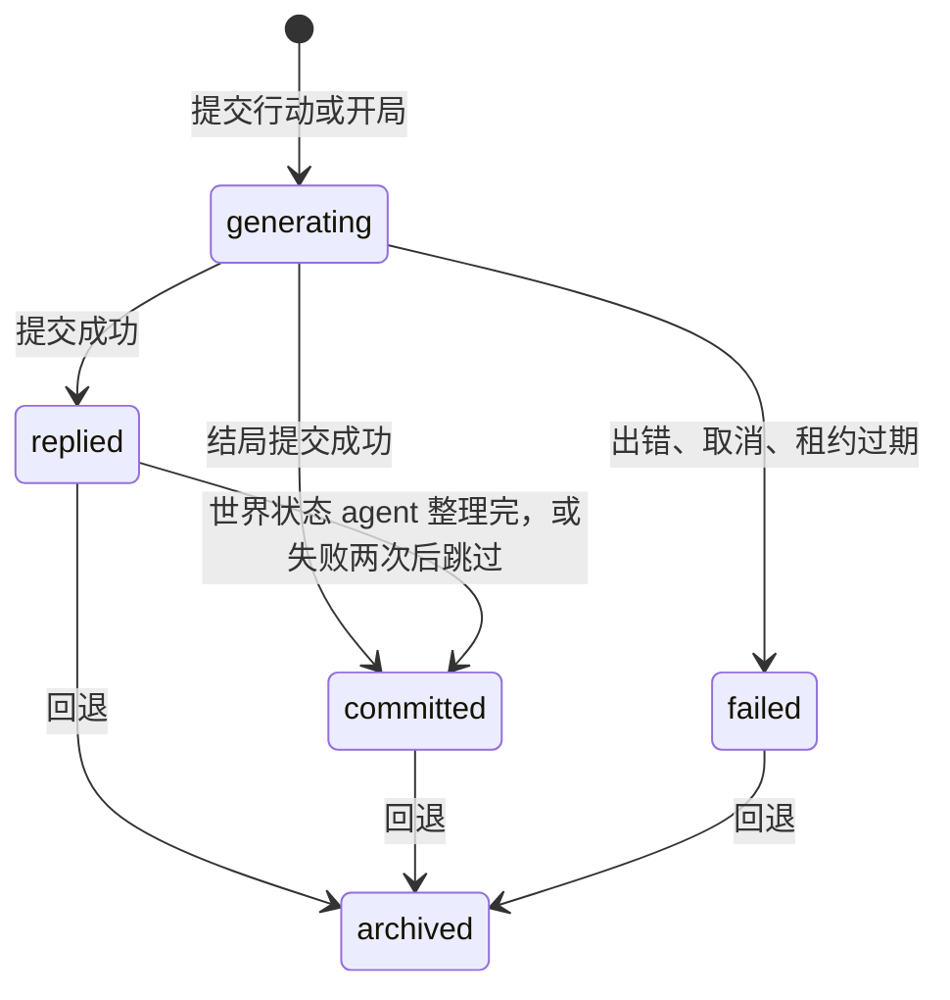

# 数据模型：游玩与回合

> 文档索引：[总览](../README.md) · [后端](../backend.md) · [客户端](../client.md) · [测试](../testing.md) · [数据模型](README.md) · [接口](../api/README.md)
>
> 数据模型：[说明与约定](README.md) · [账户与令牌](accounts.md) · [模型路由](models.md) · [点数](credits.md) · [外部服务](tools.md) · [角色卡与剧本](library.md) · [人设库](personas.md) · [工作台](workbench.md) · [游玩与回合](story.md) · [世界状态](world.md) · [记忆](memory.md) · [运行基础设施](infra.md)

一局游玩的时间线：游玩本身、回合，以及提交行动用的幂等键。热路径的并发控制（租约、带围栏的提交、加锁顺序）也写在这里。
对应的接口见 [api/play.md](../api/play.md)，回合的事件流见 [api/events.md](../api/events.md)。

## 表

### `playthroughs`

一次游玩，包括一条线性时间线和它的世界状态。它也是热路径做并发控制的地方（见下文“并发控制”）。

| 列 | 类型 | 可空 | 默认 | 说明 |
| --- | --- | --- | --- | --- |
| `id` | uuid | 否 | `gen_random_uuid()` | 主键 |
| `user_id` | uuid | 否 |  | → `users.id`，级联删除 |
| `scenario_id` | uuid | 是 |  | → `scenarios.id`，被删除时置空 |
| `title` | text | 否 |  | 标题，默认用剧本名，最多 80 字 |
| `status` | text | 否 | `'building'` | `building` 表示世界还没建好，`active` 表示开局构建已完成，`ended` 表示已经写完结局（见下文“状态”） |
| `language` | text | 否 | `'zh'` | 给 agent 的提示词用哪种语言：`zh` / `en` / `ja`。开局时由客户端按界面语言传来，之后不变（见 [i18n.md](../i18n.md) 第 4 节） |
| `mode` | text | 否 | `'standard'` | 怎么玩：`standard`（导演加后台整理世界状态、章节摘要、大纲）/ `lightning`（闪电模式：和普通模式一样开局、写叙述，只是后台不整理世界状态、不写章节摘要和大纲，原文超过阈值时压成一版梗概，见 [agent-runtime.md 的“闪电模式”](../agent-runtime.md#闪电模式)）。开局时从剧本的 `setup.lightning` 拷过来，之后不变。迁移 `0024` 加的，已有的存档都是 `standard` |
| `settings` | jsonb | 否 | `'{}'` | 主角和偏好设置，结构见下文“JSON 列” |
| `seed` | jsonb | 是 |  | 开局设定（WorldBuilder 或最小 Seed 的输出），结构见下文“JSON 列”；世界建好时写入 |
| `seed_source` | text | 是 |  | `world_builder` 表示由模型生成。`minimal` 表示没有用模型生成：模型失败或超时、没有可用的路由时只用卡片原文；剧本已被删除时设定里只有主角。闪电模式开局也和普通模式一样搭世界 |
| `head_turn_id` | uuid | 是 |  | 无外键，指向 `turns.id`：活跃链的头部 |
| `timeline_epoch` | integer | 否 | `0` | 时间线纪元，回退时加 1。回合记下发起时的值，提交时如果不一致，结果就作废；世界状态 agent 写入时也要求它没变 |
| `state_seq` | integer | 否 | `-1` | 世界状态已整理到第几回合；-1 表示还没整理过任何回合（还是开局时的样子）。世界状态 agent 写入时用带条件的 UPDATE 从 N-1 改成 N（见下文“带围栏的提交”）。迁移 `0011` 把已有的存档设成活跃链上最新的回合，不回头整理旧回合 |
| `summarized_seq` | integer | 否 | `-1` | 章节摘要已经覆盖到第几回合；-1 表示还没有（[memory.md](memory.md)）。章节整理写入时用带条件的 UPDATE 从“这一章第一回合减 1”改成这一章的最后一回合；导演上下文里的原文从它减 1 开始（多留上一章最后两回合）。闪电模式没有章节摘要，它记全书梗概覆盖到第几回合，压缩写入时同样用带条件的 UPDATE 推进，原文从它加 1 开始。CHECK 不小于 -1。迁移 `0016` 加的，同时删掉了一直是 0 的 `summary_version` 和 `rollback_floor_seq` |
| `outline_seq` | integer | 否 | `-1` | 大纲修订已经看过第几回合的“要改”的原因；-1 表示还没有大纲（[memory.md](memory.md)）。大纲修订写入时用带条件的 UPDATE 从读到的值改成这次依据到的回合。CHECK 不小于 -1。迁移 `0017` 加的，同时删掉了一直是 0 的 `outline_version` |
| `rollbacks_used` | integer | 否 | `0` | 已经回退了几次。每个存档能回退的次数有上限（服务端设置 `ROLLBACK_LIMIT`，默认 1），用完后回退接口返回 409 `ROLLBACK_LIMIT_REACHED` |
| `active_turn_id` | uuid | 是 |  | 无外键，指向 `turns.id`：持有租约、正在生成的回合；没有正在生成的回合时为空 |
| `lease_expires_at` | timestamptz | 是 |  | 租约的到期时间：领取时设为当前时间加 120 秒，生成期间每 30 秒续期 |
| `lease_owner` | text | 是 |  | 持有租约的进程，格式为 `{hostname}:{pid}`，排错用 |
| `created_at` | timestamptz | 否 | `now()` |  |
| `updated_at` | timestamptz | 否 | `now()` | 改名、领取租约、世界建好、推进头部、释放租约时写入（续期不写）；游玩列表按它倒序排列 |

约束与索引：
- `status`、`seed_source`、`language` 的 CHECK；`mode` 的 CHECK（`playthroughs_mode_ck`）；`state_seq >= -1`；`summarized_seq >= -1`；`outline_seq >= -1`；`rollbacks_used >= 0`。
- `playthroughs_user_idx (user_id, updated_at DESC)`。
- `playthroughs_lease_idx (lease_expires_at) WHERE active_turn_id IS NOT NULL`：清理过期租约时用。

### `turns`

一个回合包括玩家的一次行动和导演的一次回复，`seq = 0` 是开场。同一个 `seq` 可以有多次尝试（失败后重试），但活跃链上每个 `seq` 只有一个回合。

| 列 | 类型 | 可空 | 默认 | 说明 |
| --- | --- | --- | --- | --- |
| `id` | uuid | 否 | `gen_random_uuid()` | 主键 |
| `playthrough_id` | uuid | 否 |  | → `playthroughs.id`，级联删除 |
| `seq` | integer | 否 |  | 回合序号，等于父回合的 `seq` 加 1；CHECK 不小于 0 |
| `parent_turn_id` | uuid | 是 |  | 无外键，指向 `turns.id`：提交时的头部；开场为空 |
| `attempt` | integer | 否 | `0` | 同一个 `seq` 的第几次尝试，从 0 开始；插入时取已有的最大值加 1 |
| `status` | text | 否 |  | `generating` / `replied` / `committed` / `failed` / `archived`，状态变化见下文“状态” |
| `timeline_epoch` | integer | 否 | `0` | 创建时的 `playthroughs.timeline_epoch` |
| `user_action` | jsonb | 否 |  | 服务端解析后的玩家行动，结构见下文“JSON 列” |
| `narrative` | text | 否 | `''` | 导演写的叙述；失败时可能是半截草稿 |
| `options` | jsonb | 否 | `'[]'` | 两个选项，结构见下文“JSON 列” |
| `options_source` | text | 是 |  | 选项的来源：`model` 是模型给的（包括解析器修补过的）；`repaired` 是另调小模型补的；`missing` 表示补了两次也没补齐，`options` 不足两个（导演给出的有效选项会保留），玩家自己写下一步；`fallback` 只出现在迁移 `0013` 之前的回合，当时缺的选项用固定的兜底文案补上。生成完成前为空 |
| `director_run_id` | uuid | 是 |  | 无外键，指向 `agent_runs.id` |
| `state_seq` | integer | 否 | `-1` | 写这一回合时，状态块截至第几回合（当时的 `playthroughs.state_seq`）。下一回合不等世界状态整理，所以它可能比 `seq - 1` 小 |
| `director_notes` | text | 是 |  | 导演写在选项之后的隐藏备注（`<director-notes>`，最多 600 字）：埋下的伏笔、答应过的事、玩家还不知道的真相。玩家看不到，接口不返回；世界状态 agent 整理这一回合时读它，之后的回合里它跟着这一回合的叙述回到导演的上下文。没写时为空（迁移 `0014`） |
| `usage` | jsonb | 是 |  | 导演调用的 token 用量，结构见下文“JSON 列”；服务商没给用量时为空 |
| `error` | jsonb | 是 |  | 失败原因，结构见下文“JSON 列”；成功的回合为空 |
| `rollback_id` | uuid | 是 |  | 回退批次号：被同一次回退归档的回合（包括失败的尝试）共用一个 |
| `created_at` | timestamptz | 否 | `now()` |  |
| `replied_at` | timestamptz | 是 |  | 叙述和选项写入的时间 |
| `committed_at` | timestamptz | 是 |  | 世界状态 agent 整理完（或跳过）的时间；结局那一轮保存时直接写入，和 `replied_at` 相同 |
| `lore` | jsonb | 否 | `'{}'` | 这一回合的世界书记录，结构见下文“JSON 列”；导演写完回合时一起写入。下一回合读父回合的这一列算粘滞和冷却，回退后读的是目标回合的，自然跟着回去（迁移 `0027`） |

约束与索引：
- `turns_chain_seq_uq (playthrough_id, seq) WHERE status NOT IN ('failed', 'archived')`：保证活跃链上每个 `seq` 只有一个回合。失败的尝试和被回退的回合不受这个约束，所以重试时可以在同一个 `seq` 上插入 `attempt + 1`。
- `turns_pt_seq_idx (playthrough_id, seq, created_at)`：历史分页、查最近一次失败时用。
- `status`、`options_source` 的 CHECK（`turns_options_source_check`，迁移 `0013` 加了 `missing`）；`seq >= 0`；`state_seq >= -1`。

### `idempotency_keys`

提交行动时的幂等键，保证客户端重发同一个请求不会生成第二个回合。只有提交行动的接口使用，创建游玩的接口没有。

| 列 | 类型 | 可空 | 默认 | 说明 |
| --- | --- | --- | --- | --- |
| `user_id` | uuid | 否 |  | → `users.id`，级联删除 |
| `key` | text | 否 |  | 请求头 `Idempotency-Key` 的值，长度 1 到 128 个字符 |
| `request_hash` | text | 否 |  | 请求内容（`playthrough_id`、`parent_turn_id`、`action`）规范化成 JSON 后的 SHA-256。同一个键对应了不同的内容时，返回 422 `IDEMPOTENCY_KEY_REUSED` |
| `turn_id` | uuid | 否 |  | 无外键，指向 `turns.id`：这个键创建的回合 |
| `created_at` | timestamptz | 否 | `now()` |  |

约束与索引：主键 `(user_id, key)`（`idempotency_keys_pkey`）；`idempotency_keys_created_idx (created_at)`。

维护任务大约每 10 分钟删除一次 24 小时之前的键。

### `playthrough_lore`

这一局的世界书快照（[lorebook.md](../lorebook.md) 第 3.2 节，`domain/world/lore.py`）：开局搭世界时把剧本里几张卡自带的世界书和剧本挂的世界书合成一份，和世界状态在同一个事务里写入。之后改卡、改书、换书都不影响这一局；每回合按关键词从这里挑条目（`runtime/context/lore.py`）。迁移 `0026` 加的。

| 列 | 类型 | 可空 | 默认 | 说明 |
| --- | --- | --- | --- | --- |
| `playthrough_id` | uuid | 否 |  | 主键，→ `playthroughs.id`，级联删除 |
| `entries` | jsonb | 否 | `'[]'` | 合成好的条目，结构见下文“JSON 列” |
| `meta` | jsonb | 否 | `'{}'` | 其余的：主角名、主角色名、顺带扫描要用的文字、合了哪几本、丢了几条 |
| `created_at` | timestamptz | 否 | `now()` |  |

约束与索引：只有主键。一局一行：剧本里没有任何世界书也写一行（`entries` 是空的），表示这一局是世界书功能上线以后开的。
这个迁移之前开局的存档没有这一行，照旧没有世界书（它们的闪电存档快照 `seed.cards` 里还有卡的世界书）。
不放进 `playthroughs.seed`：世界书可能有几十万字，读存档列表时不该带出来。回退不碰它。

## JSON 列

### `playthrough_lore.entries` 与 `meta`

`entries` 里每一项是一条（`LoreItem`）：宏已经换好的条目（结构同 [library.md 的“世界书条目”](library.md#世界书条目)），加上它从哪来。按合并的顺序：主角色卡的书、其余卡的书、剧本挂的书；停用的、没正文的不要，标题和正文都一样的只留第一条；最多 3000 条、60 万字，超出时从末尾往前丢。

```jsonc
// entries 的一项
{
  "entry": { "name": "火漆", "keys": ["火漆"], "content": "…", "constant": false, "enabled": true, "order": 0,
             "secondary_keys": [], "logic": "any", "priority": 100, "rules": null },
  "source": "book",          // card（卡自带的）/ book（剧本挂的）
  "source_name": "青石渡",    // 卡的角色名或书名
  "card": 0                  // 顺带扫描时扫哪张卡的文字：卡的书是那张卡，挂的书是主角色卡
}
// meta
{
  "user_name": "林川", "char_name": "沈知微",   // 扫描时玩家行动、叙述前面带的名字
  "persona": "", "cards": [],                   // 顺带扫描要用的主角介绍、每张卡的描述等；没有条目要顺带扫描时是空的
  "books": ["青石渡"], "dropped": 0             // 合了哪几本挂的书、超过上限丢了几条
}
```

### `playthroughs.settings`

开局时由 `POST /v1/playthroughs` 写入，没填的主角和偏好用剧本的设置（[`scenarios.setup`](library.md#scenariossetup)）补上：

```jsonc
{
  "protagonist": { "name": "林川", "summary": "一名信使", "persona_id": "…" },  // name：NFKC、合并空白，最多 40 字；summary 最多 2000 字（2026-10-29 以前最多 400 字），导演每回合都看原文；
                                                // persona_id：用人设开局时才有，只用来显示头像（docs/personas.md）
  "preferences": { "length": "medium", "style": "", "boundaries": "" },  // length：short / medium / long；style 最多 200 字；boundaries 最多 300 字
  "opening": { "card_id": "…", "greeting": 0 }  // 剧本设置里选了开场白时才有：用哪张卡的哪条开场白开场
}
```

### `playthroughs.seed`

开局设定（`domain/world/seed.py` 的 `Seed`），已经校正过：名字之间的引用只保留能对上的，主角名以玩家填的为准。
每一轮装配导演的系统提示词时都会读它：世界的设定、基调、标题、规则和文风，主角的描述，以及 `characters` 的前 8 个人物（角色卡的主角色排在第一个）。
以前存下的开局设定里每个实体和事实还带着 `importance`（重要程度），现在读的时候忽略。
`opening` 只在生成开场时使用。实体现在的状态以世界表为准。

```jsonc
{
  "world": { "title": "雨夜酒馆", "setting": "…", "tone": "…", "rules": ["…"], "style": "…" },
  "protagonist": { "name": "林川", "summary": "…", "goal": "…" },
  "characters": [
    { "name": "阿苓", "aliases": [], "summary": "…", "goal": "", "attitude": "", "speech_style": "" }
  ],
  "locations": [{ "name": "灰石酒馆", "aliases": [], "summary": "…" }],
  "items": [{ "name": "无名信", "aliases": [], "summary": "…", "holder": "林川", "location": null }],
  "organizations": [{ "name": "北境商会", "aliases": [], "summary": "…", "stance": "", "members": [] }],
  "facts": [{ "text": "老周欠北境商会一笔钱", "about": ["老周"], "secret": true, "known_by": ["老周"] }],
  "opening": { "location": "灰石酒馆", "present": ["阿苓"], "situation": "…", "hook": "…" }
}
```

数量上限：`characters` 12 个，`locations` 12 个，`items` 16 个，`organizations` 8 个，`facts` 40 条。字段长度上限见 `seed.py`；模型输出超长时截断，不会被拒绝。

开局设定里还有一个 `cards` 键：开局时剧本里每张卡的原文快照（`domain/world/card_source.py`），由代码写入，不是模型输出的一部分。卡作者的指令和对话示例两种模式的导演都看（[agent-runtime.md 第 6 节“卡作者的指令”](../agent-runtime.md#卡作者的指令)），描述、性格、场景只有闪电模式放进导演的系统提示（[“闪电模式”](../agent-runtime.md#闪电模式)）。宏（`{{user}}`、`{{char}}`）已经换成主角名和角色名，其他宏去掉；世界书里停用的、没有内容的条目不存；几张卡换完名字以后一字不差的指令只留第一张卡的。迁移 `0026`（世界书快照）以后开局的存档，这里的 `lore` 一律是空的：卡里的世界书和剧本挂的一起放在 `playthrough_lore`，按关键词带进上下文。上限各算各的（都从最后一张卡往前截），截过时 `truncated` 记为 `true`：系统提示每张卡 3000 字、合计 6000 字；后置指令和角色备注合计 1500 字；对话示例合计 6000 字，按 `<START>` 分开的段去掉；描述、性格、场景和 `lore` 合计 15000 字，超出时依次去掉世界书里不是常驻的条目、去掉常驻条目、截短场景、性格、描述。这个功能上线（2026-10-25）前开局的存档没有这个键；F2（2026-10-28）以前开局的没有三项指令（读出来是空的）。

```jsonc
"cards": {
  "cards": [
    {
      "name": "阿苓", "description": "…", "personality": "…", "scenario": "…",
      "examples": "<START>\n…",                                         // 对话示例（mes_example），段与段之间是 <START>
      "lore": [{ "name": "火漆", "content": "…", "constant": true }],   // 卡里的世界书，name 最多 80 字
      "system_prompt": "…",                                             // 卡作者的系统提示
      "post_history_instructions": "…", "depth_prompt": "…"             // 历史后置指令、角色备注
    }
  ],
  "truncated": false
}
```

### `turns.lore`

这一回合的世界书记录（`runtime/context/lore.py` 的 `LoreSelection.record`）：挑中了哪几条（在 `playthrough_lore.entries` 里的序号），以及写完以后还在粘滞期、冷却期的条目各到第几回合为止（含那一回合）。不记内容。没有世界书快照的局、用卡片开场白开场的那一回合是 `{}`。

```jsonc
{
  "hits": [0, 3, 7],          // 这一回合带进上下文的条目（不含系统提示里的常驻条目）
  "sticky": { "3": 12 },      // 序号 3 的条目到第 12 回合为止一直算触发
  "cooldown": { "7": 10 }     // 序号 7 的条目到第 10 回合为止不能触发
}
```

### `turns.user_action`

客户端只提交行动来源和 `option_id`，`text` 一律由服务端确定。点选项时，`text` 从父回合的 `options` 里取。

```jsonc
{ "source": "option", "option_id": "o1", "text": "走向柜台，问老周认不认识火漆" }
{ "source": "text", "text": "我先检查窗框上的划痕" }  // 去掉首尾空白，最多 2000 字
{ "source": "opening", "text": "" }
{ "source": "ending", "text": "和阿苓一起离开小镇" }  // 写结局；text 是结局方向，可以是空串，最多 2000 字
```

### `turns.options`

固定两项，`id` 是 `o1`、`o2`。生成中、失败的回合和结局那一轮是 `[]`（结局那一轮的 `options_source` 也是空）。

```json
[{ "id": "o1", "text": "走向柜台" }, { "id": "o2", "text": "在角落坐下" }]
```

### `turns.usage`

```json
{ "prompt": 900, "completion": 120, "cached": 800, "reasoning": 0 }
```

### `turns.error`

和 SSE 事件 `turn.failed` 的 data 相同（租约在生成中途丢失时例外，见下文“并发控制”）。`code` 的取值见 [api/README.md 的“回合失败码”](../api/README.md#回合失败码)。

```json
{ "code": "PROVIDER_ERROR", "message": "The model service is busy, please try again shortly", "retryable": true, "partial": false, "reason": "overloaded" }
```

`partial` 为真时，`narrative` 里存着生成到一半的草稿。`message` 是英文说明；`reason` 是服务商错误的类别（`auth`、`billing`、`rate_limit` 等，取值同 `providers/errors.py` 的 `ErrorClass`），不是服务商错误时为 null，客户端按 `code` 和 `reason` 翻译成界面语言。这个字段加上之前写入的记录里没有 `reason`。

## 状态

`turns.status`：



- 写 `failed` 的地方有三个，都要求当前状态还是 `generating`：runner 自己（出错或取消）、清理任务（租约过期）、提交新行动时发现上一轮的租约已经过期。
- 失败的回合保留在表里；重试时插入同一个 `seq` 的新回合（`attempt + 1`）。
- 回合存为 `replied` 的同一个事务里，往任务队列放一个 `state.turn` 任务（排序键 `{playthrough_id}:state`；这个键上已经有一个还没开始的同类任务时不再放）。worker 领到后按顺序整理这一局所有 `replied` 的回合（[agent-runtime.md](../agent-runtime.md) 第 3、4 节）。
- 闪电模式的回合不整理世界状态，存好就是 `committed`；同一个事务里放一个 `memory.lightning` 任务（结局那一回合不放），看原文够不够压成梗概（[agent-runtime.md 的“闪电模式”](../agent-runtime.md#闪电模式)）。
- 下一回合不等世界状态整理：`replied` 的回合也算在活跃链上，状态块开头写明截至第几回合。结局之后不再整理世界状态，所以结局那一轮直接是 `committed`。

`playthroughs.status`：`building` → `active` → `ended`；`ended` 的故事回退后回到 `active`。

- 开场回合的 runner 建好世界后，在同一个事务里写入 `entities`、`entity_links`、`facts`、`seed`、`seed_source`，并把状态改为 `active`（条件是仍为 `building`）。
  如果开场在建好世界之前就失败了（例如被取消），状态停在 `building`，重试开场时会重新构建。
- 玩家提交了写结局（`user_action.source` 是 `ending`），结局写完提交时，推进头部的那条带围栏的 UPDATE 同时把状态改为 `ended`。
  结局这一轮失败或被取消时状态不变。`ended` 之后提交行动的接口在锁住游玩行之后检查状态，返回 409 `STORY_ENDED`；没有回到 `active` 的路径。

## 并发控制

### 租约

`playthroughs.active_turn_id` 加 `lease_expires_at` 保证同一局同时只有一个回合在生成：

1. 提交行动时，在锁住 `playthroughs` 行（`SELECT … FOR UPDATE`）的事务里插入回合并领取租约（120 秒）；开局时，在插入 `playthroughs` 的同一个事务里插入开场回合并领取租约。
   提交行动时如果已有租约且没有过期，返回 409 `TURN_IN_PROGRESS`；如果已经过期，先把那一轮标为失败（`RUNNER_LOST`）。
2. 生成期间每 30 秒续期：`UPDATE … WHERE active_turn_id = :turn AND timeline_epoch = :epoch`。续期失败说明租约已被收回，回合已经被标为 `RUNNER_LOST`。
   runner 随即取消生成；之后它对这个回合的写入都因为条件不满足而不生效。已知问题：这时推给客户端的 `turn.failed` 是 `CANCELLED`，和库里的 `RUNNER_LOST` 不一致（两者都可以重试）。
3. 提交或失败时释放租约。
4. api 进程每 15 秒执行一次清理：把过期的租约清掉，并把对应回合标为 `failed`（`RUNNER_LOST`）。清理时用 `FOR UPDATE SKIP LOCKED`，多个实例同时执行也没关系。

### 带围栏的提交

所有改变时间线的提交，先对 `playthroughs` 做带条件的 UPDATE，影响行数为 0 就回滚整个事务：

```sql
UPDATE playthroughs
SET head_turn_id = :turn, active_turn_id = NULL, lease_expires_at = NULL, lease_owner = NULL, updated_at = now(),
    status = CASE WHEN :end THEN 'ended' ELSE status END  -- 结局那一轮 :end 为真
WHERE id = :id AND active_turn_id = :turn AND timeline_epoch = :epoch
```

条件满足后才写 `turns`（`WHERE status = 'generating'`）和 `agent_runs`。条件不满足说明租约已被清理任务收回，或者发生了回退：
生成结果作废，推给客户端的错误和库里一致（`RUNNER_LOST`，可以重试）。

世界状态 agent 的写入（`infra/db/repositories/state.py`）也是先改 `playthroughs`，条件满足才写世界状态表、`state_patches`、`turn_notes`，再把回合改成 `committed`：

```sql
UPDATE playthroughs SET state_seq = :seq
WHERE id = :id AND state_seq = :seq - 1 AND timeline_epoch = :epoch
```

条件不满足说明期间发生了回退，或者这一回合已经被别的任务整理过：整个结果作废，这次运行在 `agent_runs` 里记为 `stale`。

章节整理和大纲修订的写入也一样：先用带条件的 UPDATE 推进 `summarized_seq` 或 `outline_seq`（同时要求 `timeline_epoch` 没变），
条件满足才写 `story_summaries`、`player_profiles` 或 `outline_revisions`，否则作废、记为 `stale`。

### 回退

`POST /v1/playthroughs/{id}/rollback`（`services/playthrough_service.py`，SQL 在 `infra/db/repositories/rollback.py`）在一个事务里：

1. 锁住 `playthroughs` 行。有未过期的租约就返回 409 `TURN_IN_PROGRESS`；租约已过期就先把那一轮标为 `RUNNER_LOST`。
2. 检查目标回合 K 在当前故事线上、不是头部、回退次数没用完。
3. 读出 K 之后各回合的 `state_patches`，按回合倒序、按 `idx` 倒序，把每一行写回 `before`（`before` 为空就删掉这一行），然后删掉这些撤销记录和 K 之后的 `turn_notes`。线索也在撤销记录里：K 之后记下的删掉，K 之后解开的变回没解开。
   在 K 之后写的章节摘要和全书梗概（`written_seq > K`）删掉，`summarized_seq` 改回剩下的摘要覆盖到的最后一回合（普通模式就是剩下的最后一章，闪电模式是剩下的最新一版梗概）；玩家画像不动（[memory.md](memory.md)）。
   依据超过 K 的大纲修订（`based_on_seq > K`）删掉，`outline_seq` 改回剩下的最后一次。
4. K 之后的回合（包括失败的尝试）标为 `archived`，共用一个新的 `rollback_id`。
5. `head_turn_id` 指回 K，`timeline_epoch` 加 1，`state_seq` 改成 `min(state_seq, K)`，`rollbacks_used` 加 1；`ended` 改回 `active`。
6. `state_seq` 比 K 小时（世界状态还没整理到 K），放一个 `state.turn` 任务接着整理；删了大纲修订时，放一个 `memory.outline` 任务。

回退前已经开始的世界状态整理、章节整理、大纲修订，写入时发现时间线编号变了，整个结果作废。归档的回合留在表里，它们的 `agent_runs` 也保留。

### 加锁顺序

一律先锁 `playthroughs` 行，再写 `turns`。提交、失败、清理、创建、删除、回退、世界状态 agent 的写入都遵守这个顺序；顺序反过来会死锁（代码审查时出现过一次）。

### 唯一约束兜底

- `turns_chain_seq_uq`：即使应用层的检查有漏洞，同一局的活跃链上也不会出现两个相同的 `seq`。
- `entities_name_uq`、`entities_protagonist_uq`：同一局、同一类实体里名字唯一；每局只有一个主角。
- `model_routes_user_task_uq`、`model_routes_pt_task_uq`：每个 task 只有一条路由。
- `idempotency_keys` 的主键：同一局里带同一个键的并发提交，已经被 `playthroughs` 的行锁串行化，后到的请求拿到锁后能看到先到的记录，直接返回已有回合。
  同一个键同时用在两局上时，后插入的那个违反主键，整个事务回滚，接口返回 500（已知问题，应该返回 422 `IDEMPOTENCY_KEY_REUSED`）。

### 通知

runner 提交或标记回合失败、清理任务标记回合失败时，都会在同一个事务里执行 `pg_notify('bt_turns', turn_id)`；
提交行动时顺手把过期回合标为失败的那条路径没有发通知。M1 没有订阅方，这是留给多实例部署用的。队列用的是另一个频道 `bt_jobs`。
