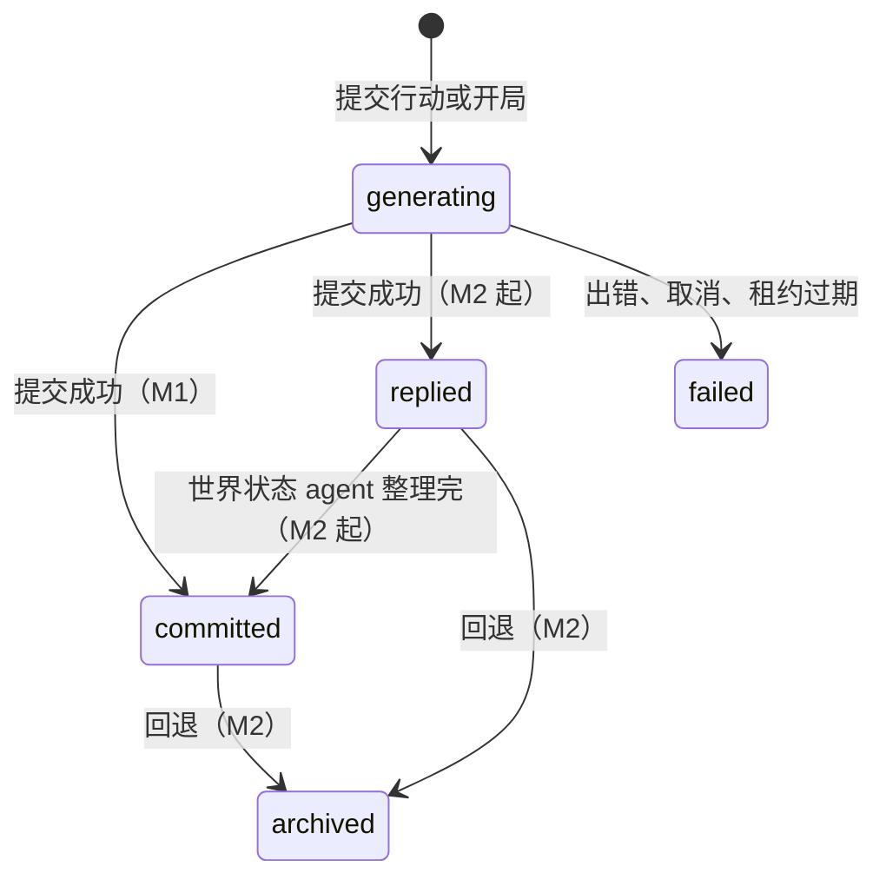

# 数据模型：游玩与回合

> 文档索引：[总览](../README.md) · [后端](../backend.md) · [客户端](../client.md) · [测试](../testing.md) · [数据模型](README.md) · [接口](../api/README.md)
>
> 数据模型：[说明与约定](README.md) · [账户与令牌](accounts.md) · [模型路由](models.md) · [剧本库](library.md) · [游玩与回合](story.md) · [世界状态](world.md) · [运行基础设施](infra.md)

一局游玩的时间线：游玩本身、回合，以及提交行动用的幂等键。热路径的并发控制（租约、带围栏的提交、加锁顺序）也写在这里。
对应的接口见 [api/play.md](../api/play.md)，回合的事件流见 [api/events.md](../api/events.md)。

## 表

### `playthroughs`

一次游玩，包括一条线性时间线和它的世界状态。它也是热路径做并发控制的地方（见下文“并发控制”）。

| 列 | 类型 | 可空 | 默认 | 说明 |
| --- | --- | --- | --- | --- |
| `id` | uuid | 否 | `gen_random_uuid()` | 主键 |
| `user_id` | uuid | 否 |  | → `users.id`，级联删除 |
| `scenario_id` | uuid | 是 |  | → `scenarios.id`，被删除时置空 |
| `title` | text | 否 |  | 标题，默认用剧本名，最多 80 字 |
| `status` | text | 否 | `'building'` | `building` 表示世界还没建好，`active` 表示开局构建已完成，`ended` 表示已经写完结局（见下文“状态”） |
| `language` | text | 否 | `'zh'` | 给 agent 的提示词用哪种语言：`zh` / `en` / `ja`。开局时由客户端按界面语言传来，之后不变（见 [i18n.md](../i18n.md) 第 4 节） |
| `settings` | jsonb | 否 | `'{}'` | 主角和偏好设置，结构见下文“JSON 列” |
| `seed` | jsonb | 是 |  | 开局设定（WorldBuilder 或最小 Seed 的输出），结构见下文“JSON 列”；世界建好时写入 |
| `seed_source` | text | 是 |  | `world_builder` 表示由模型生成。`minimal` 表示没有用模型生成：模型失败或超时、没有可用的路由时只用卡片原文；剧本已被删除时设定里只有主角 |
| `head_turn_id` | uuid | 是 |  | 无外键，指向 `turns.id`：活跃链的头部 |
| `timeline_epoch` | integer | 否 | `0` | 时间线纪元，回退和重新生成时加 1（M2）。回合和后台任务记下发起时的值，提交时如果不一致，结果就作废 |
| `state_version` | integer | 否 | `0` | 世界状态的版本，M1 里一直是 0。agent runtime 阶段 2 换成 `state_seq`（世界状态已整理到第几回合），见 [agent-runtime.md](../agent-runtime.md) 第 8 节 |
| `outline_version` | integer | 否 | `0` | 大纲的版本，一直是 0；agent runtime 阶段 5 删掉，当前大纲按依据的回合查（[agent-runtime.md](../agent-runtime.md) 第 8 节） |
| `summary_version` | integer | 否 | `0` | 摘要的版本，一直是 0；agent runtime 阶段 4 删掉（[agent-runtime.md](../agent-runtime.md) 第 8 节） |
| `rollback_floor_seq` | integer | 否 | `0` | 回退的下限，一直是 0；agent runtime 阶段 4 删掉，回退没有下限（[agent-runtime.md](../agent-runtime.md) 第 8 节） |
| `active_turn_id` | uuid | 是 |  | 无外键，指向 `turns.id`：持有租约、正在生成的回合；没有正在生成的回合时为空 |
| `lease_expires_at` | timestamptz | 是 |  | 租约的到期时间：领取时设为当前时间加 120 秒，生成期间每 30 秒续期 |
| `lease_owner` | text | 是 |  | 持有租约的进程，格式为 `{hostname}:{pid}`，排错用 |
| `created_at` | timestamptz | 否 | `now()` |  |
| `updated_at` | timestamptz | 否 | `now()` | 改名、领取租约、世界建好、推进头部、释放租约时写入（续期不写）；游玩列表按它倒序排列 |

约束与索引：
- `status`、`seed_source`、`language` 的 CHECK。
- `playthroughs_user_idx (user_id, updated_at DESC)`。
- `playthroughs_lease_idx (lease_expires_at) WHERE active_turn_id IS NOT NULL`：清理过期租约时用。

### `turns`

一个回合包括玩家的一次行动和导演的一次回复，`seq = 0` 是开场。同一个 `seq` 可以有多次尝试（失败后重试），但活跃链上每个 `seq` 只有一个回合。

| 列 | 类型 | 可空 | 默认 | 说明 |
| --- | --- | --- | --- | --- |
| `id` | uuid | 否 | `gen_random_uuid()` | 主键 |
| `playthrough_id` | uuid | 否 |  | → `playthroughs.id`，级联删除 |
| `seq` | integer | 否 |  | 回合序号，等于父回合的 `seq` 加 1；CHECK 不小于 0 |
| `parent_turn_id` | uuid | 是 |  | 无外键，指向 `turns.id`：提交时的头部；开场为空 |
| `attempt` | integer | 否 | `0` | 同一个 `seq` 的第几次尝试，从 0 开始；插入时取已有的最大值加 1 |
| `status` | text | 否 |  | `generating` / `replied` / `committed` / `failed` / `archived`，状态变化见下文“状态” |
| `timeline_epoch` | integer | 否 | `0` | 创建时的 `playthroughs.timeline_epoch` |
| `user_action` | jsonb | 否 |  | 服务端解析后的玩家行动，结构见下文“JSON 列” |
| `narrative` | text | 否 | `''` | 导演写的叙述；失败时可能是半截草稿 |
| `options` | jsonb | 否 | `'[]'` | 两个选项，结构见下文“JSON 列” |
| `options_source` | text | 是 |  | 选项的来源：`model` 是模型给的（包括解析器修补过的）；`repaired` 是另调小模型补的；`fallback` 表示补救失败，缺的选项用固定的兜底文案补上（模型给出的有效选项会保留）。生成完成前为空 |
| `director_run_id` | uuid | 是 |  | 无外键，指向 `agent_runs.id` |
| `state_lag` | boolean | 否 | `false` | 屏障等待超时，上一轮的状态还没提交就开始生成了（M1 不会出现） |
| `usage` | jsonb | 是 |  | 导演调用的 token 用量，结构见下文“JSON 列”；服务商没给用量时为空 |
| `error` | jsonb | 是 |  | 失败原因，结构见下文“JSON 列”；成功的回合为空 |
| `rollback_id` | uuid | 是 |  | 回退批次号（M2）：被同一次回退归档的回合共用一个 |
| `created_at` | timestamptz | 否 | `now()` |  |
| `replied_at` | timestamptz | 是 |  | 叙述和选项写入的时间 |
| `committed_at` | timestamptz | 是 |  | state 车道处理完的时间；M1 里和 `replied_at` 相同 |

约束与索引：
- `turns_chain_seq_uq (playthrough_id, seq) WHERE status NOT IN ('failed', 'archived')`：保证活跃链上每个 `seq` 只有一个回合。失败的尝试和被回退的回合不受这个约束，所以重试时可以在同一个 `seq` 上插入 `attempt + 1`。
- `turns_pt_seq_idx (playthrough_id, seq, created_at)`：历史分页、查最近一次失败时用。
- `status`、`options_source` 的 CHECK；`seq >= 0`。

### `idempotency_keys`

提交行动时的幂等键，保证客户端重发同一个请求不会生成第二个回合。只有提交行动的接口使用，创建游玩的接口没有。

| 列 | 类型 | 可空 | 默认 | 说明 |
| --- | --- | --- | --- | --- |
| `user_id` | uuid | 否 |  | → `users.id`，级联删除 |
| `key` | text | 否 |  | 请求头 `Idempotency-Key` 的值，长度 1 到 128 个字符 |
| `request_hash` | text | 否 |  | 请求内容（`playthrough_id`、`parent_turn_id`、`action`）规范化成 JSON 后的 SHA-256。同一个键对应了不同的内容时，返回 422 `IDEMPOTENCY_KEY_REUSED` |
| `turn_id` | uuid | 否 |  | 无外键，指向 `turns.id`：这个键创建的回合 |
| `created_at` | timestamptz | 否 | `now()` |  |

约束与索引：主键 `(user_id, key)`（`idempotency_keys_pkey`）；`idempotency_keys_created_idx (created_at)`。

维护任务大约每 10 分钟删除一次 24 小时之前的键。

## JSON 列

### `playthroughs.settings`

开局时由 `POST /v1/playthroughs` 写入：

```jsonc
{
  "protagonist": { "name": "林川", "summary": "一名信使" },  // name：NFKC、合并空白，最多 40 字；summary 最多 400 字
  "preferences": { "length": "medium", "style": "", "boundaries": "" }  // length：short / medium / long；style 最多 200 字；boundaries 最多 300 字
}
```

### `playthroughs.seed`

开局设定（`domain/world/seed.py` 的 `Seed`），已经校正过：名字之间的引用只保留能对上的，主角名以玩家填的为准。
每一轮装配导演的系统提示词时都会读它：世界的设定、基调、标题、规则和文风，主角的描述，以及重要程度不低于 3 的人物（最多 8 个）。
`opening` 只在生成开场时使用。实体现在的状态以世界表为准。

```jsonc
{
  "world": { "title": "雨夜酒馆", "setting": "…", "tone": "…", "rules": ["…"], "style": "…" },
  "protagonist": { "name": "林川", "summary": "…", "goal": "…" },
  "characters": [
    { "name": "阿苓", "aliases": [], "summary": "…", "goal": "", "attitude": "", "speech_style": "", "importance": 5 }
  ],
  "locations": [{ "name": "灰石酒馆", "aliases": [], "summary": "…", "importance": 3 }],
  "items": [{ "name": "无名信", "aliases": [], "summary": "…", "holder": "林川", "location": null, "importance": 2 }],
  "organizations": [{ "name": "北境商会", "aliases": [], "summary": "…", "stance": "", "members": [], "importance": 2 }],
  "facts": [{ "text": "老周欠北境商会一笔钱", "about": ["老周"], "importance": 2, "secret": true, "known_by": ["老周"] }],
  "opening": { "location": "灰石酒馆", "present": ["阿苓"], "situation": "…", "hook": "…" }
}
```

数量上限：`characters` 12 个，`locations` 12 个，`items` 16 个，`organizations` 8 个，`facts` 40 条。字段长度上限见 `seed.py`；模型输出超长时截断，不会被拒绝。

### `turns.user_action`

客户端只提交行动来源和 `option_id`，`text` 一律由服务端确定。点选项时，`text` 从父回合的 `options` 里取。

```jsonc
{ "source": "option", "option_id": "o1", "text": "走向柜台，问老周认不认识火漆" }
{ "source": "text", "text": "我先检查窗框上的划痕" }  // 去掉首尾空白，最多 2000 字
{ "source": "opening", "text": "" }
{ "source": "ending", "text": "和阿苓一起离开小镇" }  // 写结局；text 是结局方向，可以是空串，最多 2000 字
```

### `turns.options`

固定两项，`id` 是 `o1`、`o2`。生成中、失败的回合和结局那一轮是 `[]`（结局那一轮的 `options_source` 也是空）。

```json
[{ "id": "o1", "text": "走向柜台" }, { "id": "o2", "text": "在角落坐下" }]
```

### `turns.usage`

```json
{ "prompt": 900, "completion": 120, "cached": 800, "reasoning": 0 }
```

### `turns.error`

和 SSE 事件 `turn.failed` 的 data 相同（租约在生成中途丢失时例外，见下文“并发控制”）。`code` 的取值见 [api/README.md 的“回合失败码”](../api/README.md#回合失败码)。

```json
{ "code": "PROVIDER_ERROR", "message": "The model service is busy, please try again shortly", "retryable": true, "partial": false, "reason": "overloaded" }
```

`partial` 为真时，`narrative` 里存着生成到一半的草稿。`message` 是英文说明；`reason` 是服务商错误的类别（`auth`、`billing`、`rate_limit` 等，取值同 `providers/errors.py` 的 `ErrorClass`），不是服务商错误时为 null，客户端按 `code` 和 `reason` 翻译成界面语言。这个字段加上之前写入的记录里没有 `reason`。

## 状态

`turns.status`：



- 写 `failed` 的地方有三个，都要求当前状态还是 `generating`：runner 自己（出错或取消）、清理任务（租约过期）、提交新行动时发现上一轮的租约已经过期。
- 失败的回合保留在表里；重试时插入同一个 `seq` 的新回合（`attempt + 1`）。
- 屏障只在父回合变成 `committed`（或 `archived`）后放行，所以 M1 里不会等待。agent runtime 阶段 2 去掉屏障，下一回合不等世界状态整理（[agent-runtime.md](../agent-runtime.md) 第 3 节）。

`playthroughs.status`：`building` → `active` → `ended`。

- 开场回合的 runner 建好世界后，在同一个事务里写入 `entities`、`entity_links`、`facts`、`seed`、`seed_source`，并把状态改为 `active`（条件是仍为 `building`）。
  如果开场在建好世界之前就失败了（例如被取消），状态停在 `building`，重试开场时会重新构建。
- 玩家提交了写结局（`user_action.source` 是 `ending`），结局写完提交时，推进头部的那条带围栏的 UPDATE 同时把状态改为 `ended`。
  结局这一轮失败或被取消时状态不变。`ended` 之后提交行动的接口在锁住游玩行之后检查状态，返回 409 `STORY_ENDED`；没有回到 `active` 的路径。

## 并发控制

### 租约

`playthroughs.active_turn_id` 加 `lease_expires_at` 保证同一局同时只有一个回合在生成：

1. 提交行动时，在锁住 `playthroughs` 行（`SELECT … FOR UPDATE`）的事务里插入回合并领取租约（120 秒）；开局时，在插入 `playthroughs` 的同一个事务里插入开场回合并领取租约。
   提交行动时如果已有租约且没有过期，返回 409 `TURN_IN_PROGRESS`；如果已经过期，先把那一轮标为失败（`RUNNER_LOST`）。
2. 生成期间每 30 秒续期：`UPDATE … WHERE active_turn_id = :turn AND timeline_epoch = :epoch`。续期失败说明租约已被收回，回合已经被标为 `RUNNER_LOST`。
   runner 随即取消生成；之后它对这个回合的写入都因为条件不满足而不生效。已知问题：这时推给客户端的 `turn.failed` 是 `CANCELLED`，和库里的 `RUNNER_LOST` 不一致（两者都可以重试）。
3. 提交或失败时释放租约。
4. api 进程每 15 秒执行一次清理：把过期的租约清掉，并把对应回合标为 `failed`（`RUNNER_LOST`）。清理时用 `FOR UPDATE SKIP LOCKED`，多个实例同时执行也没关系。

### 带围栏的提交

所有改变时间线的提交，先对 `playthroughs` 做带条件的 UPDATE，影响行数为 0 就回滚整个事务：

```sql
UPDATE playthroughs
SET head_turn_id = :turn, active_turn_id = NULL, lease_expires_at = NULL, lease_owner = NULL, updated_at = now(),
    status = CASE WHEN :end THEN 'ended' ELSE status END  -- 结局那一轮 :end 为真
WHERE id = :id AND active_turn_id = :turn AND timeline_epoch = :epoch
```

条件满足后才写 `turns`（`WHERE status = 'generating'`）和 `agent_runs`。条件不满足说明租约已被清理任务收回，或者发生了回退：
生成结果作废，推给客户端的错误和库里一致（`RUNNER_LOST`，可以重试）。agent runtime 阶段 2 起，世界状态 agent 的写入条件是 `state_seq = :seq - 1 AND timeline_epoch = :epoch`（[agent-runtime.md](../agent-runtime.md) 第 8 节）。

### 加锁顺序

一律先锁 `playthroughs` 行，再写 `turns`。提交、失败、清理、创建、删除都遵守这个顺序；顺序反过来会死锁（代码审查时出现过一次）。

### 唯一约束兜底

- `turns_chain_seq_uq`：即使应用层的检查有漏洞，同一局的活跃链上也不会出现两个相同的 `seq`。
- `entities_name_uq`、`entities_protagonist_uq`：同一局、同一类实体里名字唯一；每局只有一个主角。
- `model_routes_user_task_uq`、`model_routes_pt_task_uq`：每个 task 只有一条路由。
- `idempotency_keys` 的主键：同一局里带同一个键的并发提交，已经被 `playthroughs` 的行锁串行化，后到的请求拿到锁后能看到先到的记录，直接返回已有回合。
  同一个键同时用在两局上时，后插入的那个违反主键，整个事务回滚，接口返回 500（已知问题，应该返回 422 `IDEMPOTENCY_KEY_REUSED`）。

### 通知

runner 提交或标记回合失败、清理任务标记回合失败时，都会在同一个事务里执行 `pg_notify('bt_turns', turn_id)`；
提交行动时顺手把过期回合标为失败的那条路径没有发通知。M1 没有订阅方，这是留给多实例部署用的。队列用的是另一个频道 `bt_jobs`。
